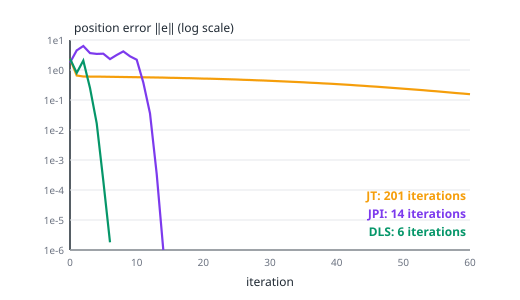
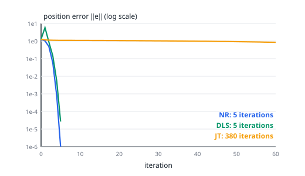

# Numerical Methods for Inverse Kinematics

**Numerical inverse kinematics finds the joint angles for a target by repeated small corrections — guess, measure the error with forward kinematics, use the Jacobian to correct the guess, and repeat — using one of four methods: Newton–Raphson, Jacobian transpose, Jacobian pseudoinverse or damped least squares.**

A satnav does something similar when you miss a turn: it does not re-plan the whole journey from a formula, it takes where you are now and works out the next correction. Robot arms with three or more joints are solved the same way.

## Before you start
<!-- bite: f77916df-7868-4629-862b-ae33fa926541 -->

You need forward kinematics with cumulative angles ([[mechatronics/18-forward-and-inverse-kinematics|Forward and Inverse Kinematics]]), multiplying a matrix by a vector, the transpose of a matrix, and the inverse of a 2 × 2 matrix.

After this lesson you will be able to:

1. build the Jacobian of a planar arm and say when it is singular;
2. state the update rule, speed, stability and stopping test of each of the four methods;
3. carry out the first iterations of the Jacobian-transpose method by hand, as in the exam.

## What numerical IK is
<!-- bite: d45f836f-048c-419e-ad91-97324ab75096 -->

The two-link formula from the last lesson does not extend nicely: a three-link planar arm has three unknown angles but only two equations (x and y), and real six-joint arms have no tidy formula at all. So instead of solving, we **search**.

Start from a guess of the joint angles. Use forward kinematics — the easy direction — to see where that guess puts the hand. The gap to the target is the **error**. Use the Jacobian to turn that error into a joint correction. Apply it, and repeat until the error is tiny.

The running example is the exam's own: **Exam Q5 / Tutorial Q8**, a 3-link arm with l = (1.8, 1.3, 1.0) m reaching (2.8, 2.0), solved by Jacobian transpose with α = 0.05 and tolerance ε = 0.00005.

## The kid version
<!-- bite: 2aefdc2d-c31b-4eed-a70a-7b44df402b24 -->

Remember playing "hot and cold"? Someone hides a sweet, and you take a step; they say "warmer" or "colder", and you adjust. You never know the exact answer in advance, but each step brings you closer, and you stop when you are close enough. Numerical IK is hot-and-cold for a robot arm: the Jacobian is the friend who tells you not just "warmer" but which way to turn each joint.

**Where the analogy stops working.** In hot-and-cold, a big step is just a wasted step. In IK, a step that is too big can make the error *grow* and the arm thrash about — which is why the methods differ mainly in how carefully they size the step.

## The Jacobian
<!-- bite: fc769366-5a6a-4b6c-b555-b6b398f926c1 -->

The **Jacobian** J is the matrix that turns small joint changes into small hand changes:

$$\Delta\mathbf{x} \approx J\,\Delta\boldsymbol{\theta}$$

For a planar arm (hand position x, y; n joints) it is 2 × n. Column k says how the hand moves when joint k turns a little, and joint k swings every link from k outwards. Differentiating the FK sums gives the pattern from the notes:

$$J_{1k} = -\sum_{j=k}^{n} l_j\sin\varphi_j \;\;\text{(all negative sines)}, \qquad J_{2k} = +\sum_{j=k}^{n} l_j\cos\varphi_j \;\;\text{(all positive cosines)}$$

For the exam arm at q = (0, 0, 0), every φ is 0, so the sines vanish and the cosines are 1:

$$J = \begin{bmatrix} 0 & 0 & 0 \\ 4.1 & 2.3 & 1.0 \end{bmatrix}$$

(4.1 = 1.8 + 1.3 + 1.0, then 2.3 = 1.3 + 1.0, then 1.0.)

## When the Jacobian is singular
<!-- bite: 07bc52e3-23fe-484a-82f9-3b287b7719f8 -->

That first row of zeros is a warning. With every link along the x-axis, turning any joint moves the hand only in y, for a moment: the arm **cannot move along its own length**. The Jacobian has lost rank.

For a square Jacobian this shows up as **det(J) = 0**, which happens when **all the links are collinear**. For a two-link arm, det(J) = l₁l₂ sin θ₂, zero when θ₂ = 0 (stretched) or 180° (folded). A method that needs J⁻¹ or (JJᵀ)⁻¹ cannot even start at such a pose — the usual fix is to **perturb** the starting guess slightly, for example to q = (0.1, 0.1).

## The universal loop
<!-- bite: 5af1b938-7c5b-4a13-9d68-082f070984ba -->

All four methods share one loop; only the step changes:

1. **Initialise** θ = (0, …, 0), or a perturbed guess.
2. **Compute FK(θ)** to get the hand position x.
3. **Error:** Δx = x_d − x.
4. **Stop** if ‖Δx‖ < ε (or if the step ‖Δθ‖ < ε, for some methods).
5. **Compute the Jacobian** J at the current θ.
6. **Compute the step** Δθ — this is where the methods differ.
7. **Update** θ ← θ + Δθ, and go back to step 2.

‖Δx‖ is the length of the error vector, √(Δx² + Δy²).

## Method 1: Newton–Raphson
<!-- bite: 38966eb9-0b51-4e28-80d0-dab9335f41e1 -->

Invert the Jacobian and jump straight to where the straight-line model says the answer is:

$$\Delta\boldsymbol{\theta} = J^{-1}\Delta\mathbf{x}$$

It is **fast** — quadratic convergence, so the number of correct digits roughly doubles each iteration once close. But it is **poor near singularities**: as det(J) → 0, J⁻¹ blows up and the steps become huge. It needs a square J (as many joints as task coordinates). Stop when **‖Δθ‖ < ε**.

## Method 2: Jacobian transpose
<!-- bite: 8851a984-9eae-4cf0-8bc2-7f604ef57733 -->

Use the transpose instead of the inverse, scaled by a small gain α:

$$\Delta\boldsymbol{\theta} = \alpha\,J^{T}\Delta\mathbf{x}$$

Jᵀ always exists — no inversion — so this is **stable**, even at a singularity. But it is **slow**: linear convergence, the error shrinking by roughly a fixed fraction each step. It is a gradient-descent step on ½‖Δx‖². Stop when **‖Δx‖ < ε**.

## Method 3: Jacobian pseudoinverse
<!-- bite: abe84b51-6065-4978-96e1-c15bf91c43e2 -->

For a **redundant** arm (more joints n than task coordinates m, so J is wide), use the right pseudoinverse:

$$\Delta\boldsymbol{\theta} = J^{+}\Delta\mathbf{x}, \qquad J^{+} = J^{T}\left(JJ^{T}\right)^{-1}$$

Of all the joint steps that achieve the hand step, J⁺ picks the smallest. It is **medium** speed and, like Newton–Raphson, **poor at singularities**, because JJᵀ becomes singular there. Stop when **‖Δq‖ < ε**.

## Method 4: damped least squares
<!-- bite: 8871f169-baf7-4466-8bfe-1ff071d2c431 -->

Add a small damping λ² to the diagonal before inverting:

$$\Delta\boldsymbol{\theta} = J^{T}\left(JJ^{T} + \lambda^2 I\right)^{-1}\Delta\mathbf{x}$$

JJᵀ + λ²I is **always invertible**, so DLS has the **best stability** and works straight through singular poses, at **medium** speed — the damping trades a little accuracy per step for never blowing up. Stop when **‖Δx‖ < ε**.

## The four methods side by side
<!-- bite: 59de8642-2bac-429f-84e6-f91ca03dba41 -->

Now that you have each one, here is the summary to memorise:

| Method | Step Δθ | Speed | Near singularities | Stop when |
| --- | --- | --- | --- | --- |
| Newton–Raphson | J⁻¹Δx | fast (quadratic) | poor | ‖Δθ‖ < ε |
| Jacobian transpose | αJᵀΔx | slow (linear) | good, no inversion | ‖Δx‖ < ε |
| Pseudoinverse | Jᵀ(JJᵀ)⁻¹Δx | medium | poor | ‖Δq‖ < ε |
| Damped least squares | Jᵀ(JJᵀ + λ²I)⁻¹Δx | medium | best, always invertible | ‖Δx‖ < ε |

## Exam Q5: check reachability first
<!-- bite: e0643ad7-b3c1-46d5-8c79-cf2abac76d1d -->

The exam wants a "clinical" technique: set out each step so a marker can follow it. Step one is always reachability.

$$R_{max} = 1.8 + 1.3 + 1.0 = 4.1, \qquad d = \sqrt{2.8^2 + 2.0^2} = 3.441$$

4.1 > 3.441, so the target is reachable. (If d were bigger than R_max, you would say so and stop.)

## Exam Q5: iteration 1
<!-- bite: ef5a2121-0362-40b2-92a0-96624bb88c81 -->

**FK at q = (0, 0, 0):** every link along x, so x₀ = 4.1, y₀ = 0.

**Error:** Δx = 2.8 − 4.1 = −1.3, Δy = 2.0 − 0 = 2.0, so ‖e‖ = √(1.69 + 4) = 2.385 > ε. Keep going.

**Jacobian** (from above): J = [0, 0, 0; 4.1, 2.3, 1.0].

**Transpose times error:** Jᵀe = [0(−1.3) + 4.1(2.0); 0(−1.3) + 2.3(2.0); 0(−1.3) + 1.0(2.0)] = [8.2; 4.6; 2.0].

**Step:** Δq = 0.05 × [8.2; 4.6; 2.0] = [0.410; 0.230; 0.100] rad.

**Update:** q₁ = [0.410; 0.230; 0.100] rad = (23.5°, 13.2°, 5.7°).

## Exam Q5: iteration 2 check
<!-- bite: 067baea6-1a7b-4a74-99a0-0123a5409bec -->

Verify the step helped. The cumulative angles are 0.41, 0.64 and 0.74 rad, so

$$x_1 = 1.8\cos 0.41 + 1.3\cos 0.64 + 1.0\cos 0.74 = 3.43, \qquad y_1 = 1.8\sin 0.41 + 1.3\sin 0.64 + 1.0\sin 0.74 = 2.17$$

The error is now ‖e₁‖ = √((2.8 − 3.43)² + (2.0 − 2.17)²) = 0.654 — down from 2.385, a **73 % reduction** in one step. The method continues the same way until ‖e‖ < 0.00005.


## How the methods compare on the exam arm
<!-- bite: c17b8ab7-0507-4fae-a75d-30199f29323f -->

Here are all three applicable methods run to ε = 0.00005 on the same arm and target (Newton–Raphson needs a square J, so it cannot be used on a 3-joint planar arm). DLS (λ = 0.1) and the transpose start from q = 0; the pseudoinverse starts from the perturbed q = (0.1, 0.1, 0.1), because JJᵀ is singular at 0.



DLS takes **6** iterations, the pseudoinverse **14**, and the transpose **201**. That is the table's "slow, linear" in practice: safe, but it creeps.

## Newton–Raphson from a singular start
<!-- bite: 5d0186d4-2a0a-49ab-8a1e-2998578476e2 -->

Tutorial Q1 is a 2-link arm, l = (1.5, 2.0), target (2, 2), ε = 0.001. Start at q = (0, 0) and det(J) = 1.5 × 2.0 × sin 0 = 0: Newton–Raphson cannot invert J. Perturb to q = (0.1, 0.1): det(J) = 3 sin 0.1 = 0.299, invertible but small, and the first step is

$$\Delta\boldsymbol{\theta} = J^{-1}\Delta\mathbf{x} = \begin{bmatrix} -7.58 \\ +14.09 \end{bmatrix}\ \text{rad}$$

Steps of several whole turns are useless — this is how Newton–Raphson behaves near a singularity. The fix is **step clipping**: scale Δθ down so no joint moves more than, say, 0.5 rad per iteration. (The notes quote −7.595 and +14.120; those come from rounding J before inverting.)

## Newton–Raphson when it behaves
<!-- bite: 8081c52e-6d50-4df0-ab25-b374f179c91d -->

Tutorial Q7: l = (2.0, 2.5), target (3.0, 1.5), ε = 0.0001, perturbed start q = (0.2, 0.2). Now det(J) = 5 sin 0.2 = 0.993, comfortably away from zero, and the first step is Δθ = (−2.80, +5.24) rad — still big, so clip it. Once close, it races home:



With clipping at 0.5 rad, Newton–Raphson and DLS each converge in **5** iterations; the transpose (α = 0.02) needs **380**.

## Redundant arms and the pseudoinverse
<!-- bite: d0243e28-945c-4cfa-9ae5-9380277b48f7 -->

Tutorials Q3 and Q9 use four links on a 2-D target: n = 4 joints, m = 2 coordinates, so the **degree of redundancy** is d_r = n − m = 2. J is 2 × 4, which has no ordinary inverse — this is exactly what the pseudoinverse is for.

Q9 checks reachability first: l = (1.5, 2.0, 1.5, 1.0), so R_max = 6.0 > d = √(5² + 1²) = 5.099. Q3 meets the usual trap: at q = 0 the Jacobian's first row is all zeros, so JJᵀ is singular. Perturb to q = (0.1, 0.1, 0.1, 0.1) before the first pseudoinverse step.

## The Newton–Raphson loop in MATLAB
<!-- bite: 9ca2ace7-fb00-424b-938c-57659837ba0e -->

The course appendix's solver, as a fragment:

```matlab
theta = theta0;
while true
    [x, y] = fk(l, theta);           % forward kinematics
    e = [x_d - x; y_d - y];          % error
    if norm(e) < tol, break; end     % tol = 1e-6
    J = jacobian(l, theta);
    delta_theta = pinv(J) * e;       % pinv = inverse for square J, J+ otherwise
    theta = theta + delta_theta;
end
```

Swapping the step line gives the other methods: `0.05 * J' * e` for the transpose, `J' / (J*J' + lambda^2*eye(2)) * e` for DLS. All four are implemented and run in `scripts/diagrams/mechatronics_robotics.py`.

## Terms used in numerical IK
<!-- bite: b087e7e3-1480-44fe-9150-f8a18185d5ad -->

1. **Jacobian, J**: this is the matrix of partial derivatives that turns small joint changes into small end-effector changes, Δx ≈ JΔθ.
2. **Singular Jacobian**: this is a Jacobian that has lost rank (det J = 0 or det JJᵀ = 0). At such a pose the arm cannot move in some direction.
3. **Pseudoinverse, J⁺**: this is Jᵀ(JJᵀ)⁻¹, the "inverse" of a wide Jacobian that gives the smallest joint step achieving a hand step.
4. **Damping factor, λ**: this is the small number added (as λ²) to JJᵀ in damped least squares so that it can always be inverted.
5. **Convergence**: this is the error shrinking towards zero as the iterations go on. Quadratic convergence doubles the correct digits each step; linear convergence removes a fixed fraction of the error each step.
6. **Tolerance, ε**: this is the size below which the error (or step) counts as zero and the loop stops.
7. **Step clipping**: this is scaling down a step that is too large so that no joint moves more than a set amount per iteration.
8. **Degree of redundancy, d_r**: this is n − m, the number of joints beyond those needed for the task.

## Common pitfalls and traps
<!-- bite: e06cd742-f48e-4425-befd-dec5bad8abb6 -->

- **Starting Newton–Raphson or the pseudoinverse at a singular pose.** At q = 0 every planar arm is stretched along x and J is singular. Perturb first.
- **Mixing up the stopping tests.** Newton–Raphson and the pseudoinverse stop on the step size; the transpose and DLS stop on the error.
- **Forgetting α in the transpose step.** Δq = αJᵀe, not Jᵀe.
- **Using Newton–Raphson on a redundant arm.** A 2 × 3 Jacobian has no inverse — that is the pseudoinverse's job.
- **Skipping reachability.** If d > R_max no method converges; it will just stretch the arm and stall at a singularity.
- **Getting the sign pattern wrong.** Row 1 of the planar Jacobian is all negative sines, row 2 all positive cosines.

## Check your understanding
<!-- bite: 8eb63839-c65a-4d1e-ac2a-0dc1c016bc38 -->

Try each one before you open the answer.

1. <!-- q: exact id="1a2746d5" answer="0.5625" tolerance="0.0001" -->
   Tutorial Q2: a 3-link arm with l = (2.0, 1.0, 1.5) m starts at q = (0, 0, 0) and must reach (3.0, 2.5) using the Jacobian transpose with α = 0.05. What is the first joint angle after one iteration, in radians?

   <details><summary>Answer</summary>

   At q = 0 the hand is at (4.5, 0), so e = (−1.5, 2.5). J = [0, 0, 0; 4.5, 2.5, 1.5], so Jᵀe = [11.25; 6.25; 3.75]. Δq = 0.05 × that = [0.5625; 0.3125; 0.1875]. The first joint goes to 0.5625 rad.

   </details>

2. <!-- q: exact id="070740b4" answer="0.299501" sigfigs="3" -->
   For a two-link arm, det(J) = l₁l₂ sin θ₂. With l₁ = 1.5 m, l₂ = 2.0 m and θ₂ = 0.1 rad, what is det(J)?

   <details><summary>Answer</summary>

   det(J) = 1.5 × 2.0 × sin 0.1 = 3 × 0.0998 = 0.300. Small but non-zero, so Newton–Raphson can invert J, though its steps will be large.

   </details>

3. <!-- q: mcq id="17a6bddd" -->
   Which method is always able to compute a step, even exactly at a singular pose, without needing step clipping?

   - [ ] Newton–Raphson
   - [ ] Jacobian pseudoinverse
   - [x] Damped least squares
   - [ ] None of them

   <details><summary>Answer</summary>

   Damped least squares: JJᵀ + λ²I is always invertible. (The Jacobian transpose also never inverts anything, but it is the slowest; DLS is the one listed as best stability.) Newton–Raphson and the pseudoinverse fail when J or JJᵀ is singular.

   </details>

4. <!-- q: mcq id="0b23f833" -->
   A planar arm with three links is solved for an (x, y) target. Why can Newton–Raphson's step J⁻¹Δx not be used?

   - [x] J is 2 × 3, so it has no ordinary inverse.
   - [ ] J is always singular for three links.
   - [ ] Newton–Raphson only works for prismatic joints.
   - [ ] The target is always out of reach.

   <details><summary>Answer</summary>

   With three joints and two task coordinates, J is 2 × 3 — not square, so not invertible. The arm is redundant (d_r = 1), and the pseudoinverse is used instead.

   </details>

5. <!-- q: gap id="fe92f70c" answers="error|position error|‖Δx‖|Δx;step|joint step|‖Δθ‖|Δθ" -->
   The Jacobian transpose and damped least squares stop when the ___ is below ε, while Newton–Raphson stops when the ___ is below ε.

   <details><summary>Answer</summary>

   The position error ‖Δx‖; the joint step ‖Δθ‖.

   </details>

6. <!-- q: open id="d7e90e6a" -->
   Compare Newton–Raphson and the Jacobian transpose: their update rules, speed and behaviour near singularities. When would you choose each?

   <details><summary>Answer</summary>

   Newton–Raphson uses Δθ = J⁻¹Δx: it converges quadratically (very fast once close) but needs a square, invertible J, and near a singularity J⁻¹ blows up and the steps become huge, so it needs a perturbed start and step clipping. The transpose uses Δθ = αJᵀΔx: no inversion, so it is stable even at singularities, but it converges only linearly and needs a well-chosen α. Choose Newton–Raphson for a square, well-conditioned problem where speed matters and the arm stays away from singularities; choose the transpose when robustness and simplicity matter more than speed, or when J may be singular.

   </details>

## Check your understanding: worked problems
<!-- bite: d25b7381-c924-4089-bf19-8d605eeae029 -->

1. <!-- q: gap id="90592fce" answers="0.2;0.1" -->
   A two-link arm with l₁ = l₂ = 1 m starts at q = (0, 0) and must reach (1, 1). One Jacobian-transpose iteration uses α = 0.1. After the iteration, q = (___, ___) rad.

   <details><summary>Answer</summary>

   At q = 0 the hand is at (2, 0), so e = (−1, 1). J = [0, 0; 2, 1], so Jᵀe = [0(−1) + 2(1); 0(−1) + 1(1)] = [2; 1]. Δq = 0.1 × [2; 1] = [0.2; 0.1], so q = (0.2, 0.1) rad.

   </details>

## Practice — independent task
<!-- bite: 2c5e1ecf-c083-4bd3-85c3-1ae41d80f4e4 -->

Take Exam Q5 (l = (1.8, 1.3, 1.0), target (2.8, 2.0), α = 0.05) and carry out **iteration 2** by hand from q₁ = (0.410, 0.230, 0.100): compute J at q₁, then Jᵀe₁, then q₂.

**Done when** your new error ‖e₂‖ is smaller than 0.654. If it grew, check the signs in row 1 of your Jacobian — they are all negative sines.

<details><summary>Answer (open after your attempt)</summary>

‖e₂‖ ≈ 0.607. Notice how much smaller this drop is than the first one (2.385 → 0.654): the transpose takes a big step while the error is large, then slows down — the linear convergence that makes it need 201 iterations in all.

</details>

## Before moving on
<!-- bite: 92baa37b-7a85-4fd2-b8a2-71012454423e -->

You are done when you can build a planar Jacobian, explain why q = 0 is singular, write all four update rules with their stopping tests, and carry out a Jacobian-transpose iteration by hand in the exam's step-by-step format.

Recap: Δx ≈ JΔθ; J row 1 = −Σ l sin φ, row 2 = +Σ l cos φ; NR J⁻¹Δx (fast, fragile), JT αJᵀΔx (slow, safe), JPI Jᵀ(JJᵀ)⁻¹Δx (redundant arms), DLS Jᵀ(JJᵀ + λ²I)⁻¹Δx (safest); check reachability first and perturb away from singular starts.

Next, [[mechatronics/20-redundancy-and-singularities|Redundancy and Singularities]] looks properly at the two things this lesson kept running into: extra joints, and the poses where the Jacobian collapses.

## Related
<!-- bite: 1befd765-c760-47fd-9429-31515b3275f1 -->

- [[robotics/07-jacobians-and-singularities|Jacobians and Singularities]]: the Jacobian in 3D.
- [[mechatronics/18-forward-and-inverse-kinematics|Forward and Inverse Kinematics]]: the forward kinematics every iteration calls.

## About this lesson
<!-- bite: bd013eb1-1d1e-4fb8-a98e-4c8ab021a7a3 -->

**Level:** trigonometry and small matrices. It covers the planar Jacobian, singularity, the universal iteration loop, the four numerical IK methods with their speed, stability and stopping tests, the exam's Q5 Jacobian-transpose solution, a measured comparison of the methods, Newton–Raphson from singular and well-conditioned starts, and the pseudoinverse for redundant arms. This is a long lesson because Topic 1 is one exam question; take it in two sittings, stopping after the four methods. It is lesson 19, in section F. All four methods are implemented and every number is checked in `scripts/diagrams/mechatronics_robotics.py`.

**Source:** University of Lagos SSG 515/519 Topic 1 deep dive, "Numerical Methods for Inverse Kinematics" (Parts 1–6: fundamentals, the four methods, exam technique, Exam Q5 / Tutorial Q8 full solution, tutorial questions Q1, Q2, Q3, Q7 and Q9), and the SSG 515 Week 3 lecture (numerical IK methods, MATLAB appendix).
