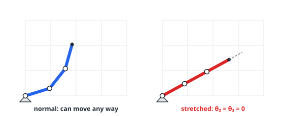
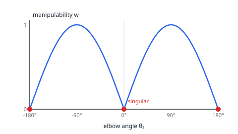

# Redundancy and Singularities

**A redundant manipulator has more joints than its task needs, and a singularity is a pose where the Jacobian loses rank so the arm loses the ability to move in some direction; handling both means using the spare joints to steer the arm away from trouble.**

Your own arm is redundant: hold your hand still on a table and you can still swing your elbow up and down. That spare freedom is what lets you reach round obstacles — and it is exactly what a robot can use to stay out of its singular poses.

## Before you start
<!-- bite: 818e11e1-68f7-48ad-adb3-5d51bae69adf -->

You should know the Jacobian, why it can be singular, and the pseudoinverse ([[mechatronics/19-numerical-inverse-kinematics|Numerical Methods for Inverse Kinematics]]).

After this lesson you will be able to:

1. compute the degree of redundancy and list the benefits and types of redundancy;
2. state the singularity condition, its consequences, and the four types of singularity;
3. explain the three resolution strategies — optimisation, null-space projection and singularity avoidance — and compute a manipulability index.

## What these two ideas are
<!-- bite: c6bca495-84f4-4ed0-a8ed-671c256644b1 -->

In the last lesson two things kept coming up. Arms with more joints than coordinates needed the pseudoinverse, and arms at certain poses — stretched straight, all joints at zero — broke Newton–Raphson. This lesson, Topic 2 of SSG 515/519, treats them properly. They are linked: redundancy is the **cure**, singularity is the **disease**.

The running example is a **three-link planar arm** with three 1 m links. On a 2-D position task it has one spare joint — just enough to show both ideas.

## The kid version
<!-- bite: 6ec3eb1f-ba90-451a-b033-f028e4ddb63a -->

Imagine carrying a tray through a crowded room. If you could only move your shoulder and elbow, there would be exactly one way to hold the tray in each spot, and some spots would leave your arm locked straight. But you also have a wrist, so you can keep the tray in the same place while wiggling your elbow out of someone's way. The wrist is the **redundant** joint. And the "locked straight" arm — where you can't push the tray any further forward, however hard you try — is the **singularity**.

**Where the analogy stops working.** You feel when your arm is locked. A robot only finds out from the numbers, when det(J) goes to zero and its commanded joint speeds shoot towards infinity — so it has to be told to watch for it.

## Redundancy and its degree
<!-- bite: cf5a67a4-8a47-484a-af14-5329db7c84c0 -->

A manipulator is redundant when it has more joints n than the number of task constraints m it must satisfy. The **degree of redundancy** is

$$d_r = n - m$$

A 3-link planar arm placing its hand at a point (m = 2) has d_r = 1. A 7-joint arm placing and orienting its hand in space (m = 6) has d_r = 1. A 6-joint arm doing a 4-coordinate task has d_r = 2. With d_r spare freedoms, there are infinitely many joint solutions for the same hand position — a family of poses with d_r "dimensions" of choice.

## The six benefits of redundancy
<!-- bite: 2fc5bf44-edc8-4467-adc2-0b4bbfba38e7 -->

The notes list six:

1. **Increased flexibility** — many ways to do the same task.
2. **Obstacle avoidance** — swing the elbow round a pillar while the hand stays on the job.
3. **Singularity avoidance** — stay away from poses where the Jacobian collapses.
4. **Energy optimisation** — choose the pose that needs the least torque or motion.
5. **Fault tolerance** — if a joint fails, the others can still finish the task.
6. **Improved dexterity** — better ability to move and apply force in all directions.

## The two types of redundancy
<!-- bite: 6ff6ee22-da41-4302-940c-1f15bd6f4e9c -->

1. **Kinematic redundancy**: more joints than task coordinates, n > m. The 3-link planar arm and the 7-joint arm are kinematically redundant.
2. **Over-actuation**: more actuators than degrees of freedom — for example, two motors driving one joint, or extra legs on a parallel robot. The extra actuators share the load or provide backup, rather than adding motion.

## The singularity condition
<!-- bite: 31f910e2-3a03-4067-afd8-5533d13b6a95 -->

A configuration is **singular** when the Jacobian loses rank:

$$\det(J) = 0 \;\;\text{(square } J\text{)} \qquad\text{or}\qquad \det(JJ^{T}) = 0 \;\;\text{(any } J\text{)}$$

What it means physically, from the notes:

1. **Loss of a degree of freedom** — the hand cannot move in some direction, however the joints turn.
2. **Infinite joint velocities** — the joint speeds needed are q̇ = J⁻¹ẋ, and as det(J) → 0, J⁻¹ blows up: a modest hand speed demands enormous joint speeds.
3. **High wear and failure** — motors driven to their limits, jerky motion, damaged gearboxes.

## The four types of singularity
<!-- bite: 86f5f185-fe62-4f0f-82d2-971ab69ae22d -->

1. **Wrist singularity** — two wrist axes line up (become collinear), so the wrist loses a rotation.
2. **Arm singularity** — the elbow is fully extended or fully folded; the arm cannot reach further along its own line.
3. **Base singularity** — the target is directly over the base (an overhead reach), where turning the base does not move the hand.
4. **Elbow singularity** — other joint alignments that remove a direction of motion.

## Worked example: the stretched three-link arm
<!-- bite: 35661443-608f-4287-8f4b-cfc76af1515e -->

Take the running example at θ₂ = 0 and θ₃ = 0, so all three links point the same way at angle θ₁. Every cumulative angle is θ₁, so every column of the Jacobian is a multiple of the same vector:

$$J = \begin{bmatrix} -3\sin\theta_1 & -2\sin\theta_1 & -\sin\theta_1 \\ 3\cos\theta_1 & 2\cos\theta_1 & \cos\theta_1 \end{bmatrix} = \begin{bmatrix} -\sin\theta_1 \\ \cos\theta_1 \end{bmatrix}\begin{bmatrix} 3 & 2 & 1\end{bmatrix}$$

All columns are proportional to (−sin θ₁, cos θ₁), so J has **rank 1** and det(JJᵀ) = 0. That is an **arm singularity**: whatever the joints do, the hand can only move sideways to the arm, never along it.

## Measuring how close you are: manipulability
<!-- bite: faeff1e3-7d1b-4fbe-8a40-e351bebfb769 -->

Singularity is not on/off — an arm can be *nearly* singular. The **manipulability index** measures how well the arm can move in all directions:

$$w = \sqrt{\det(JJ^{T})}$$

It is zero at a singularity and grows the further away you are. For a two-link arm it simplifies to w = l₁l₂|sin θ₂|:

Best at a right-angled elbow, worst stretched or folded. For our three-link arm at q = (0.3, 0.6, 0.4) rad, w = 1.91 — well clear of zero.

## Strategy 1: optimisation
<!-- bite: 10fe588b-79b0-41a1-b7ce-945baec6c93e -->

With redundancy there are infinitely many joint motions that produce the hand motion you want, so pick the best one. Write a **cost** C that measures "badness" and minimise it, subject to the hand doing its job:

$$\min_{\Delta q}\; C(\Delta q) = \lVert q - q_0\rVert^2 \quad\text{subject to}\quad J(q)\,\dot{q} = \dot{x}_d$$

This cost keeps the joints close to a preferred, comfortable pose q₀ (for example, mid-range on every joint).

## Strategy 2: null-space projection
<!-- bite: f41e0d45-a55d-4206-a1e0-3490146a15f4 -->

The neatest trick in the topic. Split the joint velocity into two parts:

$$\dot{q} = J^{+}\dot{x}_d + \left(I - J^{+}J\right)z$$

The first part does the task. The second part takes any joint motion z and projects it into the **null space** of J — the joint motions that do not move the hand. The key fact is

$$J\left(I - J^{+}J\right) = 0$$

so the second part never disturbs the end-effector. In words: **the hand does the job, and the spare joints do something useful on the side.**

## What goes in the null space
<!-- bite: 2fb179b8-4bf4-4d48-8940-1fe612504de3 -->

The "something useful" is a gradient step on the secondary objective:

1. To **reduce** a cost C (stay near q₀), use z = −k∇C. For C = ‖q − q₀‖², the gradient is ∇C = 2(q − q₀), so the spare joints drift towards q₀.
2. To **increase** a benefit, such as manipulability w, use z = +k∇w — climbing away from singular poses.

The notes write the formula with ∇C; the sign just depends on whether C is something to shrink or to grow. With d_r spare joints, the null space has d_r dimensions — so a 6-joint arm with d_r = 2 can pursue two secondary objectives at once.

## Strategy 3: singularity avoidance
<!-- bite: c8a57f0e-fefd-4a97-8ff8-2dba8046b7db -->

Three ways to stay out of trouble:

1. **Path planning** around singular regions — never ask the arm to pass through them.
2. **Damped least squares**, Δθ = Jᵀ(JJᵀ + λ²I)⁻¹Δx — near a singularity it gives up a little accuracy instead of demanding infinite joint speed.
3. **Manipulability gradient ascent** — use the null space to climb w = √det(JJᵀ), so the arm keeps itself well-conditioned while working.

## The tutorial questions
<!-- bite: 9fa8217d-bf00-4e5a-8819-b2af7a656b05 -->

Topic 2's tutorials set these up on 6- and 7-joint arms. Each one is about choosing the cost:

1. **Q1** (6 DOF, d_r = 1, x_d = [2.5, 3.0, 4.0]ᵀ): keep joints near q₀ = 0.5 rad each, C = Σ(qᵢ − 0.5)², ∇C = 2(q − q₀).
2. **Q2** (7 DOF, d_r = 1): avoid singularities using C = κ(J)² = (σ_max/σ_min)², the squared condition number, or ‖det J‖².
3. **Q3** (6 DOF, d_r = 2, q₀ = [1.0, 1.5, 1.2, 0.8, 1.3, 1.0]ᵀ): a rank-2 null space allows two secondary objectives at once.
4. **Q4** (6 DOF near a singular point x_s = [4, 2, 1]ᵀ, target x_d = [5, 4, 2]ᵀ): C = ‖x_d − x_s‖² = 1² + 2² + 1² = 6.0, and by the chain rule ∇_q C = Jᵀ · 2(x_d − x_s) = Jᵀ[2, 4, 2]ᵀ.
5. **Q5** (6 DOF, over-actuated, q₀ = [0.2, 0.5, 1.2, 0.3, 1.0, 0.8]ᵀ): minimise actuation effort, C = Σ(qᵢ − q₀ᵢ)².

## Terms used for redundancy and singularity
<!-- bite: 6fd37e18-8a16-400e-b202-a3cf0543ff88 -->

1. **Redundant manipulator**: this is a manipulator with more joints than the task needs, n > m.
2. **Degree of redundancy, d_r**: this is n − m, the number of spare joints.
3. **Over-actuated system**: this is a system with more actuators than degrees of freedom.
4. **Singularity**: this is a configuration where the Jacobian loses rank, so the end-effector cannot move in some direction.
5. **Manipulability index, w**: this is √det(JJᵀ), a measure of how freely the end-effector can move; zero at a singularity.
6. **Null space**: this is the set of joint motions that leave the end-effector still. For a redundant arm it has d_r dimensions.
7. **Condition number, κ(J)**: this is the ratio of the largest to the smallest singular value of J. It becomes infinite at a singularity.

## Common pitfalls and traps
<!-- bite: 3a49ff13-94fb-4b85-8727-ee243d14f8ea -->

- **Thinking singularities only matter at the exact pose.** Near a singularity the joint speeds are already huge; that is why manipulability is used as an early warning.
- **Using det(J) for a non-square Jacobian.** A 2 × 3 J has no determinant; use det(JJᵀ).
- **Putting the secondary task outside the null space.** Adding z directly, without (I − J⁺J), drags the hand off the target.
- **The sign of the gradient.** Descend a cost (−∇C), ascend a benefit (+∇w).
- **Confusing the types.** Fully stretched or folded elbow = arm singularity; aligned wrist axes = wrist singularity; target above the base = base singularity.

## Check your understanding
<!-- bite: c3eedaa5-be00-473b-9f8e-b0357d472a53 -->

Try each one before you open the answer.

1. <!-- q: exact id="792f0fac" answer="1" -->
   A 7-joint arm must position and orient its hand in 3-D space, a task with 6 constraints. What is its degree of redundancy?

   

Answer

   d_r = n − m = 7 − 6 = 1.

   

2. <!-- q: mcq id="827141fa" -->
   Which of these are benefits of redundancy listed in the course? (choose all that apply)

   - [x] Obstacle avoidance
   - [x] Fault tolerance
   - [x] Energy optimisation
   - [ ] Fewer joints to control
   - [x] Singularity avoidance

   

Answer

   Obstacle avoidance, fault tolerance, energy optimisation and singularity avoidance are on the list (with increased flexibility and improved dexterity). Redundancy means *more* joints, not fewer.

   

3. <!-- q: mcq id="8d20165c" -->
   A robot arm reaches as far as it can, with its elbow fully straight. Which type of singularity is this?

   - [ ] Wrist singularity
   - [x] Arm singularity
   - [ ] Base singularity
   - [ ] It is not a singularity

   

Answer

   An arm singularity: the fully extended (or fully folded) elbow lines the links up, and the hand cannot move further along that line.

   

4. <!-- q: exact id="eb8459dc" answer="1.5" tolerance="0.001" -->
   A two-link arm has l₁ = 2 m and l₂ = 1.5 m, with its elbow at θ₂ = 30°. Its manipulability is w = l₁l₂|sin θ₂|. What is w?

   

Answer

   w = 2 × 1.5 × sin 30° = 3 × 0.5 = 1.5. At θ₂ = 90° it would be 3.0, the best possible for this arm.

   

5. <!-- q: gap id="f067910e" answers="0|zero;end-effector|hand|end effector" -->
   In null-space projection, J(I − J⁺J) = ___, which means joint motion in the null space does not move the ___.

   

Answer

   Zero; the end-effector. The spare joints can move without disturbing the task.

   

6. <!-- q: open id="9b38b64b" -->
   Explain why a robot arm commanded to move its hand at a modest constant speed can demand dangerously high joint speeds as it approaches a singularity.

   

Answer

   The joint speeds are q̇ = J⁻¹ẋ (or J⁺ẋ). As the arm approaches a singularity, det(J) → 0 and the entries of J⁻¹ grow without bound, so even a modest hand speed ẋ is multiplied into very large joint speeds. Physically, the arm has almost lost a direction of motion, so it can only move the hand that way by turning its joints extremely fast. This causes jerky motion, saturated motors and wear — which is why manipulability is monitored and damped least squares or path planning is used near singular poses.

   

## Check your understanding: worked problems
<!-- bite: 1df95079-f9eb-4e97-9b05-fd4c3b03d253 -->

1. <!-- q: exact id="1ea1e1f2" answer="6" tolerance="0.001" -->
   A redundant arm must avoid a singular point at x_s = (4.0, 2.0, 1.0) while working at x_d = (5.0, 4.0, 2.0). The cost is C = ‖x_d − x_s‖². What is C?

   

Answer

   x_d − x_s = (1, 2, 1), so C = 1² + 2² + 1² = 6.0. Its gradient in joint space is ∇_q C = Jᵀ · 2(x_d − x_s) = Jᵀ(2, 4, 2).

   

2. <!-- q: open id="df695f7d" -->
   A redundant arm is tracking a hand path. You also want its joints to stay close to a comfortable pose q₀. Write the joint-velocity law that does both, say what each part does, and give the gradient for C = ‖q − q₀‖².

   

Answer

   q̇ = J⁺ẋ_d + (I − J⁺J)z, with z = −k∇C and ∇C = 2(q − q₀). The first part, J⁺ẋ_d, makes the hand follow the path with the smallest joint motion. The second part projects the secondary motion z into the null space of J, so it moves the joints towards q₀ without disturbing the hand, because J(I − J⁺J) = 0. The minus sign makes the joints move down the cost, towards q₀; k sets how strongly.

   

## Before moving on
<!-- bite: 81b1517f-a431-440e-8716-4d99be9b6592 -->

You are done when you can compute d_r, list the benefits and types of redundancy, state the singularity condition and its consequences, name the four singularity types, compute manipulability, and explain null-space projection.

Recap: d_r = n − m; singular when det(J) or det(JJᵀ) = 0, causing lost DOF and infinite joint speeds; w = √det(JJᵀ); q̇ = J⁺ẋ_d + (I − J⁺J)z uses the spare joints without moving the hand.

Next, [[mechatronics/25-manipulator-performance-evaluation|Manipulator Performance Evaluation]] uses manipulability and the Jacobian to score a whole arm: its workspace, its joints, and how its errors reach the hand. After that, [[mechatronics/21-parallel-manipulators|Parallel Manipulators]] turns to the other build from lesson 17.

## Related
<!-- bite: 2f654045-1e2a-4cd2-aeaa-a21855632f02 -->

- [[robotics/07-jacobians-and-singularities|Jacobians and Singularities]]: singularities in 3-D arms.
- [[mechatronics/19-numerical-inverse-kinematics|Numerical Methods for Inverse Kinematics]]: damped least squares and the pseudoinverse.

## About this lesson
<!-- bite: e1c90a29-b223-45c7-986e-6f4d6d5c8f24 -->

**Level:** small matrices. It covers redundancy (degree, benefits, types), singularity (condition, consequences, four types), the stretched-arm worked example, manipulability, and the three resolution strategies including null-space projection, with the Topic 2 tutorial set-ups. It is lesson 20, in section F. The singular-pose, null-space and manipulability numbers are checked in `scripts/diagrams/mechatronics_robotics.py`.

**Source:** University of Lagos SSG 515/519 Topic 2 deep dive, "Handling of Redundancies and Singularities" (Parts 1–6, including tutorials Q1–Q5), and the SSG 515 Week 3 lecture (challenges in kinematics: singularities, redundancy management).
