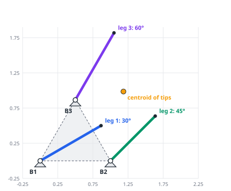
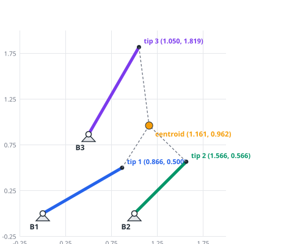

# Parallel Manipulators

**A parallel manipulator moves a platform with several independent legs, each anchored to a fixed base, and its kinematics are worked out leg by leg — with a Jacobian that links the leg speeds to the platform speed, and two kinds of singularity instead of one.**

The motion platform of a flight simulator, a Delta robot sorting biscuits, and the precise stages that align optical fibres are parallel manipulators: many legs, one platform, very stiff and very fast.

## Before you start
<!-- bite: ce458e17-fccf-4fa5-bbd8-ff977b279abb -->

You should know the serial-versus-parallel comparison ([[mechatronics/17-serial-and-parallel-manipulators|Serial and Parallel Manipulators]]), the Jacobian and the pseudoinverse ([[mechatronics/19-numerical-inverse-kinematics|Numerical Methods for Inverse Kinematics]]), and singularities ([[mechatronics/20-redundancy-and-singularities|Redundancy and Singularities]]).

After this lesson you will be able to:

1. write the forward and inverse kinematics of each leg of a planar three-legged manipulator;
2. build its 2 × 3 Jacobian and find the joint velocities for a platform velocity;
3. tell the two types of parallel singularity apart.

## What changes from serial to parallel
<!-- bite: 34c098c8-c64a-40db-b2e7-818620f76771 -->

In a serial arm, every joint carries the ones after it, so the angles **add up** along the chain (cumulative angles). In a parallel manipulator, each leg goes straight from its own anchor point on the base to the platform. So each joint angle is **independent** — measured from its own leg's anchor, not added to anyone else's. The notes underline it: *not cumulative!*

That one change flips the difficulty. For a serial arm, FK is easy and IK is hard. For a parallel manipulator, each leg's IK is a one-line formula, and it is FK — working out where the platform ends up from all the legs together — that is hard.

The running example is the course's **three-legged planar manipulator**.

## The kid version
<!-- bite: e92f75cb-6312-4d68-81d5-d512ebec7ee4 -->

Imagine three friends holding up one tray from three corners of a room, each holding the tray with a stick. Each friend only has to point their own stick at the tray — that's easy, and nobody's choice depends on anyone else's. But if you're told only how each friend is holding their stick, working out where the tray is, and whether it's level, is much harder, because all three sticks are fighting over the same tray.

**Where the analogy stops working.** Three friends with straight sticks cannot reach any spot they like — a real parallel robot has extra passive joints in each leg so that the legs can meet at the platform; the course's model leaves those out, as the next sections say.

## The course's three-legged model
<!-- bite: 9785802a-c6f2-407f-81bc-b5e1b31b58f5 -->

The base has three anchor points on an equilateral triangle with side d = 1.0 m:

$$B_1 = (0, 0), \qquad B_2 = (1.0, 0), \qquad B_3 = (0.5, 0.866)$$

Leg i is a link of length lᵢ, pivoting at Bᵢ, at angle qᵢ measured from the x-axis at its own anchor.

## What the course's model leaves out
<!-- bite: 8d0f4b58-8f76-4ce8-ab2b-716eeb0af7c3 -->

**What this model leaves out.** In a real planar parallel robot (a "3-RRR" mechanism) each leg has two links with a passive joint between them, and the three legs are pinned to a rigid platform, so they always meet. The course's model uses one rigid link per leg and estimates the platform by averaging the leg tips. It is a teaching simplification: it keeps the ideas — independent legs, per-leg kinematics, a 2 × 3 Jacobian, two singularity types — while keeping the arithmetic small.

## Forward kinematics, leg by leg
<!-- bite: f87d7621-13f7-48f0-98a8-710b66c5e178 -->

Each leg's tip is its anchor plus a link at its own angle:

$$x_i = B_{ix} + l_i\cos q_i, \qquad y_i = B_{iy} + l_i\sin q_i$$

Here is that formula for leg 3 of Tutorial Q3. Start at the anchor B₃, go $l_3\cos q_3$ across (green) and $l_3\sin q_3$ up (orange), and you're at the tip. The angle is measured from the x-direction *at the leg's own anchor*, not added to any other leg's angle.

## Forward kinematics: the platform estimate
<!-- bite: 2bf42b4e-eeeb-447e-8dbf-17f0d90ccb81 -->

Do that for all three legs, and the platform position is estimated as the **centroid** of the three tips:

$$x_{FK} = \frac{x_1 + x_2 + x_3}{3}, \qquad y_{FK} = \frac{y_1 + y_2 + y_3}{3}$$

**Tutorial Q3:** l = (1.0, 0.8, 1.1) m at q = (30°, 45°, 60°). The tips are (0.866, 0.500), (1.566, 0.566) and (1.050, 1.819), so the centroid is **(1.161, 0.962) m**. The centroid is the orange dot, where the dashed lines from the three tips meet:

## Inverse kinematics, leg by leg
<!-- bite: 920e6f6d-d1b8-46a0-b1e0-a27b175534a0 -->

Each leg's angle is simply the direction from its anchor to the target — a closed form, no iteration:

$$q_i = \operatorname{atan2}(y_d - B_{iy},\; x_d - B_{ix})$$

**Tutorial Q1:** target (2.0, 1.5). Then q₁ = atan2(1.5, 2.0) = 36.9°, q₂ = atan2(1.5, 1.0) = 56.3°, and q₃ = atan2(1.5 − 0.866, 2.0 − 0.5) = 22.9°.

## Seeing the legs point at the target
<!-- bite: 72723354-1c55-4f15-a37c-19b5f544554f -->

Here are those three angles on the base. Each leg turns, from its own anchor, until it points at the red target. The dashed lines show how far each leg falls short.

Notice the link lengths never appear in the formula. That is the simplified model again: the anchors are 2.5, 1.80 and 1.63 m from the target, but the legs are only 1.0, 0.8 and 1.2 m long, so they **point at** the target without reaching it. Part (c) of that tutorial — the challenges of parallel IK — is really about this: in a real mechanism, the geometry of all the legs together decides what is reachable, and the platform's workspace is only where every leg can reach at once.

## The Jacobian of the legs
<!-- bite: b296ccd8-2a2e-46da-8e31-01f7397a5af9 -->

Each joint moves only its own leg, so the Jacobian has one column per leg with no sums — the derivative of each tip formula:

$$J = \begin{bmatrix} -l_1\sin q_1 & -l_2\sin q_2 & -l_3\sin q_3 \\ \phantom{-}l_1\cos q_1 & \phantom{-}l_2\cos q_2 & \phantom{-}l_3\cos q_3 \end{bmatrix}, \qquad \dot{\mathbf{x}} = J\dot{\mathbf{q}}$$

Compare the serial Jacobian, whose entries were sums over all the later links. Independence makes this one simpler.

## Seeing what a Jacobian column is
<!-- bite: d17db589-ff73-4a18-9f29-aa6f701b1011 -->

Each column of J is one leg's tip velocity when only that leg's joint turns at 1 rad/s. A leg swings about its anchor, so its tip moves **at right angles to the leg**, at a speed equal to the leg's length. Here are the three columns for the exam Q4 pose, drawn as red arrows at each tip:

So $\dot{\mathbf{x}} = J\dot{\mathbf{q}}$ says: the platform velocity is column 1 times $\dot q_1$, plus column 2 times $\dot q_2$, plus column 3 times $\dot q_3$. Finding the joint velocities means finding how much of each arrow to use.

## Joint velocities: the minimum-norm solution
<!-- bite: 4ec87850-b27f-4549-a6dc-d4bbbdaf1578 -->

J is 2 × 3: three leg speeds, two platform speeds. There are infinitely many ways to produce a given ẋ, and the course takes the one with the smallest joint speeds, using the pseudoinverse:

$$\dot{\mathbf{q}} = J^{T}\left(JJ^{T}\right)^{-1}\dot{\mathbf{x}}$$

In practice, do it in two steps: solve v = (JJᵀ)⁻¹ẋ, a 2 × 2 problem, then q̇ = Jᵀv.

## Exam Q4: the Jacobian and its health
<!-- bite: 21ee48a4-399d-4468-aa2b-f3189c53a940 -->

Exam Q4 / Tutorial Q2: l = (1.0, 0.9, 1.1) m, q = (30°, 45°, 60°), required platform velocity ẋ = (1.5, 2.0) m/s. Find the joint velocities.

**Jacobian:**

$$J = \begin{bmatrix} -0.5000 & -0.6364 & -0.9526 \\ 0.8660 & 0.6364 & 0.5500 \end{bmatrix}$$

**JJᵀ and its determinant:**

$$JJ^{T} = \begin{bmatrix} 1.5624 & -1.3619 \\ -1.3619 & 1.4575 \end{bmatrix}, \qquad \det(JJ^{T}) = 0.4225$$

So the manipulability is w = √0.4225 = **0.650** — non-zero, so not singular, and JJᵀ can be inverted.

## Exam Q4: the joint velocities
<!-- bite: b584c8dd-a959-4041-bd5f-032056c1c541 -->

**Solve for v:**

$$\mathbf{v} = (JJ^{T})^{-1}\dot{\mathbf{x}} = \frac{1}{0.4225}\begin{bmatrix} 1.4575 & 1.3619 \\ 1.3619 & 1.5624 \end{bmatrix}\begin{bmatrix} 1.5 \\ 2.0 \end{bmatrix} = \begin{bmatrix} 11.62 \\ 12.23 \end{bmatrix}$$

**Then q̇ = Jᵀv:**

$$\dot q_1 = -0.5(11.62) + 0.866(12.23) = +4.78\ \text{rad/s}$$
$$\dot q_2 = -0.6364(11.62) + 0.6364(12.23) = +0.39\ \text{rad/s}$$
$$\dot q_3 = -0.9526(11.62) + 0.55(12.23) = -4.35\ \text{rad/s}$$

Check: J q̇ gives back (1.5, 2.0). (The notes quote +4.783, +0.389, −4.349; small differences in the last digit come from rounding J.)

## Seeing the joint velocities add up
<!-- bite: c8d2185d-e2ad-4b41-86b0-02b7e4486bf1 -->

Multiply each column by its joint speed and place the three arrows tip to tail. They land exactly on the platform velocity the question asked for, ẋ = (1.5, 2.0):

Now you can see why the numbers look odd. Legs 1 and 3 do most of the work, pushing in nearly opposite directions (blue up-left, purple down-right) and mostly cancelling; what's left over is the small red arrow. Leg 2 barely moves.

## Tutorial Q3: moving to a new target
<!-- bite: 8bdf5ff9-e8c8-4cd5-a8e7-f1139ecf8175 -->

Tutorial Q3 uses l = (1.0, 0.8, 1.1) m at q = (30°, 45°, 60°), and moves the platform from (1.0, 1.0) towards (2.0, 2.5).

1. **FK centroid** (from earlier): (1.161, 0.962) m.
2. **IK target angles:** q₁ = atan2(2.5, 2.0) = 51.3°, q₂ = atan2(2.5, 1.0) = 68.2°, q₃ = atan2(1.634, 1.5) = 47.4°.
3. **Jacobian at the initial pose:** det(JJᵀ) = 0.397, so w = 0.630.
4. **Velocities** for the move ẋ = (2.0 − 1.0, 2.5 − 1.0) = (1.0, 1.5), taken per unit time: q̇ ≈ (+3.48, +0.29, −3.05) rad/s.

The pattern repeats: the outer legs do the work, the middle one hardly turns.

## The two types of singularity
<!-- bite: 0058bbd2-ead3-4179-8d99-5914a365b52d -->

A parallel manipulator can go wrong in two different ways — and the second never happens to a serial arm:

1. **Type 1 (inverse, IK) singularity:** det(J_q) = 0, seen here as det(JJᵀ) = 0. It happens when two or more legs line up parallel. The legs lose the ability to move the platform in some direction, and the required **joint velocities go to infinity** — just like a serial singularity.
2. **Type 2 (direct, FK) singularity — unique to parallel:** det(J_x) = 0. It happens when the legs' **lines of action all pass through one point** (they are concurrent). Then the platform gains an **uncontrollable degree of freedom**: it can wobble or turn **even with every actuator locked**. This is the dangerous one, because the robot loses control of the load, not just its speed.

## Seeing the two singularities
<!-- bite: 416a3134-e4a8-4b54-a7cf-58c6eaafb499 -->

On the left, all three legs are parallel: every tip can only be pushed the same way (red arrows), so the platform can't move along the legs, and the joint speeds blow up trying (type 1). On the right, the three legs' lines of action meet at one point: lock every actuator and the platform can still turn about that point (type 2).

## Terms used for parallel manipulators
<!-- bite: e71c252c-21ec-4882-a1b6-e5dd2b1f8b5e -->

1. **Leg**: this is one independent kinematic chain from a base anchor to the platform.
2. **Anchor point, Bᵢ**: this is the fixed point on the base where a leg is attached.
3. **Independent joint angle**: this is a leg angle measured from its own anchor, not added to any other joint's angle.
4. **Centroid estimate**: this is the average of the leg-tip positions, used in the course's model as the platform position.
5. **Minimum-norm solution**: this is the joint velocity, from the pseudoinverse, that achieves the platform velocity with the smallest total joint speed.
6. **Type 1 singularity**: this is an inverse-kinematics singularity, det(JJᵀ) = 0, where the legs line up and joint speeds go to infinity.
7. **Type 2 singularity**: this is a direct-kinematics singularity, det(J_x) = 0, where the legs' lines of action meet at one point and the platform can move with the actuators locked.

## Common pitfalls and traps
<!-- bite: c40c684b-7955-4f1e-b6d3-b7d2e18a06fc -->

- **Adding the leg angles.** Parallel angles are independent; there are no cumulative sums.
- **Forgetting the anchor offset.** Leg 2's angle is measured from (1.0, 0), so it is atan2(y_d − 0, x_d − 1.0), not atan2(y_d, x_d).
- **Inverting J directly.** It is 2 × 3; invert the 2 × 2 JJᵀ instead and multiply by Jᵀ.
- **Mixing up the singularity types.** Legs parallel = Type 1 (infinite joint speed). Lines of action concurrent = Type 2 (platform moves with actuators locked).
- **Treating the simplified model as a real mechanism.** In it, the legs need not reach the target; say so when asked about IK challenges.

## Check your understanding
<!-- bite: 7bafce70-c09f-4bca-9fc6-0ceadc14597a -->

Try each one before you open the answer.

1. <!-- q: exact id="ad198c31" answer="63.4349" sigfigs="3" -->
   In the three-legged model, leg 2 is anchored at B₂ = (1.0, 0). Using the course's inverse kinematics, what angle (in degrees) should it point at to aim at the target (1.5, 1.0)?

   

Answer

   q₂ = atan2(1.0 − 0, 1.5 − 1.0) = atan2(1.0, 0.5) = 63.4°.

   

2. <!-- q: exact id="4019306e" answer="-0.919253" sigfigs="3" -->
   A leg of length 1.2 m is at q = 50°. What is its entry in the first row of the parallel Jacobian, −l sin q?

   

Answer

   −1.2 × sin 50° = −1.2 × 0.766 = −0.919. (Its second-row entry is 1.2 cos 50° = 0.771.)

   

3. <!-- q: mcq id="bd362f80" -->
   Which singularity is unique to parallel manipulators?

   - [ ] Type 1, where two or more legs become parallel
   - [x] Type 2, where all the legs' lines of action pass through one point
   - [ ] The wrist singularity
   - [ ] The base singularity

   

Answer

   Type 2 (direct, FK). The platform gains an uncontrollable degree of freedom and can move even with every actuator locked. Type 1 is like a serial singularity.

   

4. <!-- q: mcq id="ab59d9f8" -->
   A three-legged manipulator needs platform velocity ẋ, and its Jacobian J is 2 × 3. Which expression gives the minimum-norm joint velocities?

   - [x] q̇ = Jᵀ(JJᵀ)⁻¹ẋ
   - [ ] q̇ = J⁻¹ẋ
   - [ ] q̇ = Jẋ
   - [ ] q̇ = (JᵀJ)⁻¹ẋ

   

Answer

   q̇ = Jᵀ(JJᵀ)⁻¹ẋ. J⁻¹ does not exist for a 2 × 3 matrix, and JᵀJ is a singular 3 × 3 matrix.

   

5. <!-- q: exact id="823e2264" answer="0.65" tolerance="0.002" -->
   At a certain pose, a three-legged manipulator has det(JJᵀ) = 0.4225. What is its manipulability index w = √det(JJᵀ)?

   

Answer

   w = √0.4225 = 0.65. Non-zero, so the pose is not singular.

   

6. <!-- q: open id="ed005949" -->
   Explain why inverse kinematics is easy and forward kinematics hard for a parallel manipulator — the opposite of a serial arm.

   

Answer

   In a parallel manipulator each leg connects its own anchor to the platform independently, so given a platform position each leg's joint angle follows from that leg alone, in closed form — IK is easy. But given the joint angles, the platform's position must satisfy all the legs' constraints at once (the closed loops through the platform), which gives coupled nonlinear equations that may have several solutions — FK is hard. A serial arm is the reverse: FK just follows the chain, while IK must undo the chain.

   

## Check your understanding: worked problems
<!-- bite: 12f72324-5bbc-4b29-aeb4-85fcecfd89df -->

1. <!-- q: exact id="fe9ea8d3" answer="1.16057" sigfigs="3" -->
   Three legs are anchored at (0, 0), (1, 0) and (0.5, 0.866), with lengths 1.0, 0.8 and 1.1 m at angles 30°, 45° and 60°. Using the course's centroid estimate, what is the platform's x-coordinate, in metres?

   

Answer

   Leg tips: x₁ = 0 + 1.0 cos 30° = 0.866; x₂ = 1 + 0.8 cos 45° = 1.566; x₃ = 0.5 + 1.1 cos 60° = 1.050. Centroid x = (0.866 + 1.566 + 1.050)/3 = 1.16 m. (y = 0.962 m.)

   

## Before moving on
<!-- bite: 74bf1c00-c9bd-4412-a42d-b44835cdd74c -->

You are done when you can write each leg's FK and IK, build the 2 × 3 Jacobian, compute the minimum-norm joint velocities in the exam's step-by-step format, and explain both singularity types.

Recap: legs are independent (no cumulative angles); FK per leg xᵢ = Bᵢ + lᵢ(cos qᵢ, sin qᵢ), platform ≈ centroid; IK qᵢ = atan2(y_d − B_iy, x_d − B_ix); J columns (−lᵢ sin qᵢ, lᵢ cos qᵢ); q̇ = Jᵀ(JJᵀ)⁻¹ẋ; Type 1 legs parallel, Type 2 lines concurrent.

Next, [[mechatronics/22-robot-dynamics|Robot Dynamics]] adds the forces: how much torque the joints need, by the Newton–Euler and Lagrangian methods.

## Related
<!-- bite: c792244b-87c6-4d5f-841a-7d9d014732f6 -->

- [[mechatronics/17-serial-and-parallel-manipulators|Serial and Parallel Manipulators]]: why build parallel at all.

## About this lesson
<!-- bite: c534ef0c-36c0-4f97-bb62-63a6f2035d79 -->

**Level:** trigonometry and small matrices. It covers the three-legged planar parallel model and what it simplifies, per-leg forward and inverse kinematics, the parallel Jacobian, minimum-norm joint velocities, Exam Q4 and Tutorials Q1–Q3 worked in full, and the two singularity types. It is lesson 21, in section F. Every number is checked in `scripts/diagrams/mechatronics_robotics.py`.

**Source:** University of Lagos SSG 515/519 Topic 3, "Kinematics and Dynamics of Parallel Manipulators" (Parts 1–7: structure, core formulae, two singularity types, Exam Q4 and Tutorials Q1–Q3 with solutions), and T_3, the parallel-manipulator tutorial questions by Dr John Ogbemhe.
