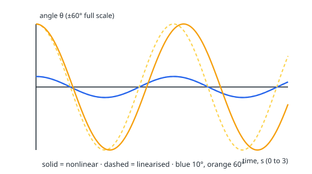

# Robot Dynamics: Newton–Euler and Lagrangian

**Robot dynamics is the study of the forces and torques that produce a robot's motion, and its equations are found by two methods: Newton–Euler, which follows forces link by link, and Lagrangian, which works from the robot's kinetic and potential energy.**

Kinematics tells a robot *where* to put its joints. Dynamics tells it *how hard to push*. A robot that knows only kinematics will sag under a heavy load or overshoot when it moves fast; the dynamic model is what lets the controller push exactly hard enough.

## Before you start
<!-- bite: e33478c2-7c5d-42f0-a1c1-69fd5c68ce02 -->

You need kinematics and the Jacobian ([[mechatronics/19-numerical-inverse-kinematics|Numerical Methods for Inverse Kinematics]]), kinetic energy ½mv² and ½Iω², potential energy mgh, partial derivatives, and the state-space idea of writing an equation as first-order equations.

After this lesson you will be able to:

1. describe the Newton–Euler and Lagrangian methods and when each is used;
2. derive a one-link arm's equation of motion from its energy, then linearise it and write it in state-space form;
3. use τ = JᵀF to find the joint torques that hold a load.

## What dynamics adds
<!-- bite: 50480c8a-7189-4dd0-b9b3-41429ba106f1 -->

Remember the mechanical modelling of section C? A mass needed F = M d²x/dt², a disc T = J d²θ/dt². A robot arm is the same physics with a twist: each link's motion depends on all the others, and gravity's pull on a link changes as the arm turns. The result is a set of coupled, nonlinear equations:

$$\boldsymbol{\tau} = M(q)\ddot{q} + C(q, \dot{q})\dot{q} + g(q)$$

— torques equal **inertia** (mass matrix times acceleration), plus **coupling** (Coriolis and centrifugal terms), plus **gravity**. Both methods in this lesson produce exactly this; they just get there differently.

The running example is the exam's **one-link robot arm** — a uniform rod of mass m and length a, swinging about one end.

## The kid version
<!-- bite: 6b2596ae-b64c-44a2-947c-e5e6a05b4c54 -->

Hold a broom out straight by the very end of its handle. It is hard work even standing still — that's gravity. Swing it quickly up and down and it fights you more — that's its inertia. Now hold two brooms taped end to end with a hinge between them: when you swing the first, the second flops about and tugs on your hand. Dynamics is the maths of exactly those tugs.

**Where the analogy stops working.** You adjust your grip by feel. A robot controller must compute the torques ahead of time from the model, many times a second — so the model has to be right, and fast to evaluate.

## The Newton–Euler method
<!-- bite: 42793359-15eb-476c-baa8-d3fc003547b6 -->

Newton–Euler applies Newton's law (F = ma) and Euler's law (τ = Iα) to each link, as a **recursive** two-pass procedure:

1. **Forward iteration (base → tip):** starting from the fixed base, compute each link's velocity and acceleration from the link before it.
2. **Backward iteration (tip → base):** starting from the end-effector, compute the forces and torques each joint must supply to give its link that motion, passing them back down the chain.

Because each pass visits each link once, it is very **efficient for serial manipulators** — which is why real-time robot controllers use it.

## The Lagrangian method
<!-- bite: 61853c11-889d-4385-8d91-38c606acd626 -->

The Lagrangian method ignores the internal forces between links and works with **energy**. Form the Lagrangian, kinetic minus potential energy:

$$L = K - P$$

Then for each joint coordinate qᵢ, the **Euler–Lagrange equation** gives its torque:

$$\frac{d}{dt}\left(\frac{\partial L}{\partial \dot{q}_i}\right) - \frac{\partial L}{\partial q_i} = \tau_i$$

It is a scalar, systematic recipe — write two energies, differentiate — so it is **straightforward for systems with multiple constraints**, and it gives the whole equation in one go rather than link by link.

## Worked example: the one-link arm's equation
<!-- bite: 40d0b581-d4be-4785-8208-383548df3a18 -->

The exam gives the model; here is where it comes from. Let θ be measured from the hanging-down position, so the rod's centre of mass (at a/2) is at height −(a/2) cos θ.

**Kinetic energy:** a uniform rod about its end has inertia ⅓ma², so K = ½(⅓ma²)θ̇² = ⅙ma²θ̇².

**Potential energy:** P = mg × height = −½mga cos θ.

**Lagrangian:** L = ⅙ma²θ̇² + ½mga cos θ.

**Differentiate:** ∂L/∂θ̇ = ⅓ma²θ̇, so d/dt of it is ⅓ma²θ̈; and ∂L/∂θ = −½mga sin θ. So

$$\tau = \tfrac{1}{3}ma^2\ddot{\theta} + \tfrac{1}{2}mga\sin\theta$$

exactly the exam's model. The first term is the rod's inertia; the second is gravity, acting at the centre of mass a/2 from the pivot.

## Making it first order: the state variables
<!-- bite: 2fa6d926-0b89-4da2-83c9-ecf4da3066ef -->

The exam asks you to set x₁ = θ and x₂ = θ̇. Then the one second-order equation becomes two first-order ones:

$$\dot{x}_1 = x_2, \qquad \dot{x}_2 = \frac{3}{ma^2}\,\tau - \frac{3g}{2a}\sin x_1$$

(The second comes from solving the model for θ̈.) This is still **nonlinear**, because of sin x₁.

## Linearising about the hanging position
<!-- bite: 59f0193a-da83-4eb6-8002-a3ee6a2ccc91 -->

For small swings about θ = 0, sin x₁ ≈ x₁ (in radians). That is the **linearisation**:

$$\dot{x}_1 = x_2, \qquad \dot{x}_2 = -\frac{3g}{2a}\,x_1 + \frac{3}{ma^2}\,\tau$$

Now every term is a constant times a state or the input — a linear system.

## The state-space form
<!-- bite: 38fbc825-b0c5-403b-9139-679191e958b5 -->

Collect it into matrices, with input u = τ and output y = θ:

$$\begin{bmatrix}\dot{x}_1\\ \dot{x}_2\end{bmatrix} = \begin{bmatrix}0 & 1\\ -\dfrac{3g}{2a} & 0\end{bmatrix}\begin{bmatrix}x_1\\ x_2\end{bmatrix} + \begin{bmatrix}0\\ \dfrac{3}{ma^2}\end{bmatrix}\tau, \qquad y = \begin{bmatrix}1 & 0\end{bmatrix}\begin{bmatrix}x_1\\ x_2\end{bmatrix}$$

That is ẋ = Ax + Bu, y = Cx. With m = 2 kg, a = 1 m and g = 9.81 m/s²: A₂₁ = −3(9.81)/2 = −14.715 and B₂ = 3/2 = 1.5. The arm swings at √14.715 = 3.84 rad/s.

## How good is the linear model?
<!-- bite: 8555fb2d-53d1-4563-90c5-c6a448764327 -->

Linearisation only holds near θ = 0. Here is the arm released from rest at 10° and at 60°, simulated with the true sin θ and with the linear θ:



At 10° the two curves sit on top of each other. At 60° the real arm swings more slowly than the linear model predicts, and they drift out of step. Use the linear model for control near the operating point; check with the full model for big motions.

## The two-link arm by Lagrange
<!-- bite: b05f31e4-2c73-4803-91ad-3dbe5faa7ee4 -->

The slides' interactive example: a 2-link planar arm in a vertical plane with l₁ = l₂ = 1 m, m₁ = m₂ = 1 kg and I₁ = I₂ = 0.1 kg·m², taking each centre of mass at its link's midpoint. Writing K (both links' translation and rotation) and P (both centres of mass) and applying Euler–Lagrange gives

$$\tau_1 = (1.7 + \cos q_2)\ddot{q}_1 + (0.35 + 0.5\cos q_2)\ddot{q}_2 - 0.5\sin q_2\,(2\dot{q}_1\dot{q}_2 + \dot{q}_2^2) + 1.5g\cos q_1 + 0.5g\cos(q_1 + q_2)$$

$$\tau_2 = (0.35 + 0.5\cos q_2)\ddot{q}_1 + 0.35\,\ddot{q}_2 + 0.5\sin q_2\,\dot{q}_1^2 + 0.5g\cos(q_1 + q_2)$$

You can see the three parts of τ = Mq̈ + Cq̇ + g: the mass matrix (which changes with the elbow angle q₂), the velocity-coupling terms in sin q₂, and gravity. Both equations are checked against a numerical Euler–Lagrange calculation in `scripts/diagrams/mechatronics_robotics.py`.

## Torques to hold a load: τ = JᵀF
<!-- bite: b32d7fa2-1a99-4059-b098-eda19da150d1 -->

The appendix's Newton–Euler fragment computes joint torques as τ = JᵀF: the torques that let the hand exert a force F. It is the static (not moving) case, and very useful.

A two-link arm with l₁ = l₂ = 1 m is at q = (0°, 90°) — upper arm along x, forearm pointing up — holding up a 1 kg load, so the hand must push up with F = (0, 9.81) N. Here J = [−1, −1; 1, 0], so

$$\boldsymbol{\tau} = J^{T}F = \begin{bmatrix}-1 & 1\\ -1 & 0\end{bmatrix}\begin{bmatrix}0\\ 9.81\end{bmatrix} = \begin{bmatrix}9.81\\ 0\end{bmatrix}\ \text{N·m}$$

The shoulder works hard; the elbow needs nothing, because the load is directly above it — no lever arm.

## The appendix code
<!-- bite: 7e512939-0056-4119-9a8f-190d003ebaae -->

As MATLAB fragments from the course appendix:

```matlab
% Newton-Euler (static form): joint torques for a hand force
J   = jacobian(l, theta);
tau = J' * F;

% Lagrangian (symbolic): energies, then differentiate
K = K1 + K2;   P = P1 + P2;
L = K - P;
dL_dtheta    = diff(L, theta);
dL_dthetadot = diff(L, theta_dot);
```

## Why dynamics is hard in practice
<!-- bite: 731e9b0f-2962-4c1c-a621-2625838006b6 -->

The slides list four challenges:

1. **Real-time computational complexity** — the equations must be evaluated hundreds of times a second.
2. **Model accuracy** — friction and link flexibility are hard to model.
3. **Parameter estimation** — the true masses and inertias are rarely known exactly.
4. **Control system integration** — the model has to fit inside the controller's loop.

## Terms used in dynamics
<!-- bite: 17b0bcb8-5221-4f40-adcd-2457fad03ce1 -->

1. **Dynamics**: this is the study of motion together with the forces and torques that cause it.
2. **Inverse dynamics**: this is finding the joint torques needed for a given motion. Newton–Euler is usually used for it.
3. **Newton–Euler method**: this is the recursive method: velocities and accelerations forward from the base, forces and torques backward from the tip.
4. **Lagrangian, L**: this is kinetic energy minus potential energy, L = K − P.
5. **Euler–Lagrange equation**: this is d/dt(∂L/∂q̇ᵢ) − ∂L/∂qᵢ = τᵢ, which turns the Lagrangian into the equations of motion.
6. **Linearisation**: this is replacing a nonlinear term by its straight-line approximation near an operating point, such as sin θ ≈ θ for small θ.
7. **State-space form**: this is a model written as ẋ = Ax + Bu, y = Cx, with x the state variables.

## Common pitfalls and traps
<!-- bite: 6313a30e-77cf-427c-baf6-3570940ba851 -->

- **Using ½ma² for a rod about its end.** A uniform rod about one end has inertia ⅓ma²; about its centre, 1⁄12 ma².
- **Putting gravity at the end of the link.** It acts at the centre of mass — a/2 for a uniform rod.
- **Linearising with sin θ ≈ θ in degrees.** It only works in radians.
- **Forgetting the operating point.** sin θ ≈ θ linearises about θ = 0; about another angle, you need a different approximation.
- **Writing τ = J·F.** It is τ = J**ᵀ**F.

## Check your understanding
<!-- bite: 80f1d9ee-ca4d-4a07-bfb9-e80dc47d69a7 -->

Try each one before you open the answer.

1. <!-- q: exact id="1dab69c0" answer="-14.715" sigfigs="4" -->
   A one-link arm has τ = ⅓ma²θ̈ + ½mga sin θ, with m = 2 kg, a = 1 m and g = 9.81 m/s². Linearised about θ = 0, its state matrix is A = [0, 1; A₂₁, 0]. What is A₂₁?

   <details><summary>Answer</summary>

   A₂₁ = −3g/(2a) = −3(9.81)/2 = −14.715.

   </details>

2. <!-- q: exact id="6c14ba8c" answer="1.5" tolerance="0.001" -->
   For the same arm (m = 2 kg, a = 1 m), the input matrix is B = [0; B₂]. What is B₂ = 3/(ma²)?

   <details><summary>Answer</summary>

   B₂ = 3/(2 × 1²) = 1.5.

   </details>

3. <!-- q: mcq id="496bf52f" -->
   In the Newton–Euler method, in what order are the two passes made?

   - [x] Velocities and accelerations from base to tip, then forces and torques from tip to base.
   - [ ] Forces and torques from base to tip, then velocities from tip to base.
   - [ ] Energies of all links first, then one differentiation.
   - [ ] Both passes from base to tip.

   <details><summary>Answer</summary>

   Forward (base → tip) for velocities and accelerations, then backward (tip → base) for forces and torques. Working with energies is the Lagrangian method.

   </details>

4. <!-- q: exact id="f908fc05" answer="30" tolerance="0.01" -->
   A two-link arm, l₁ = 1.0 m and l₂ = 0.5 m, is stretched out along the x-axis (q = 0), so J = [0, 0; 1.5, 0.5]. Its hand must push straight up with 20 N. Using τ = JᵀF, what torque does the shoulder need, in N·m?

   <details><summary>Answer</summary>

   τ = JᵀF = [0, 1.5; 0, 0.5][0; 20] = [30; 10]. The shoulder needs 30 N·m (20 N at 1.5 m) and the elbow 10 N·m (20 N at 0.5 m).

   </details>

5. <!-- q: mcq id="cc878c03" -->
   Which equation is the Euler–Lagrange equation for joint i?

   - [x] d/dt(∂L/∂q̇ᵢ) − ∂L/∂qᵢ = τᵢ
   - [ ] ∂L/∂qᵢ − ∂L/∂q̇ᵢ = τᵢ
   - [ ] d/dt(∂L/∂qᵢ) = τᵢ
   - [ ] L = K + P

   <details><summary>Answer</summary>

   d/dt(∂L/∂q̇ᵢ) − ∂L/∂qᵢ = τᵢ, with L = K − P.

   </details>

6. <!-- q: open id="71968465" -->
   The linearised one-link model works well for a 10° swing but poorly for a 60° swing. Explain why.

   <details><summary>Answer</summary>

   Linearisation replaces sin θ by θ, which is accurate only for small angles in radians: at 10° (0.175 rad) sin θ = 0.174, almost equal, but at 60° (1.047 rad) sin θ = 0.866, about 17 % less than θ. So the linear model overestimates the gravity torque at large angles, predicts a stiffer, faster swing, and its period drifts away from the real arm's. The linear model is only valid near its operating point.

   </details>

## Check your understanding: worked problems
<!-- bite: a75f3faa-5814-42d2-a33f-41d20c504734 -->

1. <!-- q: open id="6094e9e5" -->
   A uniform rod of mass m and length a swings about one end, with θ measured from hanging straight down. Using the Lagrangian method, derive τ = ⅓ma²θ̈ + ½mga sin θ.

   <details><summary>Answer</summary>

   K = ½(⅓ma²)θ̇² = ⅙ma²θ̇² (inertia of a rod about its end). The centre of mass at a/2 is at height −(a/2) cos θ, so P = −½mga cos θ. L = K − P = ⅙ma²θ̇² + ½mga cos θ. ∂L/∂θ̇ = ⅓ma²θ̇, so d/dt(∂L/∂θ̇) = ⅓ma²θ̈. ∂L/∂θ = −½mga sin θ. Euler–Lagrange: τ = ⅓ma²θ̈ − (−½mga sin θ) = ⅓ma²θ̈ + ½mga sin θ.

   </details>

## Before moving on
<!-- bite: 6578dce4-7f20-4a21-b4ce-28f48777d659 -->

You are done when you can describe both methods, derive the one-link equation from energy, linearise it and write it as ẋ = Ax + Bu, and use τ = JᵀF to find holding torques.

Recap: τ = M(q)q̈ + C(q, q̇)q̇ + g(q); Newton–Euler is recursive (forward velocities, backward forces); Lagrange uses L = K − P and d/dt(∂L/∂q̇) − ∂L/∂q = τ; one-link arm: A = [0, 1; −3g/2a, 0], B = [0; 3/(ma²)].

Next, [[mechatronics/23-multi-fingered-grasping|Multi-Fingered Grasping]] looks at the other end of the arm: the hand, and how several fingers hold an object without it slipping.

## Related
<!-- bite: ed528611-771e-4c3e-bd12-6c1bb3015563 -->

- [[robotics/08-dynamics|Robotics: Dynamics]]: robot dynamics in 3-D.
- [[mechatronics/11-rotational-systems|Rotational Systems]]: the same inertia–spring–damper physics on a shaft.
- [[control-theory/index|Control Theory]]: what to do with a state-space model.

## About this lesson
<!-- bite: d4693fe0-b24e-4097-84bd-0893a0391e40 -->

**Level:** calculus, energy and small matrices. It covers the general form of robot dynamics, the Newton–Euler and Lagrangian methods, the one-link arm derived from energy, linearised and put in state-space form, the accuracy of linearisation, the two-link Lagrangian equations, τ = JᵀF, the appendix code and the practical challenges. It is lesson 22, in section F. The equations of motion, the linearisation and the torques are all checked in `scripts/diagrams/mechatronics_robotics.py`.

**Source:** University of Lagos SSG 515 Week 3 lecture, "Robotic Manipulators II" (slides 14–18 on dynamic modelling, slides 19–25 on challenges and references, and the MATLAB appendix), and the SSG 415 exam question banks (2020/21 and 2023/24 Question 4, 2025/26 Question 5, and practice Question 7: the one-link robot arm). The lecture's references are Spong, Hutchinson and Vidyasagar, *Robot Modeling and Control* (2006); Craig, *Introduction to Robotics: Mechanics and Control* (2004); Murray, Li and Sastry, *A Mathematical Introduction to Robotic Manipulation* (1994); and Siciliano and Khatib, *Springer Handbook of Robotics* (2016).
