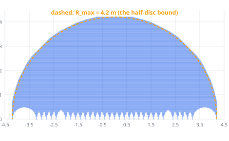

# Manipulator Performance Evaluation

**Manipulator performance evaluation is measuring how good a robot arm is at its job with numbers — how much space it can reach, how much range each joint gives per metre of link, how freely it can move at a pose, and how much its joint errors move the hand — so that designs can be compared and improved.**

When you choose a ladder you check how high it reaches and how steady it is. Choosing or designing a robot arm is the same, done with performance indices instead of a glance.

## Before you start
<!-- bite: 96bdfc80-6e20-423f-b5e4-e13a4c68aa0f -->

You should know forward kinematics ([[mechatronics/18-forward-and-inverse-kinematics|Forward and Inverse Kinematics]]), the Jacobian and manipulability ([[mechatronics/20-redundancy-and-singularities|Redundancy and Singularities]]), and the root-sum-square error rule ([[mechatronics/15-measurement-uncertainty|Measurement Uncertainty and Error Propagation]]).

After this lesson you will be able to:

1. find a manipulator's workspace bounds and estimate its workspace area;
2. compute and rank joint performance indices, and a manipulability index at a pose;
3. propagate joint errors to an end-effector error, and use the indices to improve a design.

## What a performance index is
<!-- bite: e45c0f93-9a2f-4357-a55c-f5b9babd9939 -->

The last few lessons asked "can the arm get there, and how?" This one asks "how *well*?" A **performance index** is a single number that answers one version of that question, so two designs, or two poses of one design, can be compared fairly.

The T_4 tutorials use five: the **workspace** (where it can reach), the **joint performance index** (range per link length), **manipulability** (how freely it moves at a pose), a **task-based index** (how well it suits one particular job), and **error propagation** (how joint errors show up at the hand).

The running example is the T_4 **six-link planar arm** with links (0.5, 0.7, 0.8, 0.6, 0.9, 0.7) m and every joint limited to [0°, 180°].

## The kid version
<!-- bite: 68fd875d-7fd0-4af4-989b-368c71df50c5 -->

Imagine comparing two fishing rods. One reaches further — bigger workspace. One has a reel that lets out more line for its size — better range per length. One is easy to flick in any direction from where you hold it — better manipulability. And one wobbles at the tip when your hand shakes a little — worse error propagation. You would pick the rod whose numbers suit the fish you want.

**Where the analogy stops working.** A rod is one piece. A robot's numbers change with its pose: the same arm can be dexterous in one position and nearly helpless in another, so most of these indices belong to a pose, not just to the arm.

## The tutorial's angle convention
<!-- bite: c8769dcd-5db8-4b95-bd69-7c7b651d7f02 -->

T_4 writes the forward kinematics as

$$x = \sum_{i=1}^{n} l_i\cos q_i, \qquad y = \sum_{i=1}^{n} l_i\sin q_i$$

with each qᵢ the **absolute** angle of link i, not a relative joint angle. That differs from lesson 18's cumulative angles, so in these tutorials take each qᵢ as the link's direction. It also makes the Jacobian column for link i simply (−lᵢ sin qᵢ, lᵢ cos qᵢ), like the parallel manipulator's.

## Workspace bounds
<!-- bite: 075ee1cb-9548-405f-af00-ece2243a15b1 -->

**Q1(a):** with every qᵢ in [0°, 180°], every link points somewhere in the upper half-plane. So:

1. **x range:** all links at 0° gives x_max = Σlᵢ = 4.2 m; all at 180° gives x_min = −4.2 m.
2. **y range:** all links at 90° gives y_max = 4.2 m; all at 0° or 180° gives y_min = 0.

The reachable region lies inside the upper half-disc of radius R_max = 4.2 m, whose area ½πR² = 27.7 m² is an **upper bound** on the workspace area.

## A single pose is a point, not a volume
<!-- bite: b7f04d70-795b-4fe5-8d62-b3fc936e2f36 -->

**Q1(b)** asks for the "workspace volume" at q = (45°, 60°, 90°, 120°, 150°, 180°). A single set of joint angles gives a single hand position:

$$x = 0.5\cos 45° + 0.7\cos 60° + 0.8\cos 90° + 0.6\cos 120° + 0.9\cos 150° + 0.7\cos 180° = -1.076\ \text{m}$$

$$y = 0.5\sin 45° + 0.7\sin 60° + 0.8\sin 90° + 0.6\sin 120° + 0.9\sin 150° + 0 = 2.729\ \text{m}$$

The workspace is the set of *all* such points as the joints sweep their ranges — so to get an area (in 3-D, a volume), you must consider every pose, which is a job for a numerical method.

## Estimating the workspace numerically
<!-- bite: ff69da18-127c-4879-8c14-35e8e94b7516 -->

**Q5(b)** allows "numerical methods or an approximation technique". The obvious one is Monte Carlo: pick random joint angles, compute the hand position, and count the grid cells that get hit. But it has a trap. Choosing each angle uniformly in [0°, 180°] gives only about **16 m²** for this arm — far too small — because the outer rim needs all six links lined up, which random angles almost never do.

A better method builds the reachable set link by link: start at the base, and add every position of the next link's half-circle arc to every point reached so far. On a fine grid this converges to about **25.6 m²**:

Nearly the whole half-disc, with thin gaps along the x-axis, where only certain sums of the link lengths can be made.

## Joint performance index
<!-- bite: 449979ff-1651-4be4-b13e-664e60879121 -->

**Q2** defines a simple index for each joint:

$$\text{JPI} = \frac{\text{joint range}}{\text{link length}}$$

With ranges (180°, 150°, 160°, 170°, 180°, 180°) and the six link lengths:

1. Joint 1: 180/0.5 = **360**
2. Joint 4: 170/0.6 = **283.3**
3. Joint 6: 180/0.7 = **257.1**
4. Joint 2: 150/0.7 = **214.3**
5. Joints 3 and 5 (tied): 160/0.8 = 180/0.9 = **200**

(units: degrees per metre). Highest to lowest: J1, J4, J6, J2, then J3 = J5. A high index means a lot of angular freedom for a short link — fine, controllable motion; a low one means a long link with comparatively little range.

## Manipulability at a pose
<!-- bite: 73ae2509-453c-4d5d-8f33-913c74cb5a9c -->

**Q3:** a 4-link arm, l = (1.0, 1.5, 1.0, 1.2) m, at q = (45°, 60°, 90°, 120°). The tutorial offers λ = det(J)², but J here is 2 × 4 and has no determinant, so use the general index from lesson 20:

$$w = \sqrt{\det(JJ^{T})}$$

With the tutorial's convention, the columns of J are (−lᵢ sin qᵢ, lᵢ cos qᵢ). Working it through, det(JJᵀ) = 5.35, so **w = 2.31**.

**Q3(b)** — its significance: w measures how freely the hand can move and push in every direction at this pose. Large w means the arm can move quickly and precisely in any direction; w near zero means it is close to a singularity, with some directions almost lost and joint speeds blowing up. So a task should be planned in poses with high w.

## A task-based index and error propagation
<!-- bite: e9c86dd8-1cdf-4c57-99b2-646dce045f2a -->

**Q4:** a 5-link arm for precision assembly, l = (0.8, 1.0, 1.2, 0.6, 1.0) m. The tutorial gives no task pose, so take q = (30°, 60°, 90°, 120°, 150°) as the assembly pose.

A **task-based performance index** scores the arm at the poses the task actually uses, rather than over its whole workspace. The manipulability at the task pose is a natural one: here **w = 2.12**.

**Error propagation:** small joint errors δq move the hand by δx ≈ J δq — the Jacobian is the sensitivity, exactly as partial derivatives were in lesson 15. If every joint may be off by 0.01 rad, independently, the root-sum-square of each row gives

$$\delta x = 0.0169\ \text{m}, \qquad \delta y = 0.0125\ \text{m}, \qquad \lVert\delta\mathbf{x}\rVert = 0.021\ \text{m}$$

In the worst case, with every error pushing the same way, δx = Σ|J₁ₖ| × 0.01 = 0.035 m.

## Using the indices to improve a design
<!-- bite: 62ad9510-5362-4769-8962-fdf17cd09aa3 -->

Q4(b) and Q5(c) ask how the indices guide design:

1. **Shorten or stiffen the links with the biggest Jacobian entries** — they are the long lever arms that magnify joint errors.
2. **Put the best encoders on the joints nearest the base**, whose errors are multiplied by the longest lever.
3. **Choose task poses with high manipulability**, away from singularities.
4. **Match link lengths to the task.** Q5's 6-link arm (l = 0.9, 1.1, 0.8, 1.2, 1.0, 1.0 m) has R_max = 6.0 m, but its target (1.5, 2.0, 3.0) is only 3.91 m away — much of its reach is wasted, and shorter, stiffer links would be more precise.
5. **Widen joint limits** to enlarge the workspace and remove gaps — but only where the hardware and cables allow.

For Q5's 3-D workspace, the same reasoning gives an upper bound: a sphere of radius 6.0 m, (4/3)π(6)³ = 905 m³, or half that, 452 m³, if the joint limits confine the arm to one side of its base.

## Terms used in performance evaluation
<!-- bite: eb91ccde-3465-432a-a5df-bcbbac45f808 -->

1. **Performance index**: this is a number that measures one aspect of how well a manipulator does its job, so designs or poses can be compared.
2. **Workspace**: this is the set of all positions the end-effector can reach. Its area (2-D) or volume (3-D) is a performance index.
3. **Joint performance index**: in T_4, this is a joint's range divided by its link's length.
4. **Manipulability index, w**: this is √det(JJᵀ), how freely the end-effector can move at a pose.
5. **Task-based performance index**: this is an index evaluated at the poses a particular task uses, rather than over the whole workspace.
6. **Error propagation**: this is working out the end-effector error from small joint errors, δx ≈ Jδq.
7. **Monte Carlo method**: this is estimating something by trying many random samples. It can under-sample rare cases, such as a workspace's rim.

## Common pitfalls and traps
<!-- bite: 5fc0ab53-3fe9-4d43-a17c-ece11270780a -->

- **Mixing angle conventions.** T_4's qᵢ are absolute link angles; lesson 18's are relative joint angles.
- **Calling one pose's position a "volume".** One pose is one point; the workspace needs all poses.
- **Trusting naive random sampling.** Uniform random joint angles barely reach the workspace edge and underestimate its size.
- **Using det(J) for a non-square J.** Use √det(JJᵀ).
- **Adding joint errors linearly and calling it "the" error.** That is the worst case; independent errors combine by root-sum-square.

## Check your understanding
<!-- bite: 1f1ad436-228f-4424-ad8d-f2ddcdec8877 -->

Try each one before you open the answer.

1. <!-- q: exact id="396992f1" answer="300" tolerance="0.01" -->
   A joint has a range of 120° and drives a link 0.4 m long. What is its joint performance index, in degrees per metre?

   

Answer

   JPI = 120 / 0.4 = 300 °/m.

   

2. <!-- q: mcq id="955bbe67" -->
   Three joints have ranges and link lengths: A — 180° on 0.9 m; B — 150° on 0.5 m; C — 160° on 0.64 m. Rank them by joint performance index, highest first.

   - [x] B, C, A
   - [ ] A, C, B
   - [ ] A, B, C
   - [ ] C, B, A

   

Answer

   A: 180/0.9 = 200. B: 150/0.5 = 300. C: 160/0.64 = 250. So B (300), then C (250), then A (200).

   

3. <!-- q: exact id="909bf5a8" answer="6.28319" sigfigs="3" -->
   A planar arm's links all point into the upper half-plane and its total length is 2 m. What is the upper bound on its workspace area, ½πR_max², in m²?

   

Answer

   ½ × π × 2² = 2π = 6.28 m². The real workspace can be a little smaller.

   

4. <!-- q: exact id="684d4f3c" answer="0.0116619" sigfigs="3" -->
   At some pose, one row of an arm's Jacobian is (−0.5, −0.3) m/rad. Each of the two joints may be off by 0.02 rad, independently. Using root-sum-square, what is the resulting error in that hand coordinate, in metres?

   

Answer

   √((0.5 × 0.02)² + (0.3 × 0.02)²) = √(0.0001 + 0.000036) = 0.0117 m.

   

5. <!-- q: mcq id="f9a90d7e" -->
   An arm's manipulability index is 2.3 at pose A and 0.05 at pose B. What does that tell you?

   - [x] Pose B is close to a singularity; plan the task near pose A.
   - [ ] Pose B is more precise because the number is smaller.
   - [ ] The arm cannot reach pose B.
   - [ ] The two poses are equally good.

   

Answer

   Manipulability near zero means a near-singular pose, where some directions are almost lost and joint speeds blow up. Pose A, with much higher w, moves freely in every direction.

   

6. <!-- q: open id="2ffd7079" -->
   Explain why estimating a workspace by choosing every joint angle uniformly at random underestimates its size, and describe a better method.

   

Answer

   The edge of the workspace is reached only when the links are nearly lined up, and with several joints each chosen at random, the chance of them all lining up is tiny — so random samples cluster in the middle and rarely touch the rim, and a cell-count of the hits misses much of the area (about 16 m² instead of about 25.6 m² for the T_4 arm). Better methods sample deliberately near the boundary, or build the reachable set link by link (adding every position of each link's arc to every point reached so far) on a grid, refining the grid until the area stops changing.

   

## Before moving on
<!-- bite: 91ec4f0e-d010-40b7-88a8-12c9c93b6269 -->

You are done when you can bound and estimate a workspace, compute and rank joint performance indices, compute manipulability at a pose, propagate joint errors to the hand, and say how each index would change a design.

Recap: workspace bound ½πR_max² (planar, half-plane links); one pose is one point; JPI = range/length; w = √det(JJᵀ); δx ≈ Jδq, combined by root-sum-square; use the indices to choose link lengths, joint limits, encoders and task poses.

Next, [[mechatronics/21-parallel-manipulators|Parallel Manipulators]] — then dynamics, grasping, and finally motion around obstacles.

## Related
<!-- bite: 5b3abaac-a024-48a9-bef0-33fbd9214cc8 -->

- [[mechatronics/15-measurement-uncertainty|Measurement Uncertainty and Error Propagation]]: the root-sum-square rule used here.
- [[mechatronics/20-redundancy-and-singularities|Redundancy and Singularities]]: manipulability.

## About this lesson
<!-- bite: 35e36db3-7523-440b-87fc-33e5e6939e6b -->

**Level:** trigonometry, small matrices and error propagation. It covers workspace bounds and numerical estimation, the joint performance index, manipulability at a pose, task-based indices and error propagation, and design improvement, worked through the T_4 tutorial questions. The tutorial leaves some quantities open (the task pose in Q4, and "workspace volume" for a single pose in Q1(b)); this lesson states its choices. It is lesson 25 — numbered last because it was added after the rest, but read it after lesson 20. Every number is checked in `scripts/diagrams/mechatronics_robotics.py`, which also computes the workspace area.

**Source:** T_4, "Manipulator Performance Evaluation and Optimization" tutorial questions by Dr John Ogbemhe (University of Lagos SSG 515/519), Questions 1–5.
