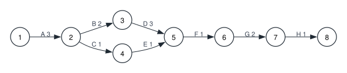
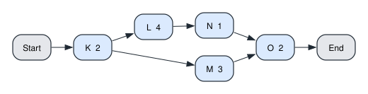

# Network Diagrams 1: Activities, Events and Two Ways to Draw

A network diagram draws a project's activities in their logical order, so you can see which jobs must wait for which.

## Before you start
<!-- bite: cf6d110c-fddb-4abc-b9ac-bd521ce23813 -->

You should have read [[planning-and-scheduling/06-work-breakdown-structure|06 — The Work Breakdown Structure]].

After this lesson you will be able to:

1. define activity, event, path and critical path;
2. draw a small project as an activity-on-node (AON) diagram;
3. draw the same project as an activity-on-arrow (AOA) diagram;
4. compare the two methods.

## What a network diagram is
<!-- bite: b115aa97-4225-4cd2-b056-1d4d1afdf355 -->

The WBS gave us the fence's eight activities, but a list says nothing about order. You can't erect the fence before the wood is bought, and you can't paint it before it's up. The network diagram adds the order. Each activity is connected to the ones it must wait for, so the whole project becomes a picture of who waits for whom.

## The fence's activities and what they wait for
<!-- bite: 56132517-09a7-42a2-8419-63c943919abf -->

Every network question starts from a table like this one.

Here is the fence again, now with what each activity must wait for (its **predecessors**) and its duration in days. This table is the starting point for every network question.

1. **A Dig holes**: 3 days, no predecessor.
2. **B Buy wood**: 2 days, after A.
3. **C Buy gate**: 1 day, after A.
4. **D Erect fence**: 3 days, after B.
5. **E Buy paint**: 1 day, after C.
6. **F Erect gate**: 1 day, after D and E.
7. **G Paint fence**: 2 days, after F.
8. **H Paint gate**: 1 day, after G.

## Terms used in network diagrams
<!-- bite: 20ac8250-d132-4e21-b65c-82b8f004f09d -->

1. **Activity**: This is a piece of work that takes time, like "dig holes".
2. **Event**: This is a single instant that marks the start or the end of an activity. It takes no time at all. "The holes are dug" is an event.
3. **Predecessor**: This is an activity that must finish before another can start. A is the predecessor of B.
4. **Path**: This is a chain of activities from the start of the project to its end, following the arrows.
5. **Critical path**: This is the longest path. Its length is how long the whole project takes, as lesson 13 shows.

## Drawing it as activity on node
<!-- bite: dfd84229-35dc-4510-ba90-6b479d8c4228 -->

In **activity on node** (AON), each activity is a box, and arrows show only "this must wait for that".

To draw one: put a box for each activity, then draw an arrow into it from each of its predecessors. Activities with no predecessor hang off a Start box; activities nothing waits for lead to an End box. AON is also called the **precedence diagramming method** (PDM).

## Drawing it as activity on arrow
<!-- bite: 5d67b754-6098-4cbe-890f-759cd29a1ed2 -->

In **activity on arrow** (AOA), each activity is an arrow, and the circles are events. An activity's arrow leaves the event where it can start and enters the event where it ends. An activity is named by its pair of event numbers, so in this picture B is activity 2-3.

To draw one: number the events left to right so every arrow goes from a smaller number to a larger one. Event 5 here means "both D and E are finished", which is exactly when F can start.

## AOA and AON side by side
<!-- bite: bd17e41e-c369-4fc5-bc33-cf93014580aa -->

Both pictures carry the same logic, and both give the same critical path. They differ in how they draw it.

1. **The activity.** AOA draws it as an arrow. AON draws it as a box.
2. **What the circles and arrows mean.** In AOA the circles are events and each activity is named by its start and end event, like 2-5. In AON the arrows only show dependency.
3. **Dummy activities.** AOA often needs them: a dashed arrow of zero duration that keeps the logic right. AON never needs them. Lesson 09 is all about these.
4. **Relationships.** AOA shows only "finish, then start". AON can show all four precedence relationships of lessons 11 and 12.

Exams use both. The 2023/24 and 2024/25 papers give AOA networks; the 2019/20 paper gives AON. So you need to draw and read either.

The fence happened to need no dummies. Many networks do, and they confuse people more than anything else in AOA, so the next lesson takes them slowly.

## Common pitfalls
<!-- bite: 4fce144a-0b11-4e64-986b-ca9f0f0b55f5 -->

1. **Giving an event a duration.** Events are instants. Only activities take time.
2. **Drawing an arrow for every pair that happen in sequence.** Only draw an arrow from an activity's *immediate* predecessors. F waits for D and E, not for A as well.
3. **Event numbers going backwards.** In AOA, number so every arrow goes from a smaller to a larger number; it makes the passes in lesson 15 much easier.

## Check your understanding
<!-- bite: 43abb303-0622-4e86-8313-6e860fa8d067 -->

Try each one before you open the answer.

1. <!-- q: mcq id="2c8e4f71" -->
   In an activity-on-arrow diagram, what does a circle stand for?

   - [ ] An activity
   - [x] An event, the instant an activity starts or ends
   - [ ] A dummy activity
   - [ ] A resource

   

Answer

   An event. In AOA the arrows are the activities.

   

2. <!-- q: mcq id="9a1d6b3e" -->
   A project has: P (no predecessor), Q after P, R after P, S after Q and R. In an AON diagram, how many arrows go into S?

   - [ ] 1
   - [x] 2
   - [ ] 3
   - [ ] 0

   

Answer

   2: one from Q and one from R, its two immediate predecessors. No arrow comes from P, because P is only an indirect predecessor.

   

3. <!-- q: gap id="d4b70e29" answers="precedence diagramming method|precedence diagramming|PDM" -->
   Activity on node is also called the ___.

   

Answer

   The precedence diagramming method (PDM).

   

4. <!-- q: sketch id="7e05c3a8" -->
   Draw the AON diagram for this project: K 2 days (no predecessor), L 4 days (after K), M 3 days (after K), N 1 day (after L), O 2 days (after M and N).

   

Answer

   

   What to check:
   - one box per activity, with its duration;
   - K's arrows going to both L and M;
   - O receiving arrows from both M and N, and nothing else;
   - a Start and an End, so the diagram has one beginning and one finish.

   

5. <!-- q: open id="b3f89d16" -->
   Give two differences between AOA and AON.

   

Answer

   Any two: AOA draws an activity as an arrow and AON as a node (box); AOA uses circles as events and names activities by event pairs, AON's arrows only show dependency; AOA often needs dummy activities, AON never does; AOA shows only finish-to-start logic, AON can show all four precedence relationships.

   

## Before moving on
<!-- bite: 0f0f4db1-0d89-4078-ac2d-85226801a860 -->

You can define the terms and draw a small project both ways. **Next:** [[planning-and-scheduling/09-network-diagrams-2|09 — Network Diagrams 2: Dummy Activities]].

## Related
<!-- bite: f19b7b07-0999-4096-b809-c64f761734d0 -->

- [[planning-and-scheduling/index|Planning and scheduling map]]
- [[operations-research/06-network-models|Network Models]]: shortest paths, flows and the critical path from the operations research side.

## About this lesson
<!-- bite: e974063b-c0cf-4c05-86d3-e9ace0ecf31e -->

**Level:** Beginner. **Covers:** activity, event, path and critical path, the fence drawn as AON and as AOA, and the differences between the two.

**Where it sits:** lesson 8 of 35, in part 3 (network diagrams). Part 1 of 2 on network diagrams.

**Source:** the author's own SSG 513 study notes, section 3, and Class Exercise 2. The diagrams come from `scripts/diagrams/planning_scheduling.py`.
