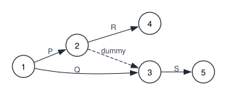
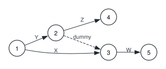

# Network Diagrams 2: Dummy Activities

A dummy activity is a dashed arrow in an activity-on-arrow diagram that takes no time and uses no resources; it exists only to keep the logic right.

## Before you start
<!-- bite: d8c094da-b8af-448b-90fa-7b44be0af74d -->

You should have read [[planning-and-scheduling/08-network-diagrams-1|08 — Network Diagrams 1]].

After this lesson you will be able to:

1. say the two reasons a dummy is needed;
2. add a dummy to give two activities their own event pairs;
3. add a dummy to show a dependency that ordinary arrows can't;
4. treat a dummy correctly in a calculation.

## What a dummy activity is
<!-- bite: ec9a4dc2-f1fb-44e6-a370-1287f90d5ce6 -->

The fence drew cleanly as arrows. But arrow diagrams have a weakness: an activity is named by its two events, and an event means "everything coming in is finished". Sometimes those two rules force a picture that says something false, or that gives two activities the same name. A dummy fixes that.

A dummy is drawn as a dashed arrow. Its duration is **zero**, and it uses no workers and no money. It is not real work; it is a piece of logic.

Two reasons to add one:

1. **Uniqueness**: two activities would otherwise have the same start and end events.
2. **Logic**: a dependency can't be shown correctly with real arrows alone.

## Reason 1: giving each activity its own pair
<!-- bite: a728d706-b58d-4b13-a138-434e185e48b4 -->

Say buying the wood (B) and buying the gate (C) both start when the holes are dug (event 2), and both must finish before building starts (event 3). Drawn directly, B and C would both be "activity 2-3". Two different activities with the same name breaks every table and calculation that follows.

The fix: let C end at its own new event, then add a dummy from that event to the merge point.

Now B is 2-4, C is 2-3, and the dummy 3-4 carries the message "C must also be finished before event 4". The logic hasn't changed; only the names have.

## Reason 2: showing logic arrows can't
<!-- bite: 19f7eb2a-dd7c-486b-b686-db5e6dda7db0 -->

Here is the classic case. Four activities:

1. **P** and **Q** both start the project.
2. **R** needs only P to be finished.
3. **S** needs both P and Q to be finished.

If P and Q both ended at the same event, R would be forced to wait for Q too, which is false. So P and Q end at separate events, and a dummy from P's end event to S's start event says "S also waits for P".

## Reading the dummy in the picture
<!-- bite: 7274f77a-80c3-4c3f-a563-7ad0c980e2a7 -->

Follow each activity back to the event it leaves, and the logic comes out right.

Read it: R leaves event 2, so it waits only for P. S leaves event 3, which has two arrows in (Q, and the dummy from P), so it waits for both. Exactly the logic we wanted.

## Dummies in the calculation
<!-- bite: b9c9e867-2de4-472a-ba7c-43cb4a4ea22b -->

Treat a dummy as an activity of duration 0 and do everything else as normal. It passes time from one event to another unchanged.

A dummy can lie on the critical path. In Assignment 1 Q1 (an arrow diagram, events 0 to 6) the dummy 1-2 has zero duration, so both 0-1-4-6 and 0-1-2-4-6 are critical at 19 days. In the 2024/25 refinery question, three of the lettered "activities" (H, J and R) are really dummies of zero duration.

Exam papers sometimes show a dummy's duration as "-". Read that as 0, and say so in your answer.

With the drawing settled, the next question is *why* one activity has to wait for another. There are four kinds of reason, and that's the next lesson.

## Common pitfalls
<!-- bite: 2a6573ac-64d4-4bb1-b3ad-c3a1e431e7cd -->

1. **Giving a dummy a duration.** It is always 0.
2. **Using a dummy where none is needed.** Each extra dummy makes the diagram harder to read. Add one only for uniqueness or for logic.
3. **Pointing the dummy the wrong way.** The arrow points from the activity that must finish to the one that waits.
4. **Leaving dummies out of the forward pass.** They still carry an event's time across; skip them and the times are wrong.

## Check your understanding
<!-- bite: e44c47e9-acb4-4d15-befc-7c85a4abdc1f -->

Try each one before you open the answer.

1. <!-- q: exact id="6e1f9a40" answer="0" accept="zero" -->
   What is the duration of a dummy activity?

   

Answer

   0. It takes no time and uses no resources.

   

2. <!-- q: mcq id="c87b25d3" -->
   Why would an AON diagram never need a dummy?

   - [ ] AON diagrams can't show parallel activities
   - [x] In AON an activity is a box, so arrows only show dependency and no activity is named by its end points
   - [ ] AON diagrams have no critical path
   - [ ] AON only works for small projects

   

Answer

   Dummies exist because AOA names activities by their events and uses events as merge points. AON draws activities as boxes and can link any box to any other directly.

   

3. <!-- q: mcq id="41ad0e6b" -->
   Activities J and K both start at event 4 and both end at event 6. What is wrong, and what fixes it?

   - [ ] Nothing is wrong
   - [x] They would both be called 4-6; end one at a new event and add a dummy from it to event 6
   - [ ] One of them must be deleted
   - [ ] Give one of them a duration of zero

   

Answer

   Two activities can't share an event pair. A new event plus a dummy gives each its own name without changing the logic.

   

4. <!-- q: sketch id="93c4e2f7" -->
   Draw an AOA diagram for: X and Y start the project; Z needs only Y; W needs both X and Y. Use one dummy.

   

Answer

   

   What to check:
   - X and Y ending at different events;
   - Z leaving Y's end event, so it doesn't wait for X;
   - a dashed dummy from Y's end event to the event W leaves;
   - W leaving an event that both X and the dummy enter.

   

5. <!-- q: open id="0f5d7b8c" -->
   An exam table lists activity 4-5 with a duration of "-". How should you treat it, and why?

   

Answer

   As a dummy activity with duration 0. It carries only logic, so in the forward and backward passes it passes an event's time across unchanged. State the assumption in the answer.

   

## Before moving on
<!-- bite: 9c4ac2df-ec35-4141-a2ed-71bf993f3709 -->

You can say when a dummy is needed, add one for uniqueness or for logic, and use it in a calculation. **Next:** [[planning-and-scheduling/10-types-of-dependency|10 — Types of Dependency]].

## Related
<!-- bite: c63fe887-e310-4639-b6bc-11ac42ea0a67 -->

- [[planning-and-scheduling/index|Planning and scheduling map]]

## About this lesson
<!-- bite: 742ce0af-0cf5-435b-b0d1-0befd5d40126 -->

**Level:** Beginner. **Covers:** what a dummy is, the uniqueness and logic reasons, and dummies in calculations.

**Where it sits:** lesson 9 of 35, in part 3 (network diagrams). Part 2 of 2 on network diagrams.

**Source:** the author's own SSG 513 study notes, sections 3 and 4. The P, Q, R, S example is the standard textbook case, added for this lesson. The diagrams come from `scripts/diagrams/planning_scheduling.py`.
