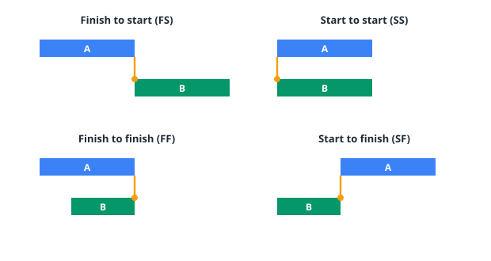

# Precedence Relationships 1: The Four Links, Leads and Lags

A precedence relationship ties the start or finish of one activity to the start or finish of another, in one of four ways.

## Before you start
<!-- bite: c02cc6c8-1d7d-49c6-931d-938e7462d9d4 -->

You should have read [[planning-and-scheduling/10-types-of-dependency|10 — Types of Dependency]].

After this lesson you will be able to:

1. state the rule for each of the four relationships;
2. draw each one as two bars on a timeline;
3. explain lead and lag with examples;
4. say why relationships with lead and lag are more realistic than plain CPM.

## What a precedence relationship is
<!-- bite: 2414fb4f-0762-40ab-ae9b-81b13eefb1c5 -->

Every wait so far has been the same shape: the first activity finishes, then the next one starts. But real work isn't always like that. On a long fence, the painter doesn't have to wait until all 40 metres are up. They can start painting the first section two days after building starts, and keep a few metres behind the builders.

A precedence relationship lets the plan say exactly that. Call the first activity A (the predecessor) and the one that follows B (the successor). The relationship ties one *end* of A to one *end* of B. That's all four come from: two ends of A, two ends of B.

These are drawn on an activity-on-node diagram, which is why AON is called the precedence diagramming method (PDM). They are asked in 2019/20, 2020/21, 2023/24 and 2024/25.

## The four relationships
<!-- bite: a8f2afed-ad82-4cdc-a2a5-f22195bb6929 -->

## The rule for each relationship
<!-- bite: 6bd58161-2ec6-45ec-a722-088bded7da16 -->

Here is what each of the four pictures above means, in words.

1. **Finish to start (FS)**: B cannot start until A finishes. This is the most common one, and it is the only one plain CPM uses. Pour the concrete, then build on it.
2. **Start to start (SS)**: B cannot start until A has started. The two can begin together, or B a set time after. Start painting once fence-building has started.
3. **Finish to finish (FF)**: B cannot finish until A has finished. Testing can't finish until coding finishes.
4. **Start to finish (SF)**: B cannot finish until A has started. This is the rarest. The night guard's shift can't end until the day guard's shift starts.

Remember this one: the **first letter** is about A, the **second letter** is about B. SF means A's **S**tart controls B's **F**inish.

## Lead and lag
<!-- bite: 2ce245d3-5dc8-462a-aba8-e9b83d8534a4 -->

A relationship can carry a number of days with it.

1. **Lag**: This is a delay added to a relationship. "FS with a lag of 2" means B starts 2 days after A finishes. Example: wait 2 days for concrete to cure before building on it.
2. **Lead**: This is an overlap, the opposite of a lag. "FS with a lead of 2" means B starts 2 days *before* A finishes. Example: start ordering the gate 2 days before the holes are finished, because you already know the size.

In exam tables a relationship is often written like **SS(A,C) = 4**: C cannot start until 4 days after A starts. Read it as "relationship type (from, to) = gap in days".

## Why bother with them?
<!-- bite: d19aaa2d-9a23-449e-acba-ead5a77c8ff2 -->

In ordinary CPM every relationship is finish to start with zero lag. That is simple, but it is often wrong about real work.

1. **Real work has gaps that must happen.** Concrete must cure; paint must dry. A lag puts that wait in the plan.
2. **Real work overlaps.** Painters follow builders down a long fence. SS with a lag shows that, and it usually shortens the project.
3. **It removes fake activities.** Without lag, the planner adds a made-up "wait for concrete" activity just to hold time.

So using lead and lag is more realistic. But a relationship can also *lengthen* a project, when a gap the plain plan ignored turns out to be needed. The next lesson works one full example and shows the answer moving.

## Common pitfalls
<!-- bite: 118cf52a-729f-4680-a2a9-d56b62c65f5c -->

1. **Reading the letters the wrong way round.** First letter belongs to the predecessor, second to the successor.
2. **Treating every link as FS.** If the question gives SS, FF or SF, the plain CPM answer is wrong.
3. **Confusing lead and lag.** Lag adds a wait; lead overlaps.
4. **Thinking relationships always shorten a project.** Lags and SF or FF links can make it longer.

## Check your understanding
<!-- bite: 5601f35a-05cf-44a5-9728-49c1cafc2791 -->

Try each one before you open the answer.

1. <!-- q: mcq id="7f2a0c58" -->
   "Testing cannot finish until coding has finished." Which relationship is this?

   - [ ] Finish to start
   - [ ] Start to start
   - [x] Finish to finish
   - [ ] Start to finish

   

Answer

   Finish to finish: the successor's finish is tied to the predecessor's finish.

   

2. <!-- q: exact id="e3b6d1a4" answer="7" -->
   Activity A finishes on day 5. Activity B follows A by FS with a lag of 2 days. On what day can B start at the earliest?

   

Answer

   Day 7: A's finish (5) plus the lag (2).

   

3. <!-- q: exact id="0c9f5e17" answer="6" -->
   Activity P starts on day 3. Activity Q is linked by SS(P,Q) = 3. On what day can Q start at the earliest?

   

Answer

   Day 6: P's start (3) plus 3.

   

4. <!-- q: mcq id="a58e3b2d" -->
   Which relationship is the rarest, and is described as "the predecessor starting releases the successor's finish"?

   - [ ] Finish to start
   - [ ] Start to start
   - [ ] Finish to finish
   - [x] Start to finish

   

Answer

   Start to finish.

   

5. <!-- q: open id="4d1c7f90" -->
   Explain lead and lag with one example of each, and say why using them makes a schedule more realistic.

   

Answer

   A lag is a delay on a relationship: after pouring a floor slab, wait 3 days for it to cure before laying blocks (FS with lag 3). A lead is an overlap: start tiling one room 2 days before the plastering of the whole floor finishes (FS with lead 2). They are more realistic because real work has compulsory waits and natural overlaps that plain finish-to-start logic with zero lag ignores.

   

## Before moving on
<!-- bite: 206a7a79-4aab-4e41-b27d-512adbfbe2ee -->

You can state and draw the four relationships and explain lead and lag. **Next:** [[planning-and-scheduling/12-precedence-relationships-2|12 — Precedence Relationships 2: A Worked Example]].

## Related
<!-- bite: 17e6d6e5-6b32-4486-b8c2-26fa310563e9 -->

- [[planning-and-scheduling/index|Planning and scheduling map]]

## About this lesson
<!-- bite: 8d858dc9-34d3-4bfc-8dfc-94db8693d7c1 -->

**Level:** Beginner to intermediate. **Covers:** FS, SS, FF and SF, lead and lag, and why they are more realistic than plain CPM.

**Where it sits:** lesson 11 of 35, in part 3 (network diagrams). Part 1 of 2 on precedence relationships.

**Source:** the author's own SSG 513 study notes, section 3. The bars come from `scripts/diagrams/planning_scheduling.py`.
