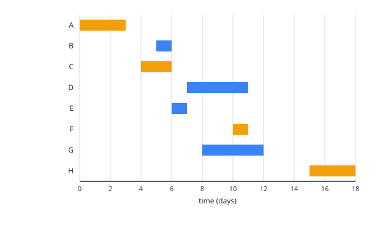

# Precedence Relationships 2: A Worked Example

This lesson schedules one network with plain logic and then with precedence relationships, and shows the answer change.

## Before you start
<!-- bite: 0c0c4066-7c18-4349-89b0-cfa0d1d44fe5 -->

You should have read [[planning-and-scheduling/11-precedence-relationships-1|11 — Precedence Relationships 1]]. It helps to have met paths, but the forward pass is explained here step by step.

After this lesson you will be able to:

1. find each activity's start and finish under FS, SS, FF and SF links with lags;
2. find the new project time and critical path;
3. explain why the answer differs from plain CPM.

## What this example does
<!-- bite: 4ec2415f-39e5-4a3d-a508-049329ffa154 -->

The 2020/21 paper gives this network, with durations in days:

1. **A**: 3 days, no predecessor.
2. **B**: 1 day, after A.
3. **C**: 2 days, after A.
4. **D**: 4 days, after B.
5. **E**: 1 day, after C.
6. **F**: 1 day, after C.
7. **G**: 4 days, after D and E.
8. **H**: 3 days, after G and F.

It asks for the project time twice: once with plain finish-to-start (FS) logic, once with a list of relationships. Comparing the two answers is the point.

## Step 1: plain FS logic
<!-- bite: 00eba441-f2ef-4257-9509-d86afa67735c -->

With plain FS, an activity starts when its predecessors finish, so the project time is the length of the longest path. List the paths:

1. A-B-D-G-H = 3 + 1 + 4 + 4 + 3 = **15**
2. A-C-E-G-H = 3 + 2 + 1 + 4 + 3 = 13
3. A-C-F-H = 3 + 2 + 1 + 3 = 9

The project takes **15 days**, along A-B-D-G-H.

## Step 2: the given relationships
<!-- bite: cec24297-d44b-4c49-b9be-6ad12f8196e8 -->

Now each link carries its own rule:

1. **FS(A,B) = 2**: B starts 2 days after A finishes.
2. **SS(A,C) = 4**: C starts 4 days after A starts.
3. **SS(B,D) = 2**: D starts 2 days after B starts.
4. **SF(C,E) = 3**: E can't finish until 3 days after C starts.
5. **FF(C,F) = 5**: F can't finish until 5 days after C finishes.
6. **SS(D,G) = 1**: G starts 1 day after D starts.
7. **SF(F,H) = 8**: H can't finish until 8 days after F starts.

The trick for the forward pass: each rule fixes *either* the successor's start *or* its finish. If it fixes the finish, subtract the duration to get the start.

## The forward pass, row by row
<!-- bite: 6d8ead23-fa8d-430c-b95d-da4ca4dbc9a7 -->

Pause before each row and predict it from the rule.

1. **A** starts the project: start 0, finish 0 + 3 = **3**.
2. **B**, FS 2 after A finishes: start 3 + 2 = 5, finish **6**.
3. **C**, SS 4 after A starts: start 0 + 4 = 4, finish **6**.
4. **D**, SS 2 after B starts: start 5 + 2 = 7, finish **11**.
5. **E**, SF 3: E can't finish before C starts + 3 = 4 + 3 = 7. So finish 7, start 7 − 1 = **6**.
6. **F**, FF 5: F can't finish before C finishes + 5 = 6 + 5 = 11. So finish 11, start 11 − 1 = **10**.
7. **G**, SS 1 after D starts: start 7 + 1 = 8, finish **12**. (E's finish at 7 is earlier, so it doesn't hold G back.)
8. **H**, SF 8: H can't finish before F starts + 8 = 10 + 8 = 18. So finish 18, start 18 − 3 = **15**. (G's finish at 12 is earlier.)

## The new schedule
<!-- bite: 5b852d6f-8d91-49c5-9497-a64da178c718 -->

The project now takes **18 days**.

Follow the chain that sets the finish backwards from H. H's finish was fixed by F's start (SF). F's start was fixed by C's finish (FF). C's start was fixed by A's start (SS). So the new critical path is **A-C-F-H**, a path that was the *shortest* one under plain logic, at 9 days.

## Why the answer changed
<!-- bite: f094918c-ac10-4141-9474-7490d4def149 -->

Two things happened at once.

1. **Some links pulled activities earlier.** D and G now start before their predecessors finish (SS links), so the old critical path A-B-D-G-H no longer drives the finish.
2. **Some links pushed activities later.** The FF on F and the big SF on H force waits that plain logic didn't have.

The 3-day increase, from 15 to 18, is the net effect of all the relationships together. That is why an exam question on precedence relationships always wants both answers: the change tells the story.

That completes the network. Part 4 turns the forward pass into the full critical path method, with a backward pass and float, starting from the fence.

## Common pitfalls
<!-- bite: 7aa50094-5a0f-4054-8118-b5891119edbd -->

1. **Forgetting to subtract the duration** when a rule fixes the finish (SF and FF).
2. **Measuring from the wrong end.** SS(A,C) counts from A's start, not its finish.
3. **Ignoring the other predecessors.** Check each one still allows the start you found, as for G and H above.
4. **Assuming the old critical path stays critical.** Here it doesn't.

## Check your understanding
<!-- bite: 0b8f0d44-f90a-4c61-9020-f3731f9600e5 -->

Try each one before you open the answer.

1. <!-- q: exact id="2a7e9c14" answer="7" -->
   A takes 4 days and starts on day 0. C takes 2 days, linked by FF(A,C) = 3. On what day does C finish at the earliest?

   

Answer

   Day 7: C can't finish before A finishes (4) + 3. Its start is 7 − 2 = 5.

   

2. <!-- q: exact id="d81b5f3e" answer="3" -->
   A takes 4 days and starts on day 0. E takes 2 days, linked by SF(A,E) = 5. On what day does E start at the earliest?

   

Answer

   Day 3. E can't finish before A starts (0) + 5 = 5, so it starts at 5 − 2 = 3.

   

3. <!-- q: exact id="6c04a2e8" answer="9" -->
   A 4 days starts the project. B 3 days follows by SS(A,B) = 2. C 2 days follows by FF(A,C) = 3. D 3 days follows B by FS(B,D) = 1. Nothing follows C or D. How long does the project take?

   

Answer

   9 days. B runs 2 to 5; C must finish by 4 + 3 = 7, so it runs 5 to 7; D starts 5 + 1 = 6 and runs 6 to 9. The finish is the later of 7 and 9.

   

4. <!-- q: exact id="f5e19b73" answer="10" -->
   The same network with plain finish-to-start logic and no lags: A 4 days; B 3 days after A; C 2 days after A; D 3 days after B. How long does it take?

   

Answer

   10 days, along A-B-D (4 + 3 + 3). With the relationships it was 9, because the SS link let B start before A finished.

   

5. <!-- q: open id="9b3d6f21" -->
   A project takes 15 days under plain CPM and 18 days once the given precedence relationships are added. Explain how adding relationships can make a project longer.

   

Answer

   Plain CPM assumes every link is finish to start with no lag. The real relationships can add waits it ignored: lags (a delay after a finish), and FF or SF links that stop an activity finishing until some time after another activity's finish or start. If those waits sit on a long chain, the finish moves later, even if SS links elsewhere let some work overlap.

   

## Before moving on
<!-- bite: ff227ab0-930b-4c3c-89f3-da92659b2cc8 -->

You can run a forward pass under all four relationships and explain why the answer moves. **Next:** [[planning-and-scheduling/13-critical-path-method-1|13 — Critical Path Method 1: The Forward Pass]].

## Related
<!-- bite: 02e2e07c-ed78-4ba0-8644-4bbf940fcf3b -->

- [[planning-and-scheduling/index|Planning and scheduling map]]

## About this lesson
<!-- bite: 5fbc22a3-281b-4419-85bc-d4565121c3d8 -->

**Level:** Intermediate. **Covers:** the 2020/21 precedence-relationship question worked in full: plain FS, the forward pass under each relationship, and the new critical path.

**Where it sits:** lesson 12 of 35, in part 3 (network diagrams). Part 2 of 2 on precedence relationships.

**Source:** the author's own SSG 513 study notes, section 3 (the 2020/21 paper, Question 3). The bar chart comes from `scripts/diagrams/planning_scheduling.py`, which also checks every start and finish.
