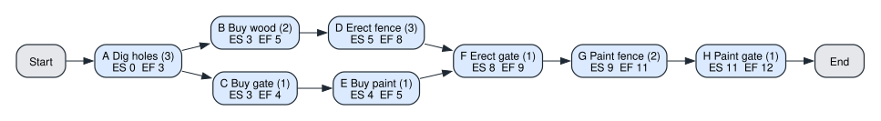

# Critical Path Method 1: The Forward Pass

The critical path method finds how long a project takes, and its first half, the forward pass, finds each activity's earliest times.

## Before you start
<!-- bite: 9ac30efc-6cbe-4bff-98fc-bb93fd0d9400 -->

You should have read [[planning-and-scheduling/08-network-diagrams-1|08 — Network Diagrams 1]].

After this lesson you will be able to:

1. say what CPM is for and where it came from;
2. define earliest start (ES) and earliest finish (EF);
3. run a forward pass on an AON network and read off the project time.

## What the critical path method is
<!-- bite: abf881f8-4bdd-4460-96e6-ada11ffb40e6 -->

Look at the fence network again. The owner asks two questions: "how long will it take?" and "if the gate arrives a day late, does that matter?" A network diagram shows the order, but not the answers. CPM gives both.

It treats each activity's duration as one fixed number, which is why it is called **deterministic**. It was developed by Du Pont in 1957 for planning chemical plant construction and shutdowns, and it also includes a method for trading time against cost (crashing, lessons 22 to 24).

CPM runs in two passes over the network:

1. The **forward pass**, left to right, finds the earliest times. This lesson.
2. The **backward pass**, right to left, finds the latest times and the float. Next lesson.

## The two earliest times
<!-- bite: ceeb0fe8-ea68-4662-9db8-958380b501d6 -->

1. **Earliest start (ES)**: This is the soonest an activity can begin, given that every one of its predecessors must be finished first. An activity with no predecessor has ES = 0.
2. **Earliest finish (EF)**: This is the soonest it can end: its earliest start plus its duration.

The rule for ES in words: an activity can start only when the **last** of its predecessors is finished. So its earliest start is the **largest** earliest finish among its predecessors.

$$ES = \max(EF \text{ of predecessors}), \qquad EF = ES + t$$

Here t is the activity's duration. Remember this one: forward pass, take the **maximum**.

## The fence: first steps
<!-- bite: 97c6447c-cd60-4da6-a3f6-9fd15f6ad22e -->

Here is the fence table from lesson 08 again: A Dig holes 3 (no predecessor); B Buy wood 2 (after A); C Buy gate 1 (after A); D Erect fence 3 (after B); E Buy paint 1 (after C); F Erect gate 1 (after D and E); G Paint fence 2 (after F); H Paint gate 1 (after G).

Start at the left.

1. **A** has no predecessor, so ES = 0 and EF = 0 + 3 = **3**.
2. **B** waits only for A. ES = 3, EF = 3 + 2 = **5**.
3. **C** waits only for A. ES = 3, EF = 3 + 1 = **4**.
4. **D** waits for B. ES = 5, EF = 5 + 3 = **8**.
5. **E** waits for C. ES = 4, EF = 4 + 1 = **5**.

## The fence: the merge at F
<!-- bite: 948e7d7b-dc0c-421a-8202-09d2f2513543 -->

Now F, which waits for both D and E. Before reading on, predict: when can F start?

D finishes at 8 and E finishes at 5. F needs both done, so it waits for the later one: ES = max(8, 5) = **8**, EF = **9**. The paint (E) is bought by day 5 and then sits waiting.

Then the rest is a straight line:

6. **G** waits for F. ES = 9, EF = **11**.
7. **H** waits for G. ES = 11, EF = **12**.

The project time is the largest EF of all: **12 days**.

## The forward pass on the diagram
<!-- bite: 307d79f0-8677-4439-a7a0-2e476f0b9e67 -->

Look at F: two arrows come in, carrying 8 and 5, and F takes the 8. Every merge point works like that. Notice too that nothing in the forward pass has yet told us which activities are allowed to slip. C finishes at 4, but could it finish at 5 or 6 without harm? To answer that we need the latest times, and that's the backward pass.

## Common pitfalls
<!-- bite: 085e7754-0493-4632-86a6-bbc526625f3b -->

1. **Taking the minimum at a merge.** An activity waits for its *slowest* predecessor, so it is always the maximum.
2. **Adding the durations of all predecessors.** ES comes from the predecessors' finish times, not their total duration.
3. **Starting at 1 instead of 0.** In this subject the project starts at time 0, so A runs from 0 to 3.
4. **Reading the project time from the last row.** It is the largest EF, which is not always the last activity listed.

## Check your understanding
<!-- bite: 47eb6692-1a2b-44b1-aef0-9d4624900650 -->

Try each one before you open the answer.

1. <!-- q: mcq id="c1f74e2a" -->
   Activity M has three predecessors with earliest finishes of 6, 11 and 9. What is M's earliest start?

   - [ ] 6
   - [ ] 9
   - [x] 11
   - [ ] 26

   

Answer

   11. M must wait for the last of its predecessors, so ES is the largest EF.

   

2. <!-- q: exact id="8b3e0d65" answer="5" -->
   A project: P 4 days (no predecessor), Q 1 day (after P), R 5 days (after P), S 3 days (after Q), T 2 days (after R and S). What is S's earliest start?

   

Answer

   5. P runs 0 to 4, Q runs 4 to 5, so S can start at 5.

   

3. <!-- q: exact id="4f9a2c17" answer="11" -->
   A project: P 4 days (no predecessor), Q 1 day (after P), R 5 days (after P), S 3 days (after Q), T 2 days (after R and S). How long does the project take?

   

Answer

   11 days. R finishes at 9 and S at 8, so T starts at max(9, 8) = 9 and finishes at 11.

   

4. <!-- q: gap id="e5d08b39" answers="Du Pont|DuPont;1957" -->
   CPM was developed by ___ in the year ___.

   

Answer

   Du Pont, 1957, for plant construction and shutdown work.

   

5. <!-- q: open id="a72c6f40" -->
   Why is CPM called deterministic?

   

Answer

   Because it uses one fixed duration for each activity and treats it as known. It has no allowance for uncertainty; PERT, which uses three estimates, is the probabilistic method.

   

## Before moving on
<!-- bite: fb67c9cf-d717-4eb8-9e8c-65f061e7bfc7 -->

You can run a forward pass and read off the project time. **Next:** [[planning-and-scheduling/14-critical-path-method-2|14 — Critical Path Method 2: The Backward Pass and Float]].

## Related
<!-- bite: a5effa57-bbfc-4223-9d4b-81b44d3f2748 -->

- [[planning-and-scheduling/index|Planning and scheduling map]]
- [[operations-research/06-network-models|Network Models]]: the critical path as a longest-path problem.

## About this lesson
<!-- bite: b1245ebf-288a-4b5c-a4c6-f9fbe2d80759 -->

**Level:** Beginner to intermediate. **Covers:** what CPM is, ES and EF, and the forward pass on the fence network.

**Where it sits:** lesson 13 of 35, in part 4 (the critical path method). Part 1 of 4 on CPM.

**Source:** the author's own SSG 513 study notes, section 4 (Class Exercise 2). The diagram comes from `scripts/diagrams/planning_scheduling.py`, which also checks the times.
