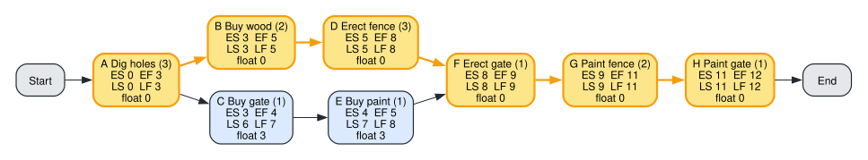

# Critical Path Method 2: The Backward Pass and Float

The backward pass finds the latest each activity can start and finish without delaying the project, and the gap between latest and earliest is the activity's float.

## Before you start
<!-- bite: 0d67fdab-43bf-40b6-b6c3-b0eaf7e16543 -->

You should have read [[planning-and-scheduling/13-critical-path-method-1|13 — Critical Path Method 1]].

After this lesson you will be able to:

1. define latest finish (LF), latest start (LS) and float;
2. run a backward pass and find every activity's float;
3. find the critical path and explain why it matters;
4. tell total float from free float.

## What the backward pass does
<!-- bite: 685a5f66-8a25-4b8c-9000-70dc99267e4a -->

The forward pass told us the fence takes 12 days. It didn't tell us which jobs can slip. C (Buy gate) could finish on day 4, but nothing needs the gate until F starts on day 8. Surely C has some room. The backward pass measures that room.

It starts at the end and works right to left, asking for each activity: "what is the latest you can finish and still keep the 12-day finish?"

## The two latest times
<!-- bite: d232e639-36a5-43d1-9693-8d8e3d793278 -->

1. **Latest finish (LF)**: This is the latest an activity can finish without delaying the project. The last activity's LF is the project time.
2. **Latest start (LS)**: This is the latest it can start: its latest finish minus its duration.

The rule for LF in words: an activity must be finished in time for **every** one of its successors to start on its latest start. So its latest finish is the **smallest** latest start among its successors.

$$LF = \min(LS \text{ of successors}), \qquad LS = LF - t$$

Remember this one: backward pass, take the **minimum**.

## The fence, backwards
<!-- bite: eb230dfd-2a6f-4b5a-8866-04d87763cc3f -->

Start at H with LF = 12, the project time.

1. **H**: LF = 12, LS = 12 − 1 = **11**.
2. **G**: its only successor is H, so LF = 11, LS = **9**.
3. **F**: LF = 9, LS = **8**.
4. **D**: LF = 8 (F's LS), LS = **5**.
5. **E**: LF = 8 (F's LS), LS = 8 − 1 = **7**.
6. **B**: LF = 5 (D's LS), LS = **3**.
7. **C**: LF = 7 (E's LS), LS = 7 − 1 = **6**.

Now A, which has two successors, B and C. Predict before reading: A's LF is the smaller of B's LS (3) and C's LS (6). So LF = **3** and LS = **0**. If A finished at 6, B would start late and the whole project would slip.

## Float
<!-- bite: a0637236-3faf-4e4d-afed-9336ba7b9d1c -->

**Float** (also called **slack**) is how long an activity can be delayed without delaying the project. It is the gap between when it *can* start and when it *must* start.

$$\text{Float} = LS - ES = LF - EF$$

Both give the same number, which makes a good check. The full fence table:

| Activity | t | ES | EF | LS | LF | Float |
| --- | --- | --- | --- | --- | --- | --- |
| A Dig holes | 3 | 0 | 3 | 0 | 3 | 0 |
| B Buy wood | 2 | 3 | 5 | 3 | 5 | 0 |
| C Buy gate | 1 | 3 | 4 | 6 | 7 | 3 |
| D Erect fence | 3 | 5 | 8 | 5 | 8 | 0 |
| E Buy paint | 1 | 4 | 5 | 7 | 8 | 3 |
| F Erect gate | 1 | 8 | 9 | 8 | 9 | 0 |
| G Paint fence | 2 | 9 | 11 | 9 | 11 | 0 |
| H Paint gate | 1 | 11 | 12 | 11 | 12 | 0 |

## The critical path
<!-- bite: 1792e2f0-ba51-4b3b-9974-90839a85f85d -->

The activities with **zero float** make the **critical path**: A-B-D-F-G-H, 12 days. It is the longest path through the network, and its length is the project time. The other path, A-C-E-F-G-H, is only 3 + 1 + 1 + 1 + 2 + 1 = 9 days, which is why C and E each have 3 days to spare.

Why it matters: a one-day delay on any critical activity delays the whole project by one day. So these are the activities a manager watches. The non-critical ones (C and E) have float the manager can use, for example to move work and smooth out the number of workers needed (lesson 27). A network can have more than one critical path.

## Total float and free float
<!-- bite: 0ba9d5cd-a47b-475c-9581-bcbb21fbafa1 -->

Your marking scheme calls LS − ES "slack or free float". Strictly, LS − ES is **total float**: how long an activity can slip without delaying the **project**. **Free float** is smaller or equal: how long it can slip without delaying the **earliest start of any successor**.

$$\text{Free float} = \min(ES \text{ of successors}) - EF$$

The fence shows the difference. C has total float 3, but its free float is E's ES (4) minus C's EF (4) = **0**. If C slips a day, E must start a day later too, though the project doesn't move. E has free float 8 − 5 = **3**: it can slip three days and nobody else notices.

Use the lecturer's wording in the exam, but know the difference.

## Common pitfalls
<!-- bite: f8884e9f-e2f0-4d93-84be-5de71a2140c3 -->

1. **Taking the maximum on the backward pass.** Backwards it is always the minimum.
2. **Starting the backward pass from the wrong number.** The last activity's LF is the project time from the forward pass.
3. **Calling the critical path "the path with the most activities".** It is the *longest in time*.
4. **Thinking float belongs to a path.** Float is per activity; two activities on the same side path share it, so using it on C uses it up for E.

Now you can run CPM on a box diagram. The next lesson does the same thing on an arrow diagram, where the times live on the events.

## Check your understanding
<!-- bite: 7a32aa95-063e-4585-80b4-1b1e737178bb -->

Try each one before you open the answer.

1. <!-- q: mcq id="3e8d1a76" -->
   Activity K has two successors with latest starts of 14 and 10. What is K's latest finish?

   - [ ] 14
   - [x] 10
   - [ ] 24
   - [ ] 12

   

Answer

   10. K must finish in time for the earlier-needed successor, so LF is the smallest LS.

   

2. <!-- q: exact id="b6f2c039" answer="14" -->
   A project: A 2 days (no predecessor), B 4 days (no predecessor), C 3 days (after A), D 6 days (after A and B), E 2 days (after C), F 3 days (after D and E), G 1 day (after F). How long does it take?

   

Answer

   14 days. D starts at max(2, 4) = 4 and finishes at 10; E finishes at 7; F starts at 10 and finishes at 13; G finishes at 14.

   

3. <!-- q: exact id="7a0e4d58" answer="2" -->
   A project: A 2 days (no predecessor), B 4 days (no predecessor), C 3 days (after A), D 6 days (after A and B), E 2 days (after C), F 3 days (after D and E), G 1 day (after F). What is A's total float?

   

Answer

   2. The project takes 14 days. Backwards: F LS 10, D LS 4, E LS 8, C LS 5. A's LF = min(D's LS 4, C's LS 5) = 4, so LS = 2. A's ES is 0, so float is 2.

   

4. <!-- q: gap id="d9c51e2b" answers="B-D-F-G|B, D, F, G" -->
   A project: A 2 days (no predecessor), B 4 days (no predecessor), C 3 days (after A), D 6 days (after A and B), E 2 days (after C), F 3 days (after D and E), G 1 day (after F). Write the critical path with dashes, like X-Y-Z: ___

   

Answer

   B-D-F-G, 4 + 6 + 3 + 1 = 14 days, the longest path. The others are A-D-F-G (12) and A-C-E-F-G (11).

   

5. <!-- q: exact id="5f13b8e4" answer="0" -->
   In a network, activity C has ES 2 and EF 5. Its only successor, E, has ES 5. C's total float is 3. What is C's free float?

   

Answer

   0. Free float = E's ES (5) − C's EF (5). Any delay to C pushes E later, even though the project has room.

   

6. <!-- q: open id="1c6a9f2d" -->
   Why does a delay on a critical activity delay the whole project, while a delay on a non-critical one may not?

   

Answer

   Critical activities have zero float: they lie on the longest path, so each one's finish feeds straight into the project's finish with no room to spare. A non-critical activity has float, so it can be delayed by up to that amount and its path is still no longer than the critical path.

   

## Before moving on
<!-- bite: 7b7da1d0-59bf-4d80-b1bf-aba30b839c0a -->

You can run a backward pass, find float and the critical path, and tell total float from free float. **Next:** [[planning-and-scheduling/15-critical-path-method-3|15 — Critical Path Method 3: Arrow Diagrams and Event Times]].

## Related
<!-- bite: c4a88958-656f-48f3-8ff3-9063ea551fc7 -->

- [[planning-and-scheduling/index|Planning and scheduling map]]

## About this lesson
<!-- bite: 92a7bf13-5bd8-4896-b65d-68a17fd74951 -->

**Level:** Intermediate. **Covers:** LF and LS, the backward pass, float, the critical path, and total against free float.

**Where it sits:** lesson 14 of 35, in part 4 (the critical path method). Part 2 of 4 on CPM.

**Source:** the author's own SSG 513 study notes, section 4 (Class Exercise 2). The free-float worked figures are added for this lesson. The diagram comes from `scripts/diagrams/planning_scheduling.py`, which also checks every time and float.
