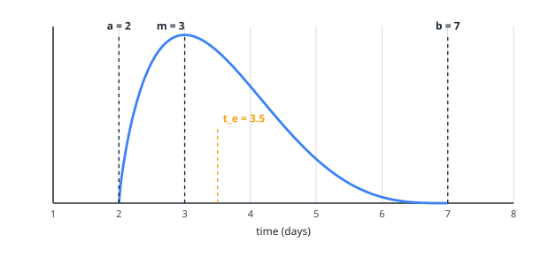

# PERT 1: The Three-Point Estimate

PERT, the program evaluation and review technique, plans a project whose durations are uncertain by giving each activity three time estimates instead of one.

## Before you start
<!-- bite: 4a0fa0eb-ae7e-4846-a71c-bf607be3144e -->

You should have read [[planning-and-scheduling/16-critical-path-method-4|16 — Critical Path Method 4]]. You need the idea of an average; standard deviation is explained here.

After this lesson you will be able to:

1. say what PERT adds to CPM and where it came from;
2. define the optimistic, most likely and pessimistic times;
3. compute an activity's expected time, standard deviation and variance;
4. sketch the beta distribution with a, m and b marked.

## What PERT is
<!-- bite: 39012799-84e8-441a-9a7a-74f2026eea1b -->

CPM gave every fence activity one number. "Erect fence: 3 days." But ask the builder honestly and you get something like: "If everything goes well, 2 days. Most likely 3. If it rains or the wood is warped, could be 7." One number throws that away.

PERT keeps it. It was built by the US Navy in 1958 for the Polaris missile programme, a project so new that nobody could give one confident duration for anything. It gives each activity three times, works out an average and a spread from them, and then (next lesson) answers the question CPM can't: what is the chance we finish by a given date?

## The three estimates
<!-- bite: 8cb7debc-a3b0-4ee7-b73d-0bf3215806bc -->

Asked every year, for 5 to 8 marks, usually with "include a diagram".

1. **Optimistic time (a)**: This is how long the activity takes if things go well. For erecting the fence: 2 days.
2. **Most likely time (m)**: This is the best single estimate, the time it takes most often. For the fence: 3 days.
3. **Pessimistic time (b)**: This is how long it takes if things go badly (but not a disaster). For the fence: 7 days.

## The beta distribution
<!-- bite: 31a2bd05-ca9d-41b5-8b3f-a42187dea56f -->

PERT assumes an activity's duration follows a **beta distribution**: a curve that starts at a, peaks over m, and ends at b. It is usually **skewed**, because things can go much more wrong than they can go right. The fence can't be built in less than 2 days, but it can easily take 7.

To draw it in the exam: a time axis, a hump with a on the far left, b on the far right, m under the peak, and the expected time marked just to the right of m when the curve leans right.

## The expected time
<!-- bite: 722e5b86-45d5-4511-8e35-5a7b938b01d9 -->

**The expected time is a weighted average of the three estimates: the most likely time counts four times, the other two once each, and you divide by the total weight of six.**

$$t_e = \frac{a + 4m + b}{6}$$

For the fence: $t_e = (2 + 4 \times 3 + 7)/6 = 21/6 =$ **3.5 days**. It is more than $m$, because b is far out to the right and pulls the average with it. That's the skew showing up in the number.

## The spread: standard deviation and variance
<!-- bite: a818e1f1-623c-4a20-9077-9d98a3123a04 -->

**PERT treats the whole range from a to b as six standard deviations**, so one standard deviation is a sixth of the range.

$$\sigma = \frac{b - a}{6}, \qquad V = \sigma^2 = \left(\frac{b - a}{6}\right)^2$$

Here σ (sigma) is the **standard deviation**, a measure of how spread out the likely durations are, and V is the **variance**, its square.

For the fence: σ = (7 − 2) / 6 = 0.833 days and V = 0.694. A bigger variance means the expected time is less reliable: the activity might come in far from 3.5. An activity with a = m = b has variance 0; it is certain.

## Reading the columns: a warning
<!-- bite: 5fde3abf-20d7-472a-9023-f10f92dce472 -->

Papers label the three columns differently. Some write a, m, b; others o, m, p; the 2024/25 e-library question labels them a, b, C. Assignment 2 even gives them in the order a, b, m.

Remember this one: whatever the labels, **the smallest number is optimistic, the middle is most likely and the largest is pessimistic**. If the headings confuse you, sort each row by size, and say in your answer that you did.

Each activity now has a mean and a variance. Next lesson adds them up along the critical path and turns them into a probability of finishing on time.

## Common pitfalls
<!-- bite: 38d0fe68-f69c-4db8-b86d-7c9442f54e6c -->

1. **Dividing by 3 instead of 6.** The weights are 1, 4 and 1, which add to 6.
2. **Forgetting to square for the variance.** σ = (b − a)/6; V is its square.
3. **Drawing a symmetric bell.** PERT's beta is usually skewed right, with $t_e$ to the right of m.
4. **Trusting the column labels.** Sort by size.

## Check your understanding
<!-- bite: 54d294df-b3c2-4853-9c19-3531ff70c2e3 -->

Try each one before you open the answer.

1. <!-- q: exact id="6d3f1a92" answer="6" -->
   An activity has a = 2, m = 5 and b = 14 days. What is its expected time?

   

Answer

   6 days: (2 + 20 + 14) / 6 = 36 / 6.

   

2. <!-- q: exact id="b0e94c28" answer="4" -->
   An activity has a = 2, m = 5 and b = 14 days. What is its variance?

   

Answer

   4: σ = (14 − 2) / 6 = 2, and V = 2² = 4.

   

3. <!-- q: exact id="3a8c6e15" answer="5.5" -->
   A table's columns read "a, b, m" and one row says 4, 9, 5 (weeks). What is the expected time?

   

Answer

   5.5 weeks. Sorted by size: optimistic 4, most likely 5, pessimistic 9. $t_e = (4 + 20 + 9)/6 = 33/6 = 5.5$.

   

4. <!-- q: mcq id="f27b5d03" -->
   An activity has a = 3, m = 4, b = 11. Where does its expected time sit?

   - [ ] Exactly at m
   - [ ] To the left of m
   - [x] To the right of m, because b is far from m
   - [ ] Exactly halfway between a and b

   

Answer

   To the right: $t_e = (3 + 16 + 11)/6 = 5$, above $m = 4$, because the long tail towards b pulls the average up.

   

5. <!-- q: sketch id="9e1c4a7b" -->
   Sketch the PERT duration curve for an activity with a = 2, m = 3 and b = 7 days, marking a, m, b and the expected time.

   

Answer

   

   What to check:
   - a time axis, with the curve starting at 2 and ending at 7;
   - the peak above 3;
   - a long tail on the right, so the curve is skewed;
   - the expected time 3.5 marked just right of the peak.

   

## Before moving on
<!-- bite: 46a17663-c59f-478e-b7ed-93d9546cf417 -->

You can compute $t_e$, $\sigma$ and $V$ and draw the beta curve. **Next:** [[planning-and-scheduling/18-pert-2|18 — PERT 2: The Chance of Finishing on Time]].

## Related
<!-- bite: 505f8453-aacd-44fc-a5a1-ebddf647a8b7 -->

- [[planning-and-scheduling/index|Planning and scheduling map]]

## About this lesson
<!-- bite: 995cf275-61fd-4abd-a643-83a61703d41b -->

**Level:** Intermediate. **Covers:** why PERT exists, the three estimates, the beta distribution, expected time, standard deviation and variance, and reading mislabelled columns.

**Where it sits:** lesson 17 of 35, in part 5 (PERT). Part 1 of 4 on PERT.

**Source:** the author's own SSG 513 study notes, section 5. The fence's three estimates are added for this lesson. The curve comes from `scripts/diagrams/planning_scheduling.py`.
