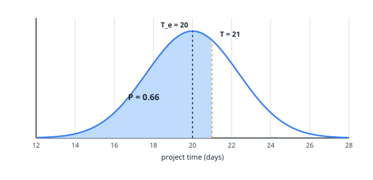

# PERT 2: The Chance of Finishing on Time

With PERT, the project's expected time and variance come from adding up the critical path's activities, and a Z score turns any deadline into a probability of finishing by it.

## Before you start
<!-- bite: 7856a972-0a83-4a60-86b8-df686b524e75 -->

You should have read [[planning-and-scheduling/17-pert-1|17 — PERT 1]].

After this lesson you will be able to:

1. follow the four steps of a PERT problem;
2. find a project's expected time and its variance from the critical path;
3. turn a target date into a Z score and read off the probability;
4. solve the PERT question that has appeared in three papers.

## What this lesson does
<!-- bite: f1c2b8a4-cdb6-4968-9a70-dde7dfa09b93 -->

Last lesson gave each activity a mean and a variance. Now the owner asks: "What's the chance the whole thing is done in 21 days?" To answer, we treat the project's finish time as uncertain too, find its mean and spread, and ask how far 21 days sits from the mean.

## The four steps
<!-- bite: f84ba77a-f765-4b63-ae4f-22d5e280fecc -->

1. **Compute t_e and the variance for every activity**, with lesson 17's formulas.
2. **Run CPM using the t_e values as durations.** This gives the expected project time T_e and the critical path.
3. **Add up the variances of the critical-path activities only.** Call it V_p. Its square root is the project's standard deviation.
4. **Turn the target time T into a Z score and read the probability** from the normal table.

Step 3 is where people go wrong: add the variances, never the standard deviations, and only along the critical path.

## The formulas in words
<!-- bite: c8b9a48a-9587-44c9-9028-3862479e0929 -->

**The project's expected time is the sum of the expected times along the critical path, and its variance is the sum of their variances.** The Z score is how many standard deviations the target is above the expected time.

$$T_e = \sum t_e, \quad V_p = \sum V \quad \text{(critical path only)}, \qquad Z = \frac{T - T_e}{\sqrt{V_p}}, \qquad P(\text{finish by } T) = \Phi(Z)$$

Here Φ(Z) is the value read from the normal table. Values worth having ready:

1. Z = 0.5 gives 0.6915.
2. Z = 1.0 gives 0.8413.
3. Z = 1.28 gives 0.8997.
4. Z = 1.64 gives 0.9495.
5. Z = 1.96 gives 0.9750.

For a negative Z, use 1 minus the value for the positive Z. Z = 0 gives exactly 0.5: a 50% chance of finishing by the expected time.

## The worked example: the data
<!-- bite: f867ce16-5d21-4853-bdd0-cff19524950f -->

This question appears in 2019/20, 2023/24 and in the slides. Ten activities, days:

| Activity | A | B | C | D | E | F | G | H | I | J |
| --- | --- | --- | --- | --- | --- | --- | --- | --- | --- | --- |
| After | - | A | A | A | B | C | D | C, G | E | F, I, H |
| a | 1 | 1 | 2 | 1 | 2 | 4 | 1 | 2 | 4 | 3 |
| m | 2 | 1 | 6 | 4 | 2 | 5 | 3 | 8 | 6 | 3 |
| b | 3 | 1 | 10 | 7 | 2 | 6 | 5 | 14 | 8 | 3 |
| t_e | 2 | 1 | 6 | 4 | 2 | 5 | 3 | 8 | 6 | 3 |
| V | 0.111 | 0 | 1.778 | 1.0 | 0 | 0.111 | 0.444 | 4.0 | 0.444 | 0 |

## Steps 1 and 2: the critical path
<!-- bite: 88829b43-c2b8-4339-b0e3-5425d7efb453 -->

Step 1 is the bottom two rows of the table. For H: t_e = (2 + 32 + 14) / 6 = 8 and V = (12/6)² = 4.

Step 2, run CPM on the t_e values. With four paths, list them:

1. A-B-E-I-J = 2 + 1 + 2 + 6 + 3 = 14
2. A-C-F-J = 2 + 6 + 5 + 3 = 16
3. A-C-H-J = 2 + 6 + 8 + 3 = 19
4. A-D-G-H-J = 2 + 4 + 3 + 8 + 3 = **20**

The critical path is **A-D-G-H-J**, and T_e = **20 days**.

## Step 3: the project's spread
<!-- bite: 6771ef3f-1149-4278-b3f5-4b89e8a92111 -->

Add the variances of A, D, G, H and J only:

V_p = 0.111 + 1.0 + 0.444 + 4.0 + 0 = **5.556**

So the project's standard deviation is √5.556 = **2.357 days**.

## Step 4: three probabilities
<!-- bite: 7fe445c5-7d49-40ee-81b3-6240524d3f41 -->

**Finish in 21 days?** Z = (21 − 20) / 2.357 = 0.42, so P = Φ(0.42) = **0.66**, about 66%.

**Finish in 20% more than expected?** That is 1.2 × 20 = 24 days. Z = (24 − 20) / 2.357 = 1.70, so P = **0.955**, about 95.5%.

**Finish in 50% more than expected?** That is 30 days. Z = 10 / 2.357 = 4.24, off the end of the table, so P is **about 1**: practically certain.

Notice what the first answer says. Even one day more than expected gives only a 66% chance. Planning to the expected time is planning to a coin toss.

## Common pitfalls
<!-- bite: e97fb336-38a1-4720-80ee-68376d7c553c -->

1. **Adding all the variances.** Only the critical path's.
2. **Adding standard deviations.** Add variances, then take the square root once.
3. **Forgetting the square root in Z.** Divide by √V_p, not V_p.
4. **Reading a negative Z as positive.** For T below T_e the probability is under 0.5.

That covers the classic question. The next lesson handles the variations: when other paths matter too, and how to find the date for a given confidence.

## Check your understanding
<!-- bite: b3847dbc-4ad8-40ed-b191-baaaf3be0a6d -->

Try each one before you open the answer.

1. <!-- q: exact id="1e7d4b90" answer="0.8413" sigfigs="2" -->
   A project's critical path has expected time 30 days and variance 9. What is the probability of finishing within 33 days?

   

Answer

   0.8413. σ = 3, Z = (33 − 30) / 3 = 1, and Φ(1) = 0.8413.

   

2. <!-- q: exact id="c4a29f61" answer="0.1587" sigfigs="2" -->
   A project's critical path has expected time 30 days and variance 9. What is the probability of finishing within 27 days?

   

Answer

   0.1587. Z = (27 − 30) / 3 = −1, so P = 1 − 0.8413.

   

3. <!-- q: exact id="8b52e0d3" answer="5" -->
   A critical path has three activities with standard deviations 3, 4 and 0 days. What is the project's standard deviation?

   

Answer

   5 days. Add the variances: 9 + 16 + 0 = 25, then take the square root. Adding the standard deviations (7) is wrong.

   

4. <!-- q: mcq id="5f0c3a7e" -->
   A project has expected time 40 days. What is the chance of finishing within exactly 40 days?

   - [ ] 0
   - [x] 0.5
   - [ ] 0.8413
   - [ ] 1

   

Answer

   0.5. Z = 0, which sits in the middle of the normal curve.

   

5. <!-- q: open id="d96e1b24" -->
   Why are only the critical path's variances added to get the project variance?

   

Answer

   Because the project's finish is taken to be set by the critical path, so its uncertainty is the uncertainty of the activities on that path. Activities off the path have float, so their variation is assumed not to reach the finish. (This assumption fails when another path is nearly as long, which is the next lesson.)

   

## Before moving on
<!-- bite: 830bba8e-7d0a-4236-9131-1a0c38ee58db -->

You can solve a full PERT probability question. **Next:** [[planning-and-scheduling/19-pert-3|19 — PERT 3: All Paths and Deadlines for a Given Confidence]].

## Related
<!-- bite: 53574a84-e715-4d4b-b0c6-6dbf39b5895d -->

- [[planning-and-scheduling/index|Planning and scheduling map]]

## About this lesson
<!-- bite: aae19187-4742-4ec9-a813-a79c5b064fb8 -->

**Level:** Intermediate. **Covers:** the four steps, T_e and V_p, Z scores, and the A to J question from three papers.

**Where it sits:** lesson 18 of 35, in part 5 (PERT). Part 2 of 4 on PERT.

**Source:** the author's own SSG 513 study notes, section 5. The curve comes from `scripts/diagrams/planning_scheduling.py`, which also checks every number.
