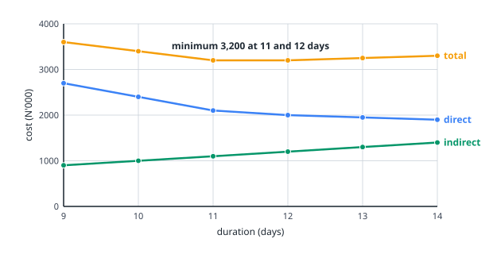

# Crashing 3: A Software Project, Step by Step

This lesson crashes a seven-activity software project day by day, through two and then three tied critical paths, and builds the full table of cost against duration.

## Before you start
<!-- bite: 17fdffe0-d74a-4f0c-b6dc-b35752f3bd54 -->

You should have read [[planning-and-scheduling/23-crashing-2|23 — Crashing 2]].

After this lesson you will be able to:

1. crash a larger network through several ties;
2. build the table of direct, indirect and total cost at each duration;
3. find the minimum-cost duration and compare it with normal and full crash.

## What this example is
<!-- bite: a0de2331-8f38-4287-9da0-fba277dbff31 -->

The 2023/24 paper (Question 1) is the biggest crashing question in the past papers, worth about 20 marks. Costs are in thousands of naira, and the fixed cost is taken as N100 thousand **per day** (see the note at the end).

| Activity | After | Tn | Tc | Cn | Cc | Slope per day |
| --- | --- | --- | --- | --- | --- | --- |
| A | - | 5 | 4 | 100 | 200 | 100 |
| B | A | 3 | 2 | 300 | 350 | 50 |
| C | A | 2 | 1 | 200 | 325 | 125 |
| D | B, C | 2 | 1 | 250 | 300 | 50 |
| E | C | 1 | 1 | 400 | 400 | cannot crash |
| F | D | 4 | 2 | 500 | 900 | 200 |
| G | E | 4 | 2 | 150 | 350 | 100 |

## The normal plan
<!-- bite: add8cea0-c147-4090-bb54-89bd077a5dda -->

1. **Normal direct cost**: 100 + 300 + 200 + 250 + 400 + 500 + 150 = **N1,900k**.
2. **Paths**: A-B-D-F = 5 + 3 + 2 + 4 = **14**; A-C-D-F = 13; A-C-E-G = 12.
3. **Critical path**: A-B-D-F, normal duration **14 days**.
4. **Normal total cost**: 1,900 + 100 × 14 = **N3,300k**.

## Days 1 and 2
<!-- bite: 7d132c31-43e3-49ca-bcb3-4672eb4756b1 -->

**Day 1.** Critical: A, B, D, F with slopes 100, 50, 50, 200. B and D tie at 50; take B. Crash B by one day (B is now at its crash time, 2).

Paths now: A-B-D-F = 13, A-C-D-F = 13, A-C-E-G = 12. **Two critical paths.** Total = 1,950 + 1,300 = N3,250k.

**Day 2.** Both 13-day paths must shorten. D lies on both, at 50. Crash D by one day (D is now at its crash time, 1).

Paths now: 12, 12, 12. **All three paths are critical.** Total = 2,000 + 1,200 = **N3,200k**.

## Days 3 to 5
<!-- bite: 81ef348a-02c9-42ca-9b18-929acf88046b -->

Pause and predict: with all three paths tied, what is the cheapest way to save another day?

**Day 3.** A lies on all three paths, at 100. Crash A by one day. Total = 2,100 + 1,100 = **N3,200k**. The day cost 100 and saved 100: it only breaks even.

**Day 4.** A is at its limit (4), and B and D are too. Path A-B-D-F can now only shorten through F (200). Path A-C-E-G needs G (100), or C (125) which also shortens A-C-D-F. Cheapest: F + G = 300 for one day. Total = 2,400 + 1,000 = N3,400k.

**Day 5.** The same again, F + G = 300. F and G are now both at their crash times. Total = 2,700 + 900 = N3,600k. Nothing on A-B-D-F can shorten any further, so **9 days is the shortest possible**.

## The cost table
<!-- bite: 21179117-bd15-4690-b2de-405913b34286 -->

| Duration (days) | Direct (N'000) | Indirect at 100/day | Total (N'000) |
| --- | --- | --- | --- |
| 14 (normal) | 1,900 | 1,400 | 3,300 |
| 13 | 1,950 | 1,300 | 3,250 |
| **12** | 2,000 | 1,200 | **3,200** |
| **11** | 2,100 | 1,100 | **3,200** |
| 10 | 2,400 | 1,000 | 3,400 |
| 9 (full crash) | 2,700 | 900 | 3,600 |

## Reading the result
<!-- bite: 514bceab-67a1-499d-85e2-ef7c014a5ad2 -->

1. **The minimum total cost is N3,200k**, at 12 days (11 days costs the same).
2. **Full crash costs N3,600k**, N400k more than the minimum and N300k more than doing nothing. The fastest plan is not the cheapest plan.
3. **"Crash all" versus "crash what's needed".** Putting every activity at its crash time costs N2,825k direct. But C doesn't need crashing to reach 9 days, so the cheapest way to get 9 days costs N2,700k. If the paper asks for the "all crashed" cost, give N2,825k and add this point.

## The assumption to state
<!-- bite: 516e2e68-b54c-471f-8652-aaa0de3184e2 -->

The paper says "fixed cost of N100,000" without "per day". If it were a one-off lump sum, the normal total would be just 1,900 + 100 = N2,000k and crashing would never pay, since no overhead is saved. That would make the time-cost part pointless, so it is read as per day here. Write your reading in your answer.

That's crashing done: time traded for money. Part 7 turns to the other thing every plan so far has taken for granted, the workers and machines.

## Common pitfalls
<!-- bite: 42763e7b-b469-41e7-aaea-b09c4383179c -->

1. **Crashing B and then crashing B again past its limit.** Check Tc before each day.
2. **Missing the three-way tie.** After day 2 every path is 12, so day 3 must shorten all three.
3. **Calling 11 days "worse" than 12.** They cost the same; say both.

## Check your understanding
<!-- bite: c6143a16-9395-4c8c-ab6b-87890a5b4300 -->

Try each one before you open the answer.

1. <!-- q: exact id="5e9a3f02" answer="2400" accept="2,400" -->
   A project's direct cost is N1,800k at its normal 12 days. Indirect cost is N50k per day. What is its normal total cost, in thousands of naira?

   

Answer

   2,400: 1,800 + 50 × 12.

   

2. <!-- q: exact id="b27d0c84" answer="150" -->
   Three paths are tied as critical. Activity P (slope 150) lies on all three. Q (slope 60) lies on path 1 only, R (slope 40) on path 2 only and S (slope 70) on path 3 only. What is the cheapest cost to cut one day off the project?

   

Answer

   150, by crashing P. Crashing Q, R and S together would cost 60 + 40 + 70 = 170.

   

3. <!-- q: mcq id="f4c1e826" -->
   A crash table shows totals of 3,300, 3,250, 3,200, 3,200, 3,400 and 3,600 for durations 14 down to 9. What should you report?

   - [ ] 9 days, because it is fastest
   - [x] The minimum total cost, 3,200, at 12 or 11 days
   - [ ] 14 days, because it has the lowest direct cost
   - [ ] 10 days, the middle value

   

Answer

   The minimum total is 3,200, reached at both 12 and 11 days.

   

4. <!-- q: open id="0c6d8a39" -->
   A paper says "fixed cost of N100,000" with no "per day". Why does the reading matter for a crashing question?

   

Answer

   If it is per day, every day cut saves N100,000 of overhead, so crashing can lower the total cost and there is a real minimum to find. If it is a one-off sum, shortening the project saves nothing, so crashing only adds cost and the normal plan is always cheapest. State which reading you use.

   

## Before moving on
<!-- bite: b697e823-8335-43e1-b9bf-93d3ee0651ab -->

You can crash a network through several ties and build the full cost table. **Next:** [[planning-and-scheduling/25-resources-1|25 — Resources 1: Allocation, Loading, Scheduling and Workload]].

## Related
<!-- bite: ed9d7bbd-1546-4c43-a349-0e807777546c -->

- [[planning-and-scheduling/index|Planning and scheduling map]]

## About this lesson
<!-- bite: 670e2951-5d6a-4b0a-98c6-f712edbb7548 -->

**Level:** Intermediate to advanced. **Covers:** the 2023/24 software crashing question in full: normal plan, day-by-day crashing, the cost table and the per-day assumption.

**Where it sits:** lesson 24 of 35, in part 6 (crashing). Part 3 of 3 on crashing.

**Source:** the author's own SSG 513 study notes, section 6 (worked example 2). The chart comes from `scripts/diagrams/planning_scheduling.py`, which reruns the crashing and checks every row.
