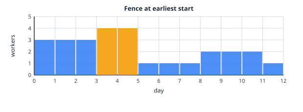

# Resources 1: Allocation, Loading, Scheduling and Workload

A resource is anything an activity needs besides time, such as workers, machines or materials.

## Before you start
<!-- bite: 81dca59d-a2bb-4c3b-82bb-81743eeb3bd7 -->

You should have read [[planning-and-scheduling/14-critical-path-method-2|14 — Critical Path Method 2]].

After this lesson you will be able to:

1. define resource allocation, resource loading, resource scheduling and workload;
2. draw a resource loading histogram from a schedule;
3. work out the workload of a team from days and hours.

## What changes when resources come in
<!-- bite: b7a6b4be-b44c-46ba-9e5b-3b416823ba6c -->

Everything so far assumed the workers are always there. CPM said the fence takes 12 days, but it never asked how many people are on site each day. Suppose the builder has only three workers. Is the 12-day plan even possible?

That's why the notes put it bluntly: **a network with times is not yet a schedule until resources are assigned.** This part is where the plan meets reality. It also carries the longest questions in the 2019/20 and 2020/21 papers.

## Four short notes
<!-- bite: 101bd160-1ae3-47fb-8e7d-dfdfefa7e717 -->

Asked every year, about 2 marks each.

1. **Resource allocation**: This is assigning the required resources to each activity, in the right amount and at the right time. Two workers to dig the holes, from day 0 to day 3.
2. **Resource loading**: This is the amount of a resource the project needs, activity by activity and period by period. It changes through the project, and plotting it gives a resource profile, usually drawn as a histogram.
3. **Resource scheduling**: This is fixing the start and finish times of activities so that resource limits are respected, or so that the demand is as even as possible.
4. **Workload**: This is the total work a resource does, taken as the time worked multiplied by the hours per day. It is measured in person-hours (or person-days).

## The fence's resource loading
<!-- bite: f9e8dfeb-3c19-4036-8fc6-78442d03b30d -->

Give each fence activity a number of workers: A Dig holes 3, B Buy wood 2, C Buy gate 2, D Erect fence 1, E Buy paint 2, F Erect gate 2, G Paint fence 2, H Paint gate 1. (Buying means two people go to the market and carry it back.)

Now put every activity at its earliest start from lesson 13 and add up the workers on site each day:

1. **Days 0 to 3**: only A, so 3 workers.
2. **Day 3 to 4**: B and C together, 2 + 2 = **4**.
3. **Day 4 to 5**: B and E together, 2 + 2 = **4**.
4. **Days 5 to 8**: only D, 1 worker.
5. **Days 8 to 12**: F, then G, then H: 2, 2, 2, then 1.

## The loading histogram
<!-- bite: 719a4647-ba86-4e2f-8489-e0bd0db7d5ff -->

The histogram shows what the network couldn't: the plan needs **4 workers** on days 3 to 5, then drops to **1** for three days. If the builder has only three people, this plan is impossible as drawn. If they hire a fourth for the whole job, that person stands idle most of the time. Either way, the uneven profile costs money. Lessons 26 and 27 are about fixing that.

## Workload: a worked example
<!-- bite: 4826a950-21c8-4d04-8467-18280ca4bc44 -->

The 2024/25 paper (Question 5b): Josiah worked 6 days at 8 hours a day. Oluwatobi and Ginika worked 2 hours a day less than Josiah, for 4 and 5 days. Jesuseun worked half of Josiah's daily hours, for 3 days.

First turn the words into hours per day: Oluwatobi and Ginika 8 − 2 = 6; Jesuseun 8 ÷ 2 = 4. Then multiply.

| Person | Days | Hours per day | Workload (hours) |
| --- | --- | --- | --- |
| Oluwatobi | 4 | 6 | 24 |
| Jesuseun | 3 | 4 | 12 |
| Ginika | 5 | 6 | 30 |
| Josiah | 6 | 8 | 48 |
| **Total** | | | **114** |

The 2019/20 version uses other names and says "Stephen works for half the time Mohammed worked", which clashes with the line before it. Read your paper carefully and write down which reading you used.

## Common pitfalls
<!-- bite: 9edd3bdc-ff74-4717-9105-9d28e95eb150 -->

1. **Calling a CPM network a schedule.** Without resources it is only a time plan.
2. **Mixing loading and allocation.** Allocation assigns resources to activities; loading is the total demand per period.
3. **Multiplying before converting.** Turn "2 hours less" or "half" into hours per day first.

## Check your understanding
<!-- bite: b752f370-4491-47e5-84da-258aee30743c -->

Try each one before you open the answer.

1. <!-- q: exact id="7d2f9e40" answer="88" -->
   Ada works 5 days at 8 hours a day. Bayo works 2 hours a day less than Ada, for 4 days. Chidi works half of Ada's daily hours, for 6 days. What is the team's total workload in hours?

   

Answer

   88. Ada 5 × 8 = 40; Bayo 4 × 6 = 24; Chidi 6 × 4 = 24.

   

2. <!-- q: mcq id="c0e5a816" -->
   "The number of welders the project needs in each week" describes which term?

   - [ ] Resource allocation
   - [x] Resource loading
   - [ ] Workload
   - [ ] Resource smoothing

   

Answer

   Resource loading: the demand for a resource, period by period.

   

3. <!-- q: exact id="4a9b1d73" answer="5" -->
   At their earliest starts, activity P (needs 3 workers) runs days 0 to 4, Q (needs 2) runs days 2 to 5, and R (needs 1) runs days 4 to 6. What is the peak number of workers needed on any day?

   

Answer

   5. Days 2 to 4 have P and Q: 3 + 2 = 5. Days 4 to 5 have Q and R: 3.

   

4. <!-- q: open id="e81c3f05" -->
   Explain why a network with activity times is "not yet a schedule".

   

Answer

   CPM assumes every resource is available whenever an activity wants to start. Real projects have a limited number of workers and machines, so some activities in the time plan may need more resources at once than exist. Only when resources are assigned and the plan respects their limits is it a schedule that can actually be carried out.

   

## Before moving on
<!-- bite: b7d20809-f131-4d03-9f57-24460248ff42 -->

You can define the four terms, draw a loading histogram and compute a workload. **Next:** [[planning-and-scheduling/26-resources-2|26 — Resources 2: Kinds of Resource and Why They Constrain the Schedule]].

## Related
<!-- bite: b579fe0c-4f9a-428f-a4ee-5a8d48e08e14 -->

- [[planning-and-scheduling/index|Planning and scheduling map]]

## About this lesson
<!-- bite: 65d3c9d4-c6a1-47a5-b98f-bd3464e0fadd -->

**Level:** Intermediate. **Covers:** resource allocation, loading, scheduling and workload, the fence's loading histogram, and the 2024/25 workload question.

**Where it sits:** lesson 25 of 35, in part 7 (resources). Part 1 of 7 on resources.

**Source:** the author's own SSG 513 study notes, section 7. The fence's worker numbers are added for this lesson. The histogram comes from `scripts/diagrams/planning_scheduling.py`.
