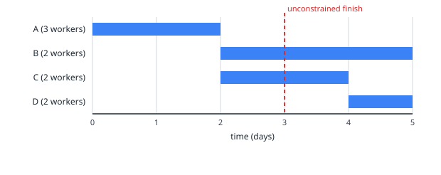

# Brooks' Algorithm 1: Serial Priority Scheduling

Brooks' algorithm builds a schedule by starting, at each moment, the highest-priority ready activities the free resources can cover.

## Before you start
<!-- bite: a2b4177d-0ba0-4305-a609-ebad4e3e1f15 -->

You should have read [[planning-and-scheduling/29-priority-rules-2|29 — Priority Rules 2]].

After this lesson you will be able to:

1. follow the five steps of Brooks' algorithm;
2. read the columns of an exam's Brooks table;
3. schedule a small project by hand and compare it with the unconstrained time.

## What Brooks' algorithm is
<!-- bite: ddc819f4-1078-4e4b-8ba1-4c13c39056e2 -->

Priority rules give each activity a score. That alone isn't a schedule. Brooks' algorithm is the procedure that turns scores into start times. It is called **serial** because it schedules one decision point at a time, moving forward through the project like a clock.

The idea in one line: whenever something finishes and frees resources, look at what's ready, and start the most important things that fit.

## The five steps
<!-- bite: 6da474c0-d43e-4f23-b6ca-afdf5a5f1fe7 -->

1. **Rank the activities** by priority (for the exam, by scaled CAF).
2. **Start the clock at time 0.** List the activities whose predecessors are all finished.
3. **Go down that list in priority order.** Start an activity now if there is enough of **every** resource it needs left; otherwise hold it back.
4. **Move the clock to the next moment an activity finishes.** That releases its resources. Go back to step 2.
5. **Stop when every activity is scheduled.** The finish of the last one is the project time.

Step 3 has a subtlety: if a high-priority activity doesn't fit, you don't stop. You carry on down the list, and a lower-priority activity that does fit can start.

## The table columns
<!-- bite: 5f8785c8-d6f7-4053-8a86-af5cf64f0991 -->

Exam tables use these column names. In plain words:

1. **TNOW**: the clock time of this step.
2. **TEARL**: an activity's earliest start from the logic alone (when its predecessors finish).
3. **TSCHED**: the time it was actually scheduled to start.
4. **TFIN**: when it finishes, TSCHED plus its duration.
5. **Resources available**: what is free at TNOW, before and after each start.
6. **Activities allowed**: the ready list at TNOW, in priority order.
7. **Iteration number**: which step this is.

TSCHED can be later than TEARL. The gap is the delay caused by resources, not logic.

## A small example: the data
<!-- bite: 66e2be3c-a704-4c76-a4a7-640cb65ce554 -->

Four activities and one resource: 4 workers.

1. **A**: 2 days, 3 workers, no predecessor. Priority 4 (highest).
2. **B**: 3 days, 2 workers, no predecessor. Priority 3.
3. **C**: 2 days, 2 workers, no predecessor. Priority 2.
4. **D**: 1 day, 2 workers, after A. Priority 1.

Without the worker limit, A, B and C start together, D follows A, and the project takes max(2 + 1, 3, 2) = **3 days**.

## The example, step by step
<!-- bite: aaeda530-b5c5-42b2-96e4-7d34870cf9f8 -->

**TNOW = 0.** Ready: A, B, C. Free: 4.
1. A needs 3: fits. Start A (0 to 2). Free: 1.
2. B needs 2: doesn't fit. Hold.
3. C needs 2: doesn't fit. Hold.

**TNOW = 2** (A finishes). Free: 4. Ready: B, C, D.
1. B needs 2: fits. Start B (2 to 5). Free: 2.
2. C needs 2: fits. Start C (2 to 4). Free: 0.
3. D needs 2: doesn't fit. Hold.

**TNOW = 4** (C finishes). Free: 2. Ready: D. D fits: start D (4 to 5). Free: 0.

**TNOW = 5.** B and D finish. Everything is scheduled. Project time: **5 days**.

## The schedule as a picture
<!-- bite: e575a259-91e1-4c05-a4e3-fc7859a71f1b -->

The worker limit stretched the project from 3 days to 5. B and C had to wait for A to release its 3 workers, and D waited for C. Look at D: its TEARL was 2 (A finished at 2), but its TSCHED was 4. Those 2 days are pure resource delay.

The next lesson runs the same procedure on the eight-task, two-resource exam question from lesson 29.

## Common pitfalls
<!-- bite: 1ea856ae-d653-4aa4-9a71-77c5a64a9977 -->

1. **Stopping at the first activity that doesn't fit.** Keep going down the list.
2. **Checking only one resource type.** An activity needs enough of **every** type.
3. **Forgetting to release resources** when an activity finishes.
4. **Jumping the clock by one day.** Jump to the next finish time, which may be a decimal like 4.33.

## Check your understanding
<!-- bite: adb1b318-2296-450a-aa5f-766e085b03ad -->

Try each one before you open the answer.

1. <!-- q: exact id="5d8b2e6f" answer="5" -->
   One resource: 5 workers. P (3 days, 4 workers, priority 1st), Q (2 days, 3 workers, priority 2nd) and R (3 days, 1 worker, priority 3rd) all have no predecessors. With Brooks' algorithm, when does the project finish?

   

Answer

   Day 5. At 0: P fits (4, free 1); Q needs 3, held; R needs 1, fits (free 0). At 3: P and R finish, free 5; Q starts, runs 3 to 5. Finish 5.

   

2. <!-- q: mcq id="c13a7f40" -->
   At TNOW = 6, the top-priority ready activity needs more workers than are free, but the third one fits. What does the algorithm do?

   - [ ] Waits until the top one fits, starting nothing
   - [x] Holds the top one and starts the third one now
   - [ ] Starts the top one anyway
   - [ ] Moves the clock forward by one day

   

Answer

   It goes down the list and starts anything that fits. The top one waits for the next release.

   

3. <!-- q: exact id="9e04b5a3" answer="3" -->
   In a Brooks table, activity K has TEARL = 4 and TSCHED = 7. How many days of delay were caused by resources rather than logic?

   

Answer

   3: TSCHED − TEARL.

   

4. <!-- q: open id="2f6c8d1e" -->
   Why is Brooks' algorithm called serial?

   

Answer

   Because it builds the schedule one decision point at a time, moving a clock forward from one activity finish to the next, and at each point it decides which ready activities start, in priority order.

   

## Before moving on
<!-- bite: 95752b5b-06ed-4849-a1e6-38d5cedf1228 -->

You can run Brooks' algorithm on a small project and read the table columns. **Next:** [[planning-and-scheduling/31-brooks-algorithm-2|31 — Brooks' Algorithm 2: The 2019/20 Exam Question]].

## Related
<!-- bite: e9be5672-053c-4bee-839c-407daade7893 -->

- [[planning-and-scheduling/index|Planning and scheduling map]]

## About this lesson
<!-- bite: 0aeba522-3fd8-4569-b0c4-9c519bfcc483 -->

**Level:** Intermediate. **Covers:** the five steps, the table columns, and a four-activity example worked step by step.

**Where it sits:** lesson 30 of 35, in part 7 (resources). Part 6 of 7 on resources; part 1 of 2 on Brooks' algorithm.

**Source:** the author's own SSG 513 study notes, section 7. The four-activity example is added for this lesson. The chart comes from `scripts/diagrams/planning_scheduling.py`, which runs the algorithm.
