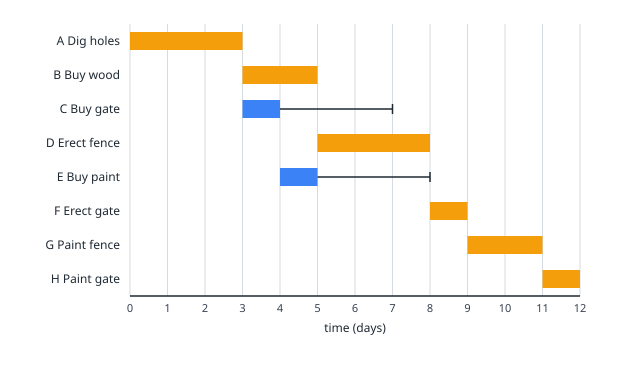
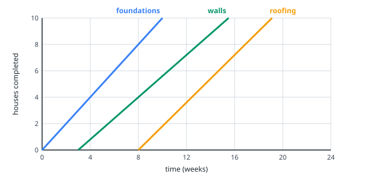
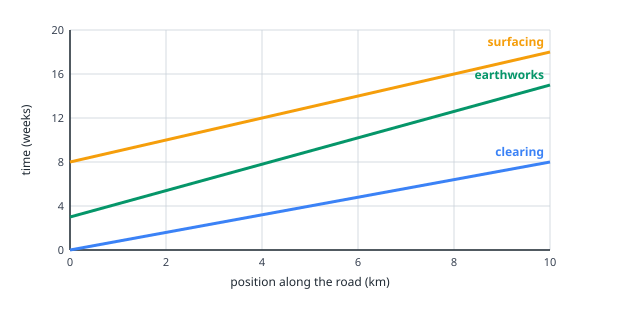
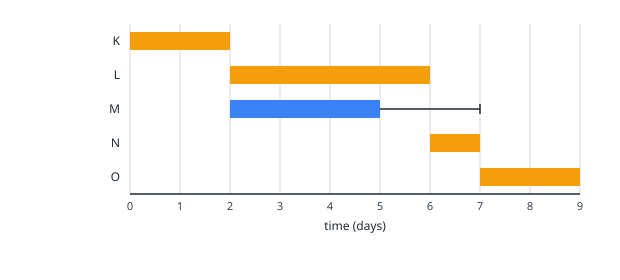

# Bar Charts, Line of Balance and Time-Location Charts

Bar charts, line-of-balance charts and time-location charts are three ways to draw a schedule on a time axis, each suited to a different kind of project.

## Before you start
<!-- bite: a9861c82-42ad-4722-88ce-94aeb3c3d8a2 -->

You should have read [[planning-and-scheduling/14-critical-path-method-2|14 — Critical Path Method 2]].

After this lesson you will be able to:

1. draw a project as a bar (Gantt) chart, with float shown;
2. explain what a line-of-balance chart shows and when to use it;
3. explain what a time-location chart shows and when to use it.

## What these charts are for
<!-- bite: 280bc015-7c9f-4472-b2d0-3fa3c75fa437 -->

A network diagram is good for logic: who waits for whom. It is bad at answering "what's happening on Thursday?" You have to run the passes in your head. The site foreman wants a picture with time running across, so they can see at a glance what should be going on today.

All three charts here put time on one axis. They differ in what goes on the other. Your course outline lists them, but your slides and past papers don't cover them, so this is general knowledge; check against your class notes.

## The bar chart (Gantt chart)
<!-- bite: 381d37bb-bfd8-45a8-9b58-6359bb9998be -->

A bar chart lists the activities down the side and draws each one as a horizontal bar on a time axis, from its start to its finish. It is also called a **Gantt chart**, after Henry Gantt, who made it popular around 1910.

Here is the fence at its earliest start times, with the float shown as a thin line after each bar.

## What a bar chart is good and bad at
<!-- bite: d9e4db67-cb67-4a92-8738-f5f4d41753fe -->

The bar chart is the most used of the three, and it has one big weakness.

1. **Strengths**: easy for anyone to read, and good for progress reporting. Shade each bar as work is done and you see at once who is behind.
2. **Weakness**: it shows dependencies poorly. Looking at the bars, you can't tell that F waits for E as well as D. That's why planners build the network first and then draw the bar chart from it.

## Line of balance
<!-- bite: 95569f2a-7982-401c-83b5-c6df254da496 -->

A line-of-balance chart is for **repetitive** work: many identical units, like 20 houses on an estate or 50 identical fences. It plots the **number of units completed** against time, with one line per trade.

## Reading a line-of-balance chart
<!-- bite: ff850651-fe03-4241-b660-1517f6f2505f -->

Three things on the chart tell you whether the trades are keeping pace.

Read it like this:

1. **The slope of a line** is that trade's rate: houses finished per week. A steep line is a fast crew.
2. **The gap between two lines** is the buffer between trades. If the walls line catches up with the foundations line, the bricklayers are waiting for foundations to be ready.
3. **Balance** means each trade keeps pace with the target rate, so the lines stay roughly parallel and nobody waits.

## Time-location charts
<!-- bite: 712f7336-e10a-422f-8298-b03504582925 -->

A time-location chart (also called a **time-chainage chart**) is for **linear** projects: roads, pipelines, railways, power lines. One axis is the position along the route (in kilometres or chainage); the other is time.

Each crew's work becomes a sloping line as it moves down the road. Its slope is the crew's speed. If two lines **cross**, two crews would be in the same place at the same time: a clash you can see before it happens on site. That is the chart's whole value.

## Which chart for which project?
<!-- bite: 9ef887ff-3110-4ea0-ab00-77d9e4d4160f -->

1. **The fence, a factory upgrade, a software release**: varied, one-off activities. Use a **bar chart**, drawn from the network.
2. **An estate of identical houses**: the same steps repeated per unit. Use a **line of balance**.
3. **A road, pipeline or rail line**: crews move along a route. Use a **time-location chart**.

These charts are views of the master schedule. The next lesson looks at that schedule itself, and at the other schedules that are built from it.

## Common pitfalls
<!-- bite: 1bcab936-96a1-41de-92da-cf77be650294 -->

1. **Using a bar chart to work out logic.** It hides dependencies; use the network for that.
2. **Reading a line-of-balance slope as time taken.** The slope is the rate, units per unit time.
3. **Ignoring crossing lines** on a time-location chart. A crossing is a clash.

## Check your understanding
<!-- bite: df18d33f-ea9d-465d-9358-b711921fca61 -->

Try each one before you open the answer.

1. <!-- q: mcq id="7b20e4c6" -->
   A contractor is laying 40 km of water pipeline with three crews: trenching, pipe-laying and backfilling. Which chart shows best where the crews will be each week?

   - [ ] A bar chart
   - [ ] A line of balance
   - [x] A time-location chart
   - [ ] A WBS

   

Answer

   A time-location chart: a linear project with crews moving along a route.

   

2. <!-- q: mcq id="f19c3a58" -->
   What is the main weakness of a bar chart?

   - [ ] It is hard to read
   - [x] It shows dependencies between activities poorly
   - [ ] It can't show float
   - [ ] It needs special software

   

Answer

   It doesn't make clear which activity waits for which. Float can be shown with a thin line.

   

3. <!-- q: mcq id="4e8d0b13" -->
   On a line-of-balance chart, the roofing line is catching up with the walls line. What does that mean?

   - [ ] The roofers are slower than the bricklayers
   - [x] The roofers are faster and will soon be waiting for walls to finish
   - [ ] The project is ahead of schedule
   - [ ] Nothing, the lines don't relate

   

Answer

   A steeper line is faster; if it closes the gap, the buffer shrinks and the roofers will soon have no walls to roof.

   

4. <!-- q: sketch id="2c9a6f71" -->
   Draw a bar chart for this project, at earliest start, showing float: K 2 days (no predecessor), L 4 days (after K), M 3 days (after K), N 1 day (after L), O 2 days (after M and N).

   

Answer

   

   What to check:
   - K from 0 to 2, then L and M both starting at 2;
   - N from 6 to 7, and O starting at 7, after both M and N;
   - the project ending at day 9;
   - M's float of 2 days shown after its bar, from 5 to 7.

   

## Before moving on
<!-- bite: 715cc4eb-0799-4165-b60e-a980d842858b -->

You can draw a bar chart and say when a line of balance or time-location chart fits better. **Next:** [[planning-and-scheduling/34-the-master-schedule|34 — The Master Schedule]].

## Related
<!-- bite: 20eee56f-ffa8-4cf6-ae87-23133ca91e26 -->

- [[planning-and-scheduling/index|Planning and scheduling map]]

## About this lesson
<!-- bite: ff6766c0-dd5d-4ef7-a93b-3e19d50c5345 -->

**Level:** Beginner to intermediate. **Covers:** bar (Gantt) charts with float, line-of-balance charts and time-location charts, and when to use each.

**Where it sits:** lesson 33 of 35, in part 8 (other planning tools).

**Source:** the author's own SSG 513 study notes, section 8. The slides and past papers don't cover these charts, so the explanations are general knowledge. The estate and road charts are illustrations added for this lesson; all charts come from `scripts/diagrams/planning_scheduling.py`.
