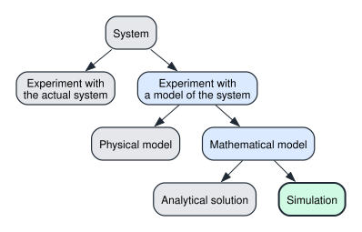

# What Simulation Is

Simulation is running a model of a system over time, so you can watch how the system behaves without touching the real thing.

## Before you start
<!-- bite: 0c788b9d-3ea9-4dca-ad8c-cfe33f55f520 -->

No background is needed. This is the first lesson.

After this lesson you will be able to:

1. say what a system is, and why its value comes from how its parts connect;
2. list the ways to study a system, from experimenting on the real thing to simulating a model;
3. define a model and a simulation in your own words.

## What simulation is
<!-- bite: 3d0f4882-f3fb-4a3c-9c60-d359ed5817e9 -->

Imagine a bank manager who wants to know whether a third teller would cut the queue. She could hire one and see, but that costs money and upsets customers if it goes wrong. Or she could build a model of the bank on a computer, add the teller there, and run a week of customers through it in a few seconds.

That second option is simulation. You build a model of a real or planned system, run experiments on the model, and use what you see to decide what to do with the real system.

This lesson sets up the words the rest of the subject uses: system, model and simulation. Lesson 02 then covers when simulation is worth it and when it isn't.

## What a system is
<!-- bite: dbeb947e-0a20-4857-8af4-bcfcf652892c -->

A **system** is a collection of different elements that together produce results the elements cannot produce on their own.

The elements can be people, hardware, software, facilities, policies and documents. A bank is tellers, customers, a counter, opening hours and a rule that says "first come, first served". None of those serves a customer alone.

The important point is that **the value of the whole comes from the relationships between the parts**, not from the parts by themselves. That is why you can't study a system by studying each part separately: the interesting behaviour, like a queue building up, only appears when the parts work together.

## Ways to study a system
<!-- bite: c2229627-8537-4d36-9b07-98b28833c175 -->

There is a tree of choices for studying a system, and it is a favourite exam question.

1. You can experiment with the **actual system**, or with a **model** of the system.
2. If you use a model, it can be a **physical model** (a prototype or a scale model) or a **mathematical model** (equations and symbols).
3. A mathematical model can be solved by an **analytical solution** (a formula that gives the answer) or by **simulation** (run the model and watch what happens).

Follow the tree from the top. Simulation sits at the bottom right: it is what you fall back on when the formula is too hard to work out, or doesn't exist at all.

## Model and simulation: the definitions
<!-- bite: 17318562-ab38-4eb8-b476-3b51bf23e26c -->

These two words carry the whole subject, so here they are carefully.

1. **Model:** A model is a representation of something, real or imagined, used in place of the real thing to understand it better. To make one you **abstract** the system: you keep the parts that matter for your question and leave out the rest.
2. **Simulation:** A simulation is the imitation of how a real-world process or system operates over a period of time. You can also say it is a way of carrying out a model over time, or an experiment done on a model instead of on the real system.

So the model is the thing you build, and the simulation is what you do with it: you set it running and watch. The bank model is a description of tellers, customers and rules; the simulation is a week of customers arriving, waiting and leaving inside it.

## Example: the bank, through the tree
<!-- bite: a95da26a-a4dd-47e8-9973-6d915ac3cb7c -->

Take the bank manager's question, "will a third teller cut the queue?", and walk it down the tree.

1. **Actual system:** hire a teller for a month and measure. Possible, but slow and costly.
2. **Model:** describe the bank instead.
3. **Physical model:** a scale model of a bank doesn't help here; the question is about time and people, not shape.
## Example: the bank, the mathematical branch
<!-- bite: 445dc473-5d9e-4c59-93eb-9958c8eb17b9 -->

The mathematical model then has two ways forward.

4. **Mathematical model:** customers arrive at some rate, each teller serves at some rate.
5. **Analytical solution:** if arrivals and service follow neat patterns, a queueing formula (lesson 14) gives the average wait directly.
6. **Simulation:** if customers bunch up at lunchtime, some leave when the line is long, and service times are irregular, the formula no longer fits. You run the model and measure the wait.

Real systems are usually messy in exactly that way, which is why simulation is so widely used.

## Common pitfalls
<!-- bite: 38fb4fe2-7b3f-4035-b5bc-c90e2554995b -->

1. **Mixing up model and simulation.** The model is the representation. The simulation is running it over time.
2. **Thinking simulation is the first choice.** If a formula answers the question, use the formula. Simulation is for when the analytical route fails.
3. **Studying parts on their own.** A system's behaviour comes from how the parts connect, so a model must keep those connections.

We know what simulation is. Next lesson asks the practical question: when is it better than just trying things on the real system, and when is it a waste of effort?

## Check your understanding
<!-- bite: db6e52c9-cb13-46b4-986c-da4ee7f4ba16 -->

Try each one before you open the answer.

1. <!-- q: mcq id="e994ccf8" -->
   In the tree of ways to study a system, a mathematical model can be solved in two ways. Which two?

   - [ ] A physical model or a prototype
   - [x] An analytical solution or a simulation
   - [ ] An experiment or a survey
   - [ ] A scale model or a drawing

   

Answer

   An analytical solution (a formula) or a simulation (running the model). Physical models and prototypes are the other branch, under "model".

   

2. <!-- q: gap id="7e200114" answers="model;simulation" -->
   A ___ is a representation of a system used in place of the real thing. A ___ is the imitation of how that system operates over a period of time.

   

Answer

   Model, then simulation. The model is what you build; the simulation is running it over time.

   

3. <!-- q: mcq id="55ffb6b4" -->
   A hospital wants to know how long patients wait in its emergency department. Arrivals bunch up in the evening, some patients leave before being seen, and treatment times vary a lot. Which route on the tree fits best?

   - [ ] Experiment on the actual system by closing a ward
   - [ ] A physical scale model of the building
   - [ ] An analytical formula
   - [x] A simulation of a mathematical model

   

Answer

   Simulation. Bunched arrivals, patients leaving and irregular treatment times break the neat assumptions a formula needs, and experimenting on a real emergency department is risky.

   

4. <!-- q: open id="8bf732f3" -->
   Why can't you understand a system just by studying each of its parts separately?

   

Answer

   A system's results come from the relationships between its parts, not from the parts alone. A queue, for example, only appears when customers, tellers and the service rule work together. Study each part on its own and that behaviour never shows up, so a model has to keep the connections.

   

5. <!-- q: open id="1bf61dca" -->
   What does it mean to "abstract" a system when you build a model?

   

Answer

   You keep the parts and relationships that matter for your question and leave out everything else. A bank model for queue length keeps arrivals, tellers and service times, and leaves out the colour of the walls.

   

## Before moving on
<!-- bite: 36ae03c7-75dd-469e-a9f6-0f88280355dd -->

You can say what a system, a model and a simulation are, and walk a problem down the tree of ways to study a system. **Next:** [[systems-simulation/02-when-to-simulate|02 — When to Simulate]]: why experimenting on the real thing is often impossible, and what simulation costs you.

## Related
<!-- bite: 7c2d3e84-034d-4ed7-9577-73626aa277a7 -->

- [[systems-simulation/index|Systems simulation map]]

## About this lesson
<!-- bite: 7040f9ac-e8c0-44ed-83f5-5af3736b9961 -->

**Level:** Beginner. **Covers:** what a system is, the tree of ways to study a system, and the definitions of model and simulation.

**Where it sits:** lesson 01 of 38, the start of part 1 (systems and models).

**Source:** the author's own SSG 418 and SSG 517 study notes, section A. The diagram comes from `scripts/diagrams/systems_simulation.py`.
