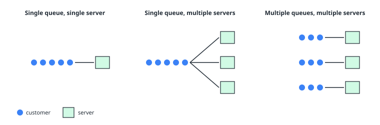

# Queueing Systems 1: Configurations and Characteristics

A queueing system is any system where customers ask for service from a resource with limited capacity, so some of them have to wait.

## Before you start
<!-- bite: 3d0a7558-084e-49aa-a51c-d2d08ac4be5c -->

You should have read [[systems-simulation/09-discrete-event-simulation|09 — Discrete-Event Simulation]].

After this lesson you will be able to:

1. say what a queueing system is and why waiting lines form;
2. name the three major events and the three common configurations;
3. describe the seven characteristics of a queueing system.

## What a queueing system is
<!-- bite: 277f66f6-dfb3-4b10-8acc-222532c4d175 -->

A **queueing system**, also called a system of flow, is any system where a customer asks for service from a resource of limited capacity. The customer might be a person at a bank, a car at a fuel station, a packet in a router or a part at a machine.

A waiting line forms for two reasons: arrivals are unpredictable, and service often takes longer than the gap between arrivals. If everyone arrived exactly when the server became free, nobody would ever wait.

This lesson describes the shape of a queueing system: its events, its layout and its characteristics. Lesson 11 then covers how customers behave while waiting, and the shorthand for writing a queue down.

## The three major events
<!-- bite: 156b6699-8c6f-41bc-a878-32e1749f57aa -->

Every queueing system has three major events:

1. **Arrival** of a customer.
2. **Servicing** of the customer, which starts when a server is free.
3. **Departure** of the customer when service ends.

These are exactly the events on the event list in lesson 09.

## Configurations
<!-- bite: 1d15e966-88e1-4e21-b891-7c5ed8f70806 -->

Queues come in three common layouts.

| Configuration | What it looks like | Everyday example |
| --- | --- | --- |
| Single queue, single server | One line feeding one server | A BRT ticket queue |
| Single queue, multiple servers | One line feeding several servers | Banks, supermarkets with one snake line |
| Multiple queues, multiple servers | Each server has its own line | Fuel pumps, ATMs |

The middle layout is usually fairer and faster, because no server sits idle while someone waits in another line. Lesson 11's jockeying only happens in the third layout.

## The seven characteristics
<!-- bite: 942a8d76-b990-4ed7-8a9a-f3dd2324d9f7 -->

These describe any queueing system.

1. **Calling population:** This is the pool of potential customers. It is **finite** if the number expected is known, such as a doctor with 20 booked appointments, and **infinite** if it isn't, such as a fuel station. In a finite population, arrivals depend on how many are already in the system: once 18 of the 20 patients have come, only 2 more can arrive.
2. **System capacity:** This is the limit on how many customers can be in the system or the waiting line. It is separate from the calling population and is usually finite: a waiting room with 10 chairs.
3. **Customer arrival:** Arrivals are random events, described by arrival times and an arrival rate, and represented by a statistical distribution.
## The seven characteristics: timing and the line
<!-- bite: 82b86b00-adbb-4d46-b9e1-25e37e39d7f5 -->

The other four describe the timing, and how the line itself behaves.

4. **Service time:** This is the time a server needs for one customer. It is also random.
5. **Inter-arrival time:** This is the time between two consecutive arrivals.
6. **Queue behaviour:** This is what customers do while waiting (lesson 11).
7. **Queue discipline:** This is the order in which waiting customers are picked when a server becomes free (lesson 11).

## Common pitfalls
<!-- bite: 17f9509d-110e-43d7-a48b-e4e6d745fba2 -->

1. **Confusing population with capacity.** The population is who *could* come; capacity is how many *fit*.
2. **Treating arrival rate and inter-arrival time as unrelated.** An average of 12 arrivals per hour means an average gap of 5 minutes.
3. **Assuming service is constant.** In nearly every real queue it is random.

Next lesson covers what happens inside the line: customers who leave, switch lines, or never join, the rules for who goes next, and Kendall's shorthand for writing a queue in a few letters.

## Check your understanding
<!-- bite: b32cb575-4490-4545-b7fd-ff648183fcd5 -->

Try each one before you open the answer.

1. <!-- q: mcq id="3cfac326" -->
   A row of ATMs where each machine has its own line is which configuration?

   - [ ] Single queue, single server
   - [ ] Single queue, multiple servers
   - [x] Multiple queues, multiple servers
   - [ ] Not a queueing system

   

Answer

   Multiple queues, multiple servers: each ATM is a server with its own line.

   

2. <!-- q: exact id="df0f36d7" answer="4" -->
   Customers arrive at an average rate of 15 per hour. What is the average inter-arrival time, in minutes?

   

Answer

   4 minutes: 60 minutes ÷ 15 arrivals.

   

3. <!-- q: mcq id="b863fed3" -->
   A dentist has 12 appointments booked today. What kind of calling population is this?

   - [x] Finite, because the number of possible customers is known
   - [ ] Infinite, because anyone could walk in
   - [ ] It is the system capacity
   - [ ] It has no calling population

   

Answer

   Finite. With a finite population, arrivals depend on how many are already in the system: once 10 have come, only 2 can still arrive.

   

4. <!-- q: gap id="d510c148" answers="arrival|arrivals;servicing|service;departure|departures" -->
   The three major events in a queueing system are ___, ___ and ___.

   

Answer

   Arrival, servicing (start of service) and departure.

   

5. <!-- q: open id="0a493fdb" -->
   A clinic's waiting room has 8 chairs, and people who find it full go elsewhere. The clinic serves an area of 50,000 people. Which characteristic is the 8 chairs, and which is the 50,000? Why are they different?

   

Answer

   The 8 chairs are the system capacity, the limit on how many can be in the system. The 50,000 people are the calling population, the pool who could come. They are separate: a large population can still be held back by a small waiting room.

   

## Before moving on
<!-- bite: d12ccc19-04bc-46e7-ad45-fb6ba743f023 -->

You can describe a queueing system's events, configuration and characteristics. **Next:** [[systems-simulation/11-queueing-systems-2|11 — Queueing Systems 2]]: queue behaviour, discipline and Kendall's notation.

## Related
<!-- bite: 28f8f7ce-f34c-4e57-8f7b-e0c2bd170480 -->

- [[systems-simulation/index|Systems simulation map]]

## About this lesson
<!-- bite: 522934cd-44ae-43c4-89de-e346902a78d6 -->

**Level:** Beginner. **Covers:** what a queueing system is, the three major events, the three configurations and the seven characteristics.

**Where it sits:** lesson 10 of 38, part 1 of 2 on queueing systems.

**Source:** the author's own SSG 418 and SSG 517 study notes, section 2. The diagram comes from `scripts/diagrams/systems_simulation.py`.
