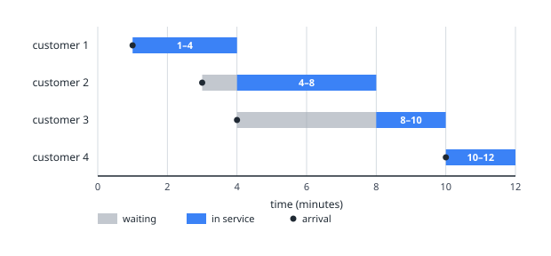

# Measuring a Queue 2: A Hand Simulation

A hand simulation fills in a table one customer at a time, then reads the performance measures off it.

## Before you start
<!-- bite: b638b377-fb32-4fa3-a97c-77d771347f06 -->

You should have read [[systems-simulation/12-measuring-a-queue-1|12 — Measuring a Queue 1]].

After this lesson you will be able to:

1. hand-simulate a single-server FIFO queue from a list of arrivals and service times;
2. compute mean delay, mean time in system and utilisation from the table;
3. draw the run on a timeline.

## What a hand simulation is
<!-- bite: 38ea46a5-f379-4621-9908-dab0c2b6b81e -->

A **hand simulation** is a discrete-event simulation done on paper. You are the clock and the event list. It is slow, but it shows exactly what a simulation program does, and it is a favourite exam question: "here are arrival and service times, find the mean delay and the utilisation".

The method uses only the rules from lesson 12. Work down the table one customer at a time, because each customer's start depends on the one before.

## The data
<!-- bite: 660aa9b6-d34c-42eb-9b8d-8642c83ee381 -->

Four customers, one server, served in order of arrival (FIFO). Times are in minutes.

| Customer | Arrival | Service time |
| --- | --- | --- |
| 1 | 2 | 4 |
| 2 | 5 | 3 |
| 3 | 6 | 5 |
| 4 | 10 | 2 |

## Filling in the table
<!-- bite: d710614b-dbdc-454c-826d-ded8b64135e5 -->

For each customer: start = max(arrival, previous departure), departure = start + service, delay = start − arrival, time in system = departure − arrival.

| Customer | Arrival | Service starts | Service time | Departure | Delay | Time in system |
| --- | --- | --- | --- | --- | --- | --- |
| 1 | 2 | 2 | 4 | 6 | 0 | 4 |
| 2 | 5 | 6 | 3 | 9 | 1 | 4 |
| 3 | 6 | 9 | 5 | 14 | 3 | 8 |
| 4 | 10 | 14 | 2 | 16 | 4 | 6 |

Customer 1 finds the server free and starts at once. Customer 2 arrives at 5 but must wait until 6, when customer 1 leaves. Customer 3 arrives at 6, but customer 2 now has the server until 9. Customer 4 arrives at 10 and waits until 14.

## Reading off the measures
<!-- bite: 1ff71a57-2bef-4469-b3f5-22faf7c72827 -->

1. **Mean delay** = (0 + 1 + 3 + 4) ÷ 4 = 8 ÷ 4 = **2 minutes**.
2. **Mean time in system** = (4 + 4 + 8 + 6) ÷ 4 = 22 ÷ 4 = **5.5 minutes**.
3. **Busy time** B = 4 + 3 + 5 + 2 = **14 minutes**.
4. **Utilisation** = B ÷ T = 14 ÷ 16 = **0.875**, taking T = 16, when the last customer leaves.

So the server was busy 87.5% of the time. The only idle time was minutes 0 to 2, before anyone arrived.

## Seeing it on a timeline
<!-- bite: 6902be80-b5c6-4088-afdd-b621b5b94c5e -->

The same run, drawn against time. Each row is a customer: the grey bar is waiting, the blue bar is service.

Notice the blue bars sit end to end from minute 2 to 16: once the server starts, it never rests. The grey bars grow down the page, because each customer inherits the backlog of the one before.

## Common pitfalls
<!-- bite: 584b1b9e-1b08-4d4b-9542-7cb343400db7 -->

1. **Computing customers out of order.** Each start depends on the previous departure, so go down the table.
2. **Using the wrong T for utilisation.** Use the run's total time, here 16, not the busy time.
3. **Forgetting idle time at the start.** The server is idle until the first arrival.

A hand simulation measures one run. Next lesson gives the formulas that predict the long-run averages for the most common queue, M/M/1, and the one law that connects all of them: Little's law.

## Check your understanding
<!-- bite: 460fa9af-5ca1-4b76-adf3-2f1568ad02c7 -->

Try each one before you open the answer.

1. <!-- q: exact id="95b28be2" answer="8" -->
   One server, FIFO. Customers arrive at minutes 1, 3, 4 and 10 with service times 3, 4, 2 and 2. At what minute does customer 3 start service?

   

Answer

   8. Customer 1 is served 1–4, customer 2 is served 4–8, so customer 3, who arrived at 4, starts at 8.

   

2. <!-- q: exact id="12dea822" answer="1.25" -->
   Same data: arrivals 1, 3, 4, 10 and service times 3, 4, 2, 2, one server, FIFO. What is the mean delay, in minutes?

   

Answer

   1.25. Delays are 0 (starts at 1), 1 (starts at 4), 4 (starts at 8) and 0 (arrives at 10, after customer 3 left at 10). Sum 5, divided by 4.

   

3. <!-- q: exact id="ecfaee4d" answer="4" -->
   Same data: arrivals 1, 3, 4, 10 and service times 3, 4, 2, 2, one server, FIFO. What is the mean time in system, in minutes?

   

Answer

   4. Times in system are 3 (1 to 4), 5 (3 to 8), 6 (4 to 10) and 2 (10 to 12). Sum 16, divided by 4.

   

4. <!-- q: exact id="38c6260f" answer="0.916667" sigfigs="2" accept="11/12" -->
   Same data: arrivals 1, 3, 4, 10 and service times 3, 4, 2, 2, one server, FIFO. The run ends when the last customer leaves, at minute 12. What is the server's utilisation?

   

Answer

   11/12 ≈ 0.92. Busy time is 3 + 4 + 2 + 2 = 11 minutes out of 12. The only idle minute is 0 to 1.

   

5. <!-- q: sketch id="3a85514e" -->
   One server, FIFO. Customers arrive at minutes 1, 3, 4 and 10 with service times 3, 4, 2 and 2. Draw the run on a timeline from 0 to 12, one row per customer, showing waiting and service.

   

Answer

   

   What to check:
   - customer 1's service from 1 to 4, with no wait;
   - customer 2 waiting 3 to 4, then served 4 to 8;
   - customer 3 waiting 4 to 8, then served 8 to 10;
   - customer 4 served 10 to 12 with no wait, because the server became free exactly as they arrived.

   

## Before moving on
<!-- bite: 38c18abf-1850-4f8d-aea3-c6031c422f87 -->

You can hand-simulate a single-server queue and read off its measures. **Next:** [[systems-simulation/14-littles-law-and-the-mm1-queue|14 — Little's Law and the M/M/1 Queue]].

## Related
<!-- bite: 6e06bc74-7d5b-44cf-8c4f-ac1632162ced -->

- [[systems-simulation/index|Systems simulation map]]

## About this lesson
<!-- bite: 448b365e-5b5e-4b25-ac15-2aebaababb1f -->

**Level:** Beginner. **Covers:** a full four-customer hand simulation, its measures, and its timeline.

**Where it sits:** lesson 13 of 38, part 2 of 2 on measuring a queue.

**Source:** the author's own SSG 418 and SSG 517 study notes, section 3. The quiz data is added for this lesson, and the timelines come from `scripts/diagrams/systems_simulation.py`, which checks the numbers.
