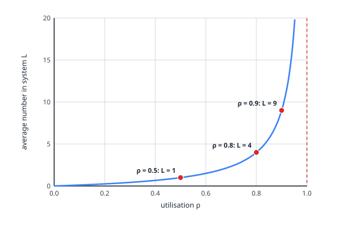

# Little's Law and the M/M/1 Queue

Little's law links the number in a system to the arrival rate and the time spent there, and the M/M/1 formulas predict a single-server queue's long-run averages.

## Before you start
<!-- bite: 20d71f32-3b04-42c4-876d-ace969871573 -->

You should have read [[systems-simulation/13-measuring-a-queue-2|13 — Measuring a Queue 2]].

After this lesson you will be able to:

1. state and use Little's law, for the whole system and for the queue alone;
2. use the M/M/1 formulas for ρ, L, Lq, W, Wq and P0;
3. explain why these formulas are used to check simulations.

## What Little's law and the M/M/1 formulas are
<!-- bite: 2ca687af-1ebd-4954-a896-436440f1784a -->

A hand simulation measures one particular run. For some queues there are exact formulas for the averages over a very long run. **Little's law** works for almost any queue. The **M/M/1 formulas** work for the classic single-server queue with exponential gaps and exponential service.

They matter for simulation in a specific way: when a formula exists, you can run your simulation on that case and check it gives the formula's answer. That is a validation test (lesson 32).

## Little's law
<!-- bite: 7b9ff1c1-429a-4ec3-a13e-b3787f4247e6 -->

**The average number of customers in the system equals the arrival rate times the average time each customer spends in the system.**

$$L = \lambda W$$

The same law works for the queue alone: $L_q = \lambda W_q$, the average number waiting equals the arrival rate times the average wait.

It holds whatever the arrival and service distributions are, so it needs no special assumptions. Example: a shop gets 20 customers an hour and each spends 0.3 hours inside, so on average 20 × 0.3 = 6 customers are in the shop.

## The M/M/1 formulas
<!-- bite: 84289ea6-3b6e-424b-84e8-3c5917fff2d6 -->

Here λ is the arrival rate and μ the service rate, both per unit time. The queue is only stable if the server is fast enough: **ρ = λ/μ must be less than 1**, or the line grows forever.

1. **Utilisation:** $\rho = \dfrac{\lambda}{\mu}$
2. **Average number in system:** $L = \dfrac{\rho}{1-\rho}$
3. **Average number in queue:** $L_q = \dfrac{\rho^2}{1-\rho}$
4. **Average time in system:** $W = \dfrac{1}{\mu-\lambda}$
5. **Average wait in queue:** $W_q = \dfrac{\rho}{\mu-\lambda}$
6. **Probability the system is empty:** $P_0 = 1-\rho$

## Example: the pharmacy
<!-- bite: eeda01b4-4e45-4036-bfe5-7eeb4a6aaf75 -->

From the Arena textbook: customers arrive at 10 per hour, so λ = 1/6 per minute. Service averages 3 minutes, so μ = 1/3 per minute.

1. ρ = (1/6) ÷ (1/3) = 0.5.
2. Lq = 0.5² ÷ (1 − 0.5) = 0.25 ÷ 0.5 = 0.5 customers waiting on average.
3. Wq = 0.5 ÷ (1/3 − 1/6) = 0.5 ÷ (1/6) = 3 minutes.
4. Check with Little's law: Lq = λ Wq = (1/6) × 3 = 0.5. ✓

The Arena run gave about a 3-minute wait and about 50% utilisation, so the simulation and the theory agree within sampling error. That agreement is evidence the model is built right.

## Why the queue explodes near ρ = 1
<!-- bite: 6876b5ef-8cdc-459b-82ee-2ffa29233235 -->

The formula $L = \rho/(1-\rho)$ has $1 - \rho$ underneath, so as utilisation creeps towards 1 the queue grows without limit.

Read three points off it: at 50% busy there is 1 customer on average, at 80% there are 4, at 90% there are 9. Going from 80% to 90% busy more than doubles the crowd. This is why a server that is "only" 90% busy can still have long queues.

## Common pitfalls
<!-- bite: 5c8f9559-5e91-4e98-bf13-6b61f18419f9 -->

1. **Mixing units.** λ and μ must be per the same time unit, per minute or per hour, not one of each.
2. **Using the formulas when ρ ≥ 1.** The queue has no steady state; it just grows.
3. **Using M/M/1 for non-exponential times.** With normal or constant service, the formulas don't hold, and simulation (or M/G/1) is the tool.
4. **Mixing W and Wq.** W includes service; Wq is waiting only. W = Wq + 1/μ.

Many systems have more than one server. Next lesson extends these formulas to c servers sharing one line: the M/M/c queue.

## Check your understanding
<!-- bite: d2333dbd-eb93-4c8f-82b5-be10f240507d -->

Try each one before you open the answer.

1. <!-- q: exact id="a445279d" answer="3" -->
   A clinic receives 12 patients an hour, and each spends on average 0.25 hours there. By Little's law, how many patients are in the clinic on average?

   

Answer

   3: L = λW = 12 × 0.25.

   

2. <!-- q: exact id="c96c9e25" answer="0.666667" sigfigs="2" accept="2/3" -->
   An M/M/1 queue has λ = 4 per hour and μ = 6 per hour. What is the utilisation ρ?

   

Answer

   2/3 ≈ 0.67: ρ = λ/μ = 4/6.

   

3. <!-- q: exact id="3538859a" answer="2" -->
   An M/M/1 queue has λ = 4 per hour and μ = 6 per hour. What is L, the average number in the system?

   

Answer

   2: L = ρ/(1 − ρ) = (2/3)/(1/3).

   

4. <!-- q: exact id="944688bf" answer="20" -->
   An M/M/1 queue has λ = 4 per hour and μ = 6 per hour. What is Wq, the average wait in the queue, in minutes?

   

Answer

   20 minutes. Wq = ρ/(μ − λ) = (2/3)/2 = 1/3 hour. Check with Little's law: Lq = ρ²/(1 − ρ) = 4/3, and Lq/λ = (4/3)/4 = 1/3 hour.

   

5. <!-- q: mcq id="013600a0" -->
   An M/M/1 queue has λ = 10 per hour and μ = 8 per hour. What happens?

   - [ ] L = ρ/(1 − ρ) gives a sensible average
   - [x] ρ = 1.25 is above 1, so the queue grows without limit and has no steady state
   - [ ] The server is idle 25% of the time
   - [ ] The formulas work if you swap λ and μ

   

Answer

   ρ = 10/8 = 1.25. Customers arrive faster than they can be served, so the line keeps growing and the formulas don't apply.

   

6. <!-- q: open id="06b325d3" -->
   Why are the M/M/1 formulas useful even when the real system isn't M/M/1?

   

Answer

   They let you check the simulation. Run the model with exponential inputs, compare its averages with the formulas, and if they agree within sampling error, the model's logic is probably right. Then change the inputs to the real, non-exponential ones, where only simulation gives the answer.

   

## Before moving on
<!-- bite: f81fd90c-c8a2-44d7-b61f-326fd41e1107 -->

You can use Little's law and the M/M/1 formulas, and explain why utilisation near 1 is dangerous. **Next:** [[systems-simulation/15-the-mmc-queue|15 — The M/M/c Queue]].

## Related
<!-- bite: 5fdab3db-c985-46c8-89d3-370e144d0b40 -->

- [[systems-simulation/index|Systems simulation map]]
- [[operations-research/12-queueing-theory|Queueing Theory]]: the same formulas from the operations research side.

## About this lesson
<!-- bite: cd689b66-0946-4833-8ddb-70e301608724 -->

**Level:** Beginner to intermediate. **Covers:** Little's law, the M/M/1 formulas, the pharmacy check, and why queues explode near full utilisation.

**Where it sits:** lesson 14 of 38, in part 3 (discrete-event simulation and queues).

**Source:** the author's own SSG 418 and SSG 517 study notes, section 3. The curve comes from `scripts/diagrams/systems_simulation.py`.
