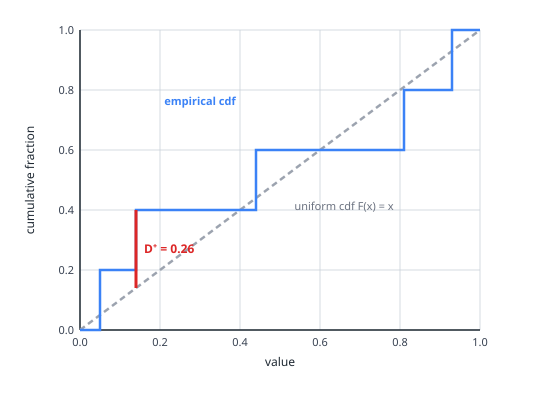

# Testing Random Numbers 1: Hypothesis Tests and the Kolmogorov-Smirnov Test

Random numbers are tested with hypothesis tests, and the Kolmogorov-Smirnov test checks uniformity by comparing the numbers' spread with a perfect straight line.

## Before you start
<!-- bite: 15479677-3f07-4a7e-bf63-cc70a9bcdfc4 -->

You should have read [[systems-simulation/18-random-numbers-3|18 — Random Numbers 3]].

After this lesson you will be able to:

1. set up the hypotheses for a uniformity test, and say what rejecting and not rejecting mean;
2. carry out the Kolmogorov-Smirnov test by hand;
3. read the test on a graph of the empirical and uniform cdfs.

## What testing random numbers means
<!-- bite: 88262fd2-d0af-4b52-9ae0-44ba85aa8a42 -->

A generator can look fine and still be biased. So its numbers are **tested**: you assume they are good, then check whether the data gives strong evidence against that.

The tests fall into two groups, one for each property from lesson 16: **uniformity** tests and **independence** tests. This lesson sets up the method and does the first uniformity test, Kolmogorov-Smirnov. Lesson 20 does chi-square for uniformity and autocorrelation for independence.

## The hypothesis set-up
<!-- bite: 1e55288e-9cf1-47f6-b925-eca0a7d60060 -->

Every test follows the same steps:

1. State a **null hypothesis H0** and an **alternative H1**.
2. Compute a test statistic from the numbers.
3. Compare it with a **critical value** for your chosen **significance level α**, often 0.05.

For uniformity: **H0: R ~ U[0, 1]** (the numbers are uniform), **H1: they are not**.

What the answer means:

1. **Reject H0:** there is strong evidence the numbers aren't uniform.
2. **Fail to reject H0:** no evidence of non-uniformity was found. This does *not* prove the numbers are perfect; it only means this test didn't catch a problem.

α is the probability of rejecting a good generator by bad luck, called a **Type I error**. At α = 0.05 it happens 5% of the time.

## The Kolmogorov-Smirnov test
<!-- bite: 7789d917-67ec-4081-bb6e-60daa7a857e5 -->

The **Kolmogorov-Smirnov (KS) test** compares the **empirical cdf** of the numbers (the fraction of them at or below each value) with the uniform cdf, which is the straight line F(x) = x. If the numbers are uniform, the staircase hugs the line. It works for small samples and uses the numbers without grouping them.

The steps:

1. Sort the N numbers from smallest to largest: R(1) ≤ R(2) ≤ ... ≤ R(N).
2. Compute $D^+ = \max_i \left(\dfrac{i}{N} - R_{(i)}\right)$, how far the staircase rises above the line.
3. Compute $D^- = \max_i \left(R_{(i)} - \dfrac{i-1}{N}\right)$, how far the line rises above the staircase.
4. Take D = max(D⁺, D⁻).
5. Look up the critical value D_α for N and α. If D > D_α, reject H0; otherwise don't reject.

## Worked example
<!-- bite: 94936da9-1288-42a5-a1f1-ea32d0580f45 -->

Five numbers: 0.44, 0.81, 0.14, 0.05, 0.93. Use α = 0.05.

| i | R(i) | i/N | i/N − R(i) | R(i) − (i−1)/N |
| --- | --- | --- | --- | --- |
| 1 | 0.05 | 0.20 | 0.15 | 0.05 |
| 2 | 0.14 | 0.40 | 0.26 | −0.06 |
| 3 | 0.44 | 0.60 | 0.16 | 0.04 |
| 4 | 0.81 | 0.80 | −0.01 | 0.21 |
| 5 | 0.93 | 1.00 | 0.07 | 0.13 |

D⁺ = 0.26 and D⁻ = 0.21, so D = 0.26. The critical value for N = 5 and α = 0.05 is 0.565. Since 0.26 < 0.565, **do not reject**: no evidence these numbers aren't uniform.

## Seeing the test
<!-- bite: f947d6f1-faa1-484e-a299-e8c42a601b50 -->

The test statistic is the biggest vertical gap between the staircase and the line.

The biggest gap is at 0.14: two of the five numbers (40%) are at or below 0.14, while a uniform sample would have only 14% there. A gap of 0.26 sounds big, but with only five numbers, gaps that size happen by chance, which is why the critical value is as large as 0.565.

## Common pitfalls
<!-- bite: 439816d1-c448-4b0b-8de5-70b1bbee89f3 -->

1. **Forgetting to sort.** The formulas use the ordered numbers.
2. **Using i/N in both formulas.** D⁻ uses (i − 1)/N.
3. **Saying "the numbers are proven uniform".** Not rejecting is not proof.
4. **Reading the critical value for the wrong N.** It shrinks as N grows.

KS is best for small samples. Next lesson does chi-square, the uniformity test for large samples, and then tests independence.

## Check your understanding
<!-- bite: 6235199e-8693-465c-9a41-11ef37c0fce5 -->

Try each one before you open the answer.

1. <!-- q: exact id="68605724" answer="0.36" -->
   Four random numbers: 0.39, 0.08, 0.82, 0.31. In the Kolmogorov-Smirnov test, what is D⁺?

   

Answer

   0.36. Sorted: 0.08, 0.31, 0.39, 0.82, with i/N = 0.25, 0.5, 0.75, 1. The gaps i/N − R(i) are 0.17, 0.19, 0.36 and 0.18, and the largest is 0.36.

   

2. <!-- q: exact id="05ef2414" answer="0.08" -->
   Same four numbers: 0.39, 0.08, 0.82, 0.31. What is D⁻?

   

Answer

   0.08. The gaps R(i) − (i − 1)/N are 0.08 − 0 = 0.08, 0.31 − 0.25 = 0.06, 0.39 − 0.5 = −0.11 and 0.82 − 0.75 = 0.07. The largest is 0.08.

   

3. <!-- q: mcq id="d598cdd2" -->
   For the four numbers 0.39, 0.08, 0.82 and 0.31, D = 0.36. The critical value for N = 4 and α = 0.05 is 0.624. What do you conclude?

   - [ ] Reject H0: the numbers are not uniform
   - [x] Do not reject H0: no evidence they aren't uniform
   - [ ] The numbers are proven uniform
   - [ ] The test can't be used with four numbers

   

Answer

   Do not reject, since 0.36 < 0.624. That isn't proof of uniformity, only no evidence against it.

   

4. <!-- q: open id="8708d015" -->
   A generator passes a uniformity test at α = 0.05. A classmate says "so the numbers are definitely uniform". What is wrong with that?

   

Answer

   Failing to reject H0 only means this test found no evidence of non-uniformity. A small sample, or a problem this test isn't sensitive to, could hide a real flaw. It also says nothing about independence, which needs its own tests.

   

5. <!-- q: gap id="703a9615" answers="Type I|type 1|type one" -->
   At α = 0.05, there is a 5% chance of rejecting a perfectly good generator. Rejecting a true null hypothesis is called a ___ error.

   

Answer

   A Type I error. α is set to keep it small.

   

## Before moving on
<!-- bite: d70d8d2e-d1e8-476b-bfe4-b85ad2c929d8 -->

You can set up a uniformity test and carry out the Kolmogorov-Smirnov test. **Next:** [[systems-simulation/20-testing-random-numbers-2|20 — Testing Random Numbers 2]]: chi-square and autocorrelation.

## Related
<!-- bite: 1f5f7e09-5758-4b76-a0d4-d0218fedbec4 -->

- [[systems-simulation/index|Systems simulation map]]

## About this lesson
<!-- bite: 9ed5b3e5-0ffb-4b10-9231-612f756b8da9 -->

**Level:** Intermediate. **Covers:** hypothesis tests for random numbers, Type I error, the Kolmogorov-Smirnov test by hand, and its picture.

**Where it sits:** lesson 19 of 38, part 1 of 2 on testing random numbers.

**Source:** the author's own SSG 517 study notes, section 4. The quiz numbers are added for this lesson; the diagram and both D values come from `scripts/diagrams/systems_simulation.py`.
