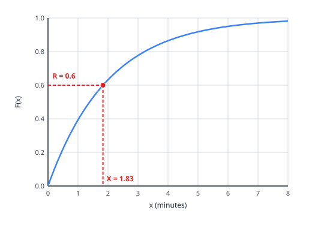

# Generating Random Variates

A random variate is a value from a chosen distribution, made by transforming a uniform random number, most often with the inverse-transform method.

## Before you start
<!-- bite: b01fce26-b645-437d-b229-aa1e11507b52 -->

You should have read [[systems-simulation/20-testing-random-numbers-2|20 — Testing Random Numbers 2]].

After this lesson you will be able to:

1. explain the inverse-transform method and why it works;
2. generate an exponential variate from a random number;
3. generate a value from a discrete table using its cumulative probabilities.

## What a random variate is
<!-- bite: e28b8339-7c45-4cda-b31b-3b1ac18733af -->

A simulation needs exponential gaps between arrivals, normal service times, demand from a table. The generator only gives uniform numbers between 0 and 1. A **random variate** is a value from the distribution you actually want, and **random-variate generation** is turning R into it.

This lesson shows the main method, **inverse transform**, for a continuous distribution and for a discrete table. Packages like Arena do it for you, but knowing how it works lets you check them and answer the hand-calculation questions.

## The inverse-transform idea
<!-- bite: eaa972db-f81e-4a96-8b9b-7d78284fbe02 -->

Every distribution has a **cdf**, F(x): the probability the value is x or less. It climbs from 0 to 1. A uniform R also lives between 0 and 1.

So: draw R, then find the x where F(x) = R. In symbols, $X = F^{-1}(R)$. Values of x where F rises steeply (where the distribution is likely) catch a wide band of R, so they come out often. Values where F is flat catch a thin band, so they come out rarely. The result has exactly the distribution F.

## Example: the exponential distribution
<!-- bite: 720a37b2-98f0-4916-bcc6-797cd5e546c5 -->

The exponential distribution with rate λ (mean 1/λ) has cdf $F(x) = 1 - e^{-\lambda x}$. Setting $1 - e^{-\lambda X} = R$ and solving for X:

$$X = -\frac{1}{\lambda}\ln(1 - R)$$

With a mean gap of 2 minutes (λ = 0.5) and R = 0.6: X = −2 ln(0.4) = 2 × 0.916 = **1.83 minutes**.

## Seeing the inverse transform
<!-- bite: 2a44c7a0-f9d8-441e-8a4a-8d22ad2c9b96 -->

Here is that example on the cdf itself.

Read the picture from the left: start at R = 0.6 on the vertical axis, go across to the curve, then down. Where you land is the variate.

Because 1 − R is also uniform, some books write $X = -\frac{1}{\lambda}\ln R$. Both are correct; use the one your lecturer uses, which here is ln(1 − R).

## Example: a discrete table
<!-- bite: c834e602-c76f-48e0-b4e2-0f3be74a7453 -->

A newspaper stand's daily demand follows this table. Build the **cumulative probability** column, then give each demand a range of R.

| Demand | Probability | Cumulative | R range |
| --- | --- | --- | --- |
| 40 | 0.2 | 0.2 | 0.00 ≤ R < 0.20 |
| 50 | 0.5 | 0.7 | 0.20 ≤ R < 0.70 |
| 60 | 0.3 | 1.0 | 0.70 ≤ R < 1.00 |

Draw R = 0.83: it falls in 0.70 to 1.00, so demand is 60. Draw R = 0.15: demand is 40. This is inverse transform for a discrete table: find the first cumulative probability above R.

## In Arena
<!-- bite: 8e27ea1c-d26f-459c-a95c-5d08839c4912 -->

Arena does the transform for you with built-in functions:

1. **EXPO(mean):** exponential with that mean, such as EXPO(5).
2. **UNIF(min, max):** uniform between two values.
3. **NORM(mean, sd):** normal.
4. **TRIA(min, mode, max):** triangular.
5. **DISC(cumulative probability, value, ...):** an empirical table like the newspaper one, written DISC(0.2, 40, 0.7, 50, 1.0, 60).

Note that EXPO takes the **mean**, not the rate λ.

## Common pitfalls
<!-- bite: 6d5d7cbf-9fc8-4dc8-a209-2c0e817221e0 -->

1. **Using the rate where the mean is wanted.** EXPO(5) means a mean of 5, so λ = 0.2.
2. **Using probabilities instead of cumulative ones.** The ranges come from the cumulative column.
3. **Forgetting the minus sign.** ln(1 − R) is negative, and −(1/λ) makes X positive.

With uniform numbers turned into any distribution, we can now simulate. The simplest kind of simulation has no clock at all: next lesson is Monte Carlo.

## Check your understanding
<!-- bite: 6c0630c4-f8e0-4354-a5cf-480b9ea34a4f -->

Try each one before you open the answer.

1. <!-- q: exact id="d8c115c4" answer="1.150728" sigfigs="2" -->
   Inter-arrival times are exponential with a mean of 4 minutes. Using X = −(1/λ) ln(1 − R), what gap does R = 0.25 give, in minutes?

   

Answer

   About 1.15 minutes. The mean is 4, so 1/λ = 4, and X = −4 ln(0.75) = 4 × 0.2877.

   

2. <!-- q: exact id="1f3a8629" answer="2.079442" sigfigs="2" -->
   Service times are exponential with a mean of 3 minutes. Using X = −(1/λ) ln(1 − R), what service time does R = 0.5 give, in minutes?

   

Answer

   About 2.08 minutes: X = −3 ln(0.5) = 3 × 0.693. R = 0.5 gives the median, which for an exponential is below the mean.

   

3. <!-- q: exact id="3a127627" answer="50" -->
   Daily demand is 40 with probability 0.2, 50 with probability 0.5 and 60 with probability 0.3. Using cumulative probabilities in that order, what demand does R = 0.55 give?

   

Answer

   50. The cumulative probabilities are 0.2, 0.7 and 1.0. R = 0.55 is at least 0.2 but below 0.7, so it falls in the band for 50.

   

4. <!-- q: mcq id="06cc7a52" -->
   In Arena, a process time is written EXPO(6). What is its rate λ?

   - [ ] 6 per minute
   - [x] 1/6 per minute
   - [ ] 36 per minute
   - [ ] 0.6 per minute

   

Answer

   1/6 per minute. EXPO takes the mean, which is 1/λ.

   

5. <!-- q: open id="8cc6c896" -->
   Explain in words why the inverse-transform method gives values with the right distribution.

   

Answer

   R is equally likely anywhere in [0, 1]. Mapping R back through the cdf sends each band of R to the values of x where the cdf rises over that band. Where the distribution is likely, the cdf is steep, so a wide band of R lands there and those values come out often; where it is unlikely, the cdf is flat and few R land there.

   

## Before moving on
<!-- bite: 30e5fdf7-2b82-4176-9122-00849c96e5bd -->

You can generate exponential and discrete variates by inverse transform, and read Arena's distribution functions. **Next:** [[systems-simulation/22-monte-carlo-simulation|22 — Monte Carlo Simulation]].

## Related
<!-- bite: 43786dc3-e60d-4783-b8e6-6abd2bb9d1c9 -->

- [[systems-simulation/index|Systems simulation map]]

## About this lesson
<!-- bite: b5dbdc5a-8f4a-47c4-8f32-5f8757c24380 -->

**Level:** Intermediate. **Covers:** random variates, the inverse-transform idea, the exponential formula, discrete tables with cumulative probabilities, and Arena's distribution functions.

**Where it sits:** lesson 21 of 38, in part 4 (random numbers and Monte Carlo).

**Source:** the author's own SSG 517 study notes, sections 4 and 8. The discrete table example is added for this lesson; the diagram comes from `scripts/diagrams/systems_simulation.py`.
