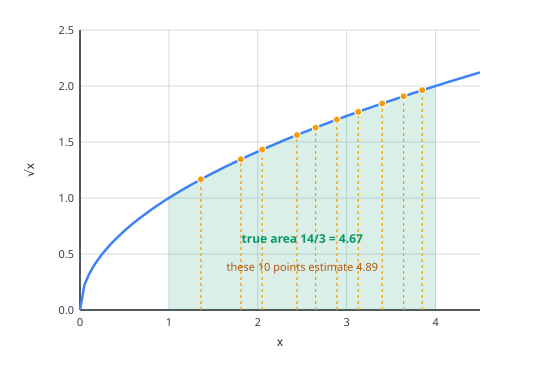

# Monte Carlo Simulation

Monte Carlo simulation estimates something hard to compute by sampling random inputs many times and averaging the results.

## Before you start
<!-- bite: 135fbb27-5a41-4c95-8fbe-a8b2f1cd9c8e -->

You should have read [[systems-simulation/21-generating-random-variates|21 — Generating Random Variates]].

After this lesson you will be able to:

1. describe the Monte Carlo pattern and why it is called static;
2. estimate an area under a curve with random numbers;
3. run a news vendor day by hand, and explain how more replications reduce error.

## What Monte Carlo simulation is
<!-- bite: 70c62973-a80e-4fca-930d-cd77c3454a59 -->

**Monte Carlo simulation** uses random numbers to estimate a quantity that is hard to compute directly. The pattern is always the same:

1. Generate random inputs.
2. Compute the result for those inputs.
3. Repeat many times.
4. Average the results.

Time plays no part, so it is called a **static** simulation: there is no clock and no event list. It is the bridge between the two courses. Everything rests on good random numbers (lessons 16–20) and the right input distributions (lessons 27–29). In Arena, the same idea is a CREATE, ASSIGN, RECORD, DISPOSE model with many replications.

## Example: area under a curve
<!-- bite: 1bd74b62-a671-4115-bbfd-3d86bd00b6e0 -->

To estimate the area under f(x) from a to b:

1. Draw a random number R and set x = a + (b − a)R, a random point between a and b.
2. Compute f(x).
3. Repeat, and average the f(x) values.
4. Area ≈ (b − a) × average of f(x).

Why it works: the area equals the width times the average height, and averaging random heights estimates the average height.

The textbook example is $\sqrt{x}$ from 1 to 4. The true area is $\frac{2}{3}(4^{1.5} - 1) = 14/3 \approx 4.67$. Twenty replications gave about 4.39. The gap is **sampling error**: twenty random points don't pin down the average height exactly.

## Seeing the Monte Carlo area
<!-- bite: 17465ff7-ce7b-4f86-8843-0f37f90e4412 -->

Here are ten random points on that curve.

## Example: the news vendor
<!-- bite: 6f57c40a-e11c-48a5-a5ec-aee542b5eae9 -->

A vendor buys newspapers in the morning and sells them through the day. Unsold papers are sold back for scrap. Order too few and you lose sales; order too many and you lose on scrap. Each day:

$$\text{profit} = \text{sales revenue} + \text{salvage} - \text{ordering cost}$$

Say papers cost ₦30, sell for ₦50 and scrap for ₦5. The vendor orders 70. Today's demand, drawn from the table of lesson 21 with a random number, is 60.

1. Sales: 60 papers × ₦50 = ₦3,000.
2. Salvage: 10 unsold × ₦5 = ₦50.
3. Cost: 70 × ₦30 = ₦2,100.
4. Profit: 3,000 + 50 − 2,100 = **₦950**.

Repeat for hundreds of random days and average to get the expected daily profit for an order of 70. Do it again for 50, 60 and 80, and the best order size shows itself.

## More replications, less error
<!-- bite: 8d2fba5b-0018-4922-b977-dd2391f56cd5 -->

Each replication is one random sample, so the average wobbles. The error shrinks with the square root of the number of replications: **four times as many replications halve the error**. That is why Arena reports a 95% confidence half-width with every average (lesson 34): it tells you how much the average might still wobble.

## Common pitfalls
<!-- bite: fc29e83d-11ba-4109-8eb2-0c4a73e00112 -->

1. **Forgetting to multiply by the width.** The area is (b − a) times the average height.
2. **Too few replications.** Twenty samples gave 4.39 for a true 4.67.
3. **Expecting error to fall in proportion.** Doubling replications only cuts error by about 30%; you need four times as many to halve it.
4. **Leaving out salvage.** In the news vendor, unsold papers still earn something.

That completes randomness. The next part goes back to SSG 418's language for building discrete-event models, GPSS/H, before SSG 517 moves on to building models properly.

## Check your understanding
<!-- bite: 65dddaeb-6116-42a2-9b55-88c3da87b8ba -->

Try each one before you open the answer.

1. <!-- q: exact id="33c80c99" answer="2.333333" sigfigs="2" accept="7/3" -->
   You estimate the area under f(x) = x² from 0 to 2 with three random numbers: 0.5, 0.25 and 0.75. Using x = a + (b − a)R, what is the Monte Carlo estimate?

   

Answer

   About 2.33. The x values are 1, 0.5 and 1.5, giving f(x) = 1, 0.25 and 2.25. Their average is 3.5/3 ≈ 1.167, and times the width 2 gives 2.33. The true area is 8/3 ≈ 2.67; the gap is sampling error.

   

2. <!-- q: exact id="a2c50e6b" answer="1200" accept="1,200|₦1,200|₦1200" -->
   A vendor buys papers at ₦30, sells them at ₦50 and scraps unsold ones for ₦5. She orders 60 and today's demand is 75. What is today's profit, in naira?

   

Answer

   ₦1,200: she can only sell the 60 she has, so revenue is 60 × 50 = 3,000, there are no unsold papers, and the cost is 60 × 30 = 1,800. Profit = 3,000 − 1,800 = 1,200.

   

3. <!-- q: exact id="f92d9bfe" answer="4" -->
   A Monte Carlo estimate from 400 replications has a 95% half-width of ±6. About how many times as many replications would you need to get it down to ±3?

   

Answer

   4 times as many (1,600 replications). Error shrinks with the square root of the number of replications, so halving it needs four times the runs.

   

4. <!-- q: mcq id="8142755e" -->
   Why is Monte Carlo called a static simulation?

   - [ ] It only uses fixed numbers
   - [x] Time plays no role: there is no clock or event list
   - [ ] It can only be run once
   - [ ] It doesn't use random numbers

   

Answer

   Time plays no role. Each replication is a single calculation from random inputs, not a sequence of events over time.

   

5. <!-- q: open id="9f2a7c37" -->
   A delivery company's journey time depends on the weather, which is sunny, rainy or stormy with known probabilities. How would Monte Carlo help it promise delivery times?

   

Answer

   Draw a random weather condition from its probabilities, then a random journey time for that weather, and repeat thousands of times. The results form a distribution of delivery times, so the company can promise a time it meets, say, 95% of the time, rather than just an average.

   

## Before moving on
<!-- bite: 26a0e10b-f037-4811-a5ed-16225e2ea8aa -->

You can run a Monte Carlo estimate, a news vendor day, and explain how replications cut error. **Next:** [[systems-simulation/23-gpss-1|23 — GPSS/H 1]].

## Related
<!-- bite: 7d01c57b-5673-45b2-8819-ad2c13e6f890 -->

- [[systems-simulation/index|Systems simulation map]]
- [[operations-research/14-simulation|Simulation]] in operations research: Monte Carlo used for decisions.

## About this lesson
<!-- bite: 61fbee73-ef09-45e1-bab3-bb6677b64904 -->

**Level:** Beginner to intermediate. **Covers:** the Monte Carlo pattern, area under a curve, the news vendor problem, and how replications reduce error.

**Where it sits:** lesson 22 of 38, the end of part 4 (random numbers and Monte Carlo).

**Source:** the author's own SSG 418 and SSG 517 study notes, sections G and 4. The news vendor prices and the quiz numbers are added for this lesson; the diagram comes from `scripts/diagrams/systems_simulation.py`.
