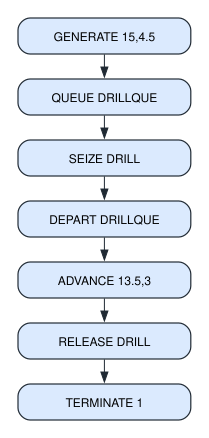

# GPSS/H 2: Two Complete Models

A drill fed by castings and a two-line telephone system show how a few GPSS/H blocks make a complete simulation.

## Before you start
<!-- bite: 45409bc5-701b-4f17-aad8-e9b6ae58ca93 -->

You should have read [[systems-simulation/23-gpss-1|23 — GPSS/H 1]].

After this lesson you will be able to:

1. write the GPSS/H model of a single-server queue from a word problem;
2. read a GPSS report and check its utilisation;
3. follow a model with a GATE and a TRANSFER loop.

## What the two models are
<!-- bite: ab1345c4-44a6-4d9f-ad53-55e87bca6107 -->

Lesson 23 gave the blocks one at a time. Here they come together in two worked models from the SSG 418 handout. The first is the standard single-server queue. The second adds a storage, a condition and a loop for callers who try again.

## Model 1: the castings and the drill
<!-- bite: 7a6affa6-ba48-4f29-af77-144c8ed0a882 -->

Castings arrive at a drill every 15 ± 4.5 minutes, uniform. Drilling takes 13.5 ± 3.0 minutes, uniform. First come, first served. Simulate until 100 castings have been drilled.

```text
        SIMULATE
        GENERATE   15,4.5       ; castings arrive
        QUEUE      DRILLQUE     ; join the drill queue
        SEIZE      DRILL        ; capture the drill
        DEPART     DRILLQUE     ; leave the queue
        ADVANCE    13.5,3       ; drilling time
        RELEASE    DRILL        ; give up the drill
        TERMINATE  1            ; drilled casting leaves
        START      100          ; run until 100 have left
```

**Correction:** the printed code in the handout says `GENERATE 10.0,2.5`, which matches neither the question (15 ± 4.5) nor the report. The model above uses the question's figures. The report's end time of 1,534.483 minutes is about 15.3 minutes per casting, consistent with 15 ± 4.5.

## The drill model as a block diagram
<!-- bite: 21069bfa-bff8-44bf-ab2e-4c2e596e9017 -->



Each casting follows this one path from top to bottom. The only place it can be held up is SEIZE, when the drill is busy.

## Reading the report
<!-- bite: 94ba72b7-5bf9-41b6-a504-8cd9053aaf5c -->

1. **Block counts:** all 7 blocks have an entry count of 100, so every casting went through every block.
2. **Facility `DRILL`:** 100 entries, **utilisation 0.879** (busy 87.9% of the time) and an **average time of 13.491** minutes per casting.
3. **Queue `DRILLQUE`:** read its maximum content, average content, number of entries, **zero entries** (castings that never waited) and the average time in the queue.

**Check the utilisation.** Expected utilisation is mean service time ÷ mean inter-arrival time = 13.5 ÷ 15 = **0.9**. The run gave 0.879. They are close, and the small gap is sampling randomness from only 100 castings. That kind of check against a simple formula is a quick validation (lesson 32).

## Model 2: a simple telephone system
<!-- bite: 1c47e61f-6503-4609-a3da-d7ad97252a91 -->

Two external lines. Calls arrive every 100 ± 60 seconds. If both lines are busy, the caller redials after 5 ± 1 minutes. A call lasts 3 ± 1 minutes. We want a table of how long each caller takes to complete a call. Times are in minutes, so 100 ± 60 seconds becomes 1.667 ± 1.

```text
Sets     STORAGE   2               ; two external lines
Transit  TABLE     M1,.5,1,20      ; histogram of transit times
         GENERATE  1.667,1         ; calls arrive (100 +/- 60 s)
Again    GATE SNF  Sets,Occupied   ; if the lines are full go to Occupied
         ENTER     Sets            ; take a line
         ADVANCE   3,1             ; talk for 3 +/- 1 min
         LEAVE     Sets            ; free the line
         TABULATE  Transit         ; record time in system
         TERMINATE 1               ; call completed
Occupied ADVANCE   5,1             ; wait before redialling
         TRANSFER  ,Again          ; try again
```

## How the telephone model flows
<!-- bite: 72dba495-e3c9-4485-b3e2-575c7afe06ce -->


1. A call that finds a free line passes the GATE (SNF means "storage not full"), takes a line, talks, frees the line, is tabulated and ends.
2. A call that finds both lines busy is sent by the GATE to `Occupied`, waits about 5 minutes, then TRANSFERs back to `Again` and tries the GATE once more.
3. `M1` is the time a transaction has spent in the model. Tabulating it just before TERMINATE gives the total time from first dialling to finishing the call.

To find how long 200 calls take, run it with `START 200` and read the `END TIME` in the report. Trying 3 or 4 lines is a one-line change to the STORAGE statement.

## Common pitfalls
<!-- bite: 42d750ed-5e47-499a-972d-42e611870516 -->

1. **Leaving the handout's GENERATE 10.0,2.5.** Use the figures in the question.
2. **Expecting the utilisation to equal 0.9 exactly.** A run of 100 castings is one random sample.
3. **Tabulating M1 too early.** It must come after the call ends to capture the whole time.

GPSS/H is the SSG 418 tool. SSG 517 moves up a level: before any tool, how to turn a messy real problem into a model worth building. That starts next lesson.

## Check your understanding
<!-- bite: f6b827df-eb1e-4c9f-b8a8-ede40d287367 -->

Try each one before you open the answer.

1. <!-- q: exact id="885f0d08" answer="0.75" accept="3/4|75%" -->
   Parts arrive at a lathe as `GENERATE 16,4` and are machined as `ADVANCE 12,2`. What utilisation should you expect for the lathe in a long run?

   <details><summary>Answer</summary>

   0.75: mean service time ÷ mean inter-arrival time = 12 ÷ 16.

   </details>

2. <!-- q: open id="be57d8df" -->
   Write the GPSS/H model for this: customers arrive every 8 ± 3 minutes, one barber cuts hair in 7 ± 2 minutes, first come first served, run until 50 customers have left.

   <details><summary>Answer</summary>

   ```text
           SIMULATE
           GENERATE   8,3
           QUEUE      LINE
           SEIZE      BARBER
           DEPART     LINE
           ADVANCE    7,2
           RELEASE    BARBER
           TERMINATE  1
           START      50
   ```

   Any names will do for the queue and facility, as long as QUEUE and DEPART use the same one, and SEIZE and RELEASE the same one.

   </details>

3. <!-- q: mcq id="4781909a" -->
   In the telephone model, what does the block `GATE SNF Sets,Occupied` do?

   - [ ] Always sends calls to Occupied
   - [x] Lets the call through if the storage Sets is not full; otherwise sends it to Occupied
   - [ ] Records the call in a table
   - [ ] Ends the call

   <details><summary>Answer</summary>

   SNF means "storage not full". A call passes if a line is free, and is sent to the redial block if both lines are busy.

   </details>

4. <!-- q: mcq id="ca9c3b3c" -->
   A drill report shows a utilisation of 0.879, but mean service ÷ mean inter-arrival gives 0.9. What is the most likely reason?

   - [ ] The model has a bug
   - [x] Sampling randomness: one run of 100 castings is a random sample
   - [ ] The drill broke down
   - [ ] Utilisation can't be predicted

   <details><summary>Answer</summary>

   Sampling randomness. A longer run or more replications would bring the estimate closer to 0.9.

   </details>

5. <!-- q: open id="1c5b952f" -->
   In the telephone model, why is M1 tabulated just before TERMINATE rather than straight after ENTER?

   <details><summary>Answer</summary>

   M1 is the time the transaction has spent in the model so far. Just before TERMINATE it covers everything: every failed attempt, every redial wait and the call itself. Straight after ENTER it would miss the talk time.

   </details>

## Before moving on
<!-- bite: bf6ffeee-dda3-4740-8038-384f53228607 -->

You can write a single-server GPSS/H model, read its report and follow a GATE and TRANSFER loop. **Next:** [[systems-simulation/25-model-building-1|25 — Model Building 1]].

## Related
<!-- bite: b1403bd0-d737-4989-81cf-55e25b52c0bf -->

- [[systems-simulation/index|Systems simulation map]]

## About this lesson
<!-- bite: 461a5a21-c882-4757-a734-b1e6db212e9f -->

**Level:** Beginner to intermediate. **Covers:** the castings and drill model, reading its report, the utilisation check, and the telephone model with a GATE and TRANSFER loop.

**Where it sits:** lesson 24 of 38, part 2 of 2 on GPSS/H.

**Source:** the author's own SSG 418 study notes, section F, with the handout's GENERATE line corrected as stated. The block diagrams come from `scripts/diagrams/systems_simulation.py`.
