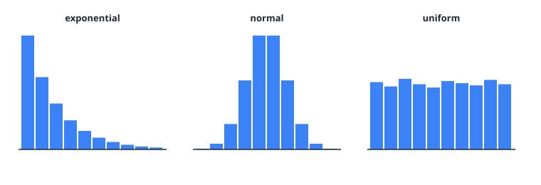

# Input Analysis 1: Garbage In, Garbage Out, and the Four Steps

Input analysis chooses the distribution for each random input from real data, because a model fed the wrong inputs gives wrong answers however well it is built.

## Before you start
<!-- bite: 11546713-63ed-4a53-b9fa-730ba68c5e28 -->

You should have read [[systems-simulation/26-model-building-2|26 — Model Building 2]].

After this lesson you will be able to:

1. explain garbage in, garbage out with examples of how inputs go wrong;
2. list the four steps of input analysis;
3. use a histogram, a stem-and-leaf diagram and a scatter diagram to look at data.

## What input analysis is
<!-- bite: 08a42c26-9ab4-48a0-bd7a-da27e6ba6c14 -->

**Input analysis** answers one question: what distribution should I use for each random input, such as inter-arrival times, service times and breakdown times? Your flow chart can be perfect and your model can run without errors, but if the inputs are wrong, the outputs are wrong. This is **garbage in, garbage out (GIGO)**.

Two of the six questions on the 2025/26 paper come straight from input analysis, so this lesson and the next three are worth care. This one gives the method. Lesson 28 chooses the distribution, lesson 29 handles awkward data, and lesson 30 covers collecting and cleaning it.

## How inputs go wrong
<!-- bite: be6b8cb8-0cc2-4e1a-b795-2a6fb04523df -->

1. **Wrong shape.** Assume constant gaps between arrivals when they are really exponential, and you may never see a line form, because constant gaps never bunch up.
2. **Wrong pattern over time.** Assume one arrival rate all day when it actually changes, and the lunchtime rush disappears from the model.
3. **Wrong rate.** Get the distribution right but the rate wrong, and the whole system is sized wrongly: too few tellers, or too many.

## The four steps
<!-- bite: 23c7f57d-600b-40e9-8c15-76243704b90c -->

1. **Collect data** on the real process. Know what data you need before you start: understand the process (arrival, service, departure) and draw it as a flow chart first.
2. **Choose the distribution** that describes the data, such as Normal(30, 8).
3. **Estimate its parameters:** mean, standard deviation, minimum, maximum, as the distribution needs.
4. **Test the fit** with a goodness-of-fit test, such as chi-square or Kolmogorov-Smirnov (the same tests as lessons 19 and 20, now comparing data with a fitted distribution).

The attitude: choose a reasonable distribution, then test that it isn't ridiculous. If you think the data is normal, it should fall roughly on a straight line on a normal probability plot, and pass a goodness-of-fit test for normality.

## Look at the data first
<!-- bite: f19fd28f-50ed-4423-a008-22f509ab9dfa -->

Three pictures, each answering a different question.

1. **Histogram:** bars showing how many values fall in each range. Its shape suggests the distribution: a tall bar on the left with a long tail to the right looks exponential; a symmetric hump looks normal; a flat top looks uniform. With enough data it converges to the true shape.
2. **Stem-and-leaf diagram:** a sideways histogram that keeps every number. Each value splits into a **stem** (the leading digits, such as the tens) and a **leaf** (usually the last digit).
3. **Scatter diagram:** plots one variable against another, to show whether they are related. This matters for correlated data (lesson 29).

## Seeing the three shapes
<!-- bite: 8f400734-2be4-4826-bf1a-6d4ab0072338 -->

Here are the three shapes the histogram most often suggests.

## Reading a stem-and-leaf diagram
<!-- bite: e808ebb1-3e28-4ec1-a6d1-98c98e1882fa -->

These are service times in minutes: 23, 27, 31, 34, 34, 38, 42, 45, 51.

| Stem (tens) | Leaves (units) |
| --- | --- |
| 2 | 3 7 |
| 3 | 1 4 4 8 |
| 4 | 2 5 |
| 5 | 1 |

Read the stem 3 row as 31, 34, 34 and 38. Turned on its side, the leaves make the bars of a histogram, and you can still read back every original value.

## Common pitfalls
<!-- bite: 83a0a67b-33b1-449b-9025-60323a32b28d -->

1. **Choosing a distribution before looking.** Plot the data first.
2. **Skipping the goodness-of-fit test.** A histogram suggests; the test checks.
3. **Collecting data without a flow chart.** You end up missing the stage you most needed.

The histogram suggests a shape. Next lesson gives the full list of distributions to choose from, and the questions that point you to the right one.

## Check your understanding
<!-- bite: beb48a4e-5660-4e88-9b8d-2f0568f8b32b -->

Try each one before you open the answer.

1. <!-- q: mcq id="0adda004" -->
   A model of a restaurant assumes the same arrival rate all evening, but customers actually pour in between 7 and 8 pm. What will the model get wrong?

   - [ ] Nothing, if the average rate is right
   - [x] It will smooth away the peak, so it underestimates the queues and waits at the busy time
   - [ ] It will overestimate every queue
   - [ ] It will crash

   

Answer

   It hides the rush. With one average rate, the 7 to 8 pm crowd is spread over the evening, so the model shows shorter queues than customers really face. That's garbage in, garbage out.

   

2. <!-- q: gap id="18d35926" answers="collect data|collect the data|data collection;choose the distribution|determine the distribution|choose a distribution;estimate the parameters|estimate parameters|parameter estimation;test the fit|goodness-of-fit test|test the suitability" -->
   The four steps of input analysis are: ___, ___, ___ and ___.

   

Answer

   Collect data, choose the distribution, estimate its parameters, and test the fit with a goodness-of-fit test.

   

3. <!-- q: exact id="74af8ab5" answer="5" -->
   Inspection times in seconds are 61, 64, 70, 72, 72, 75, 79, 83 and 90. In a stem-and-leaf diagram with the tens as stems, how many leaves are on stem 7?

   

Answer

   5: the values 70, 72, 72, 75 and 79 are all in the seventies, so stem 7 has the leaves 0 2 2 5 9.

   

4. <!-- q: mcq id="4607b5c8" -->
   A histogram of times between machine breakdowns has its tallest bar near zero and a long tail to the right. Which distribution does it suggest?

   - [ ] Normal
   - [ ] Uniform
   - [x] Exponential
   - [ ] Triangular

   

Answer

   Exponential: most gaps are short, a few are very long.

   

5. <!-- q: open id="fb472800" -->
   Why should you draw a scatter diagram of service time against arrival rate before modelling them separately?

   

Answer

   To see whether they are related. If busy periods also bring longer service times, the two are correlated, and modelling them as independent would make the model underestimate queues (lesson 29).

   

## Before moving on
<!-- bite: bfa24b7d-b8f2-432e-b072-73e783792f91 -->

You can explain GIGO, list the four steps and look at data three ways. **Next:** [[systems-simulation/28-input-analysis-2|28 — Input Analysis 2]]: choosing a distribution.

## Related
<!-- bite: 61145f6a-a41a-435d-b952-13e05bc79819 -->

- [[systems-simulation/index|Systems simulation map]]
- [[data-analysis/index|Data Analysis]]: exploring data before modelling it.

## About this lesson
<!-- bite: 67a7de99-c309-46da-a245-81e427549ce8 -->

**Level:** Beginner. **Covers:** garbage in, garbage out, how inputs go wrong, the four steps of input analysis, and the histogram, stem-and-leaf and scatter diagrams.

**Where it sits:** lesson 27 of 38, part 1 of 3 on input analysis.

**Source:** the author's own SSG 517 study notes, section 6. The stem-and-leaf data is added for this lesson; the histograms come from `scripts/diagrams/systems_simulation.py`.
