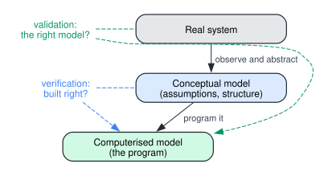

# Verification and Validation 1: Built Right, and the Right Model

Verification checks the model was built as designed, and validation checks the design matches the real world.

## Before you start
<!-- bite: 852f6381-c9a9-4efe-8a47-f774a2a6cd54 -->

You should have read [[systems-simulation/30-collecting-and-preparing-data|30 — Collecting and Preparing Data]].

After this lesson you will be able to:

1. define verification, validation, calibration, accreditation and the conceptual model;
2. compare verification and validation on what they check and how;
3. list the techniques used to verify a model.

## What verification and validation are
<!-- bite: ee3736da-c183-4054-bded-0482f34eea73 -->

A model is only useful if the people who use its results believe them, and engineers and managers rightly look at models with some suspicion. **Verification and validation (V&V)** are how you earn that trust. The goal is twofold: a model close enough to the real system to stand in for it, and a model its users find credible.

One of the six 2025/26 exam questions is entirely V&V. This lesson defines the terms and covers verification. Lesson 32 covers validation and calibration, and lesson 33 the errors and limits.

## Key definitions
<!-- bite: c7e4d9c2-c7d0-4831-9d68-c650460540ae -->

1. **Verification:** This is checking that the model's program and data match the developer's conceptual description and specification. *Did I build the model right?*
2. **Validation:** This is checking how well the model and its data represent the real world, for its intended use. *Did I build the right model?*
3. **Calibration:** This is the repeated process of comparing the model with the real system, adjusting the model, and comparing again, until the accuracy is acceptable.
4. **Accreditation:** This is official certification that a model is acceptable for a specific purpose.
5. **Conceptual model:** This is the developer's description of what the model will represent, the assumptions that limit it, and what it needs to do to meet the user's requirements.

## Where each check sits
<!-- bite: 494e0f25-f670-4816-bd6e-7898f279a006 -->

Model building runs in a chain: observe the **real system**, describe it as a **conceptual model** (assumptions and structure), then build the **computerised model**.

Verification checks the step from concept to code. Validation checks the finished model against reality.

## Verification and validation compared
<!-- bite: b2318674-5b76-4654-b824-93eb57d80c7c -->

| | Verification | Validation |
| --- | --- | --- |
| Question | Am I building the model right? | Am I building the right model? |
| Compares | The conceptual model with the computer program | The model and its behaviour with the real system |
| Purpose | The concept is reflected accurately in the program | The model accurately represents the real system |
| Usually done by | Debugging and checking the logic | Calibration and comparison with real data |

They are different questions but are usually worked on at the same time.

## Verification techniques
<!-- bite: 47a6eba5-a0b7-4c69-94a4-bca743424678 -->

1. **Have someone else check** the computerised model, not just the developer.
2. **Draw a flow diagram** of every logically possible action for each event, and trace the model's logic against it.
3. **Check the output is reasonable** under many different input settings.
4. **Have the model print its input parameters** at the end of the run, to be sure none was changed by accident.
5. **Make the code self-documenting,** with clear names and comments.
6. **Check the animation** imitates the real system, if the model is animated.
7. **Use the interactive run controller** (the debugger): watch the run progress, follow one line of logic or one entity, see the current values of variables, attributes, queues, resources and counters, and pause to change values or redirect entities.

## Tracing, stepping and breakpoints
<!-- bite: fb647428-4b84-4300-aec8-a97d22f58702 -->

The class notes name three techniques for using the run controller:

1. **Tracing:** following the run step by step, watching the state and output change.
2. **Stepping:** pausing the run at chosen points to examine the state.
3. **Breakpoints:** conditions that stop the run when met, such as "stop when the queue exceeds 20", so you can inspect what led there.

## Common pitfalls
<!-- bite: 7ebb175a-57cc-4a8f-a542-7dc2f580cefb -->

1. **Swapping the two questions.** Verification: built right. Validation: right model.
2. **Thinking a model that runs is verified.** It can run perfectly and still not match its own design.
3. **Only the developer checking.** A second pair of eyes finds what the author can't see.

A verified model does what its design says. Next lesson asks whether the design itself matches reality: the validation methods, the three-step approach, and calibration.

## Check your understanding
<!-- bite: 74d932fe-92b3-4c8a-a288-7e591d9bd570 -->

Try each one before you open the answer.

1. <!-- q: mcq id="ce68155c" -->
   A model is meant to send 10% of patients to surgery, but a trace shows the code sends 1%. Which check found this?

   - [x] Verification: the program doesn't match its design
   - [ ] Validation: the model doesn't match reality
   - [ ] Accreditation
   - [ ] Calibration

   

Answer

   Verification. The program differs from the conceptual model, which is a building error, not a question about reality.

   

2. <!-- q: mcq id="0256de2d" -->
   A model correctly implements its design, but its average queue is half what the real bank shows. Which check has failed?

   - [ ] Verification
   - [x] Validation
   - [ ] Neither
   - [ ] Both

   

Answer

   Validation: the program matches its design, but the design (or its data) doesn't match the real system.

   

3. <!-- q: gap id="aa42a1ec" answers="verification;validation" -->
   "Did I build the model right?" is the question of ___. "Did I build the right model?" is the question of ___.

   

Answer

   Verification, then validation.

   

4. <!-- q: mcq id="f3f76f1d" -->
   You set the run to stop the moment a queue exceeds 20 so you can see what led to it. Which technique is this?

   - [ ] Tracing
   - [ ] Stepping
   - [x] A breakpoint
   - [ ] Face validity

   

Answer

   A breakpoint: a condition that stops the run when it is met.

   

5. <!-- q: open id="8afb39c9" -->
   For a logistics model of a delivery network, give one example each of verification and validation.

   

Answer

   Verification: trace one truck through a depot step by step and check it loads, travels and unloads exactly as the design says. Validation: compare the model's delivery times and delays with real delivery records, and check they match well enough for decisions.

   

## Before moving on
<!-- bite: cc4212cf-c965-4f6b-9b72-4c37d4ea9f03 -->

You can define the V&V terms, compare verification with validation, and list verification techniques. **Next:** [[systems-simulation/32-verification-and-validation-2|32 — Verification and Validation 2]].

## Related
<!-- bite: 5bf4b808-fede-42ca-a956-bdb01e0caebd -->

- [[systems-simulation/index|Systems simulation map]]
- [[concepts/01-best-practices/03-testing-fundamentals/index|Testing fundamentals]]: the software version of "built right".

## About this lesson
<!-- bite: ffb94f80-1f9f-482e-8f3a-cdce76b977bb -->

**Level:** Beginner to intermediate. **Covers:** the five V&V definitions, the chain from real system to computerised model, verification against validation, and verification techniques including tracing, stepping and breakpoints.

**Where it sits:** lesson 31 of 38, part 1 of 3 on verification and validation.

**Source:** the author's own SSG 517 study notes, sections 1 and 7. The diagram comes from `scripts/diagrams/systems_simulation.py`.
