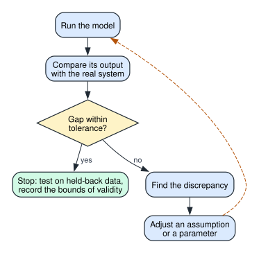

# Verification and Validation 2: Validation Methods and Calibration

A model is validated by comparing it with experts, with known results and with real data, and calibrated by adjusting it until the match is good enough.

## Before you start
<!-- bite: 5ab4a9d9-5a2b-41d6-ba3f-8ddafab83b25 -->

You should have read [[systems-simulation/31-verification-and-validation-1|31 — Verification and Validation 1]].

After this lesson you will be able to:

1. describe six validation methods and when each is used;
2. apply the three-step approach to validation;
3. explain iterative calibration and when to stop.

## What validation and calibration are
<!-- bite: c5926af8-3602-4d2b-8e68-0ed4cef876ab -->

Lesson 31 checked that the model matches its design. This lesson checks the design against the world. First the toolbox of **validation methods**, then the **three-step approach** from the class notes that puts them in order, then **calibration**, the loop that fixes what validation finds.

## The validation methods
<!-- bite: 814aa6dc-1984-4da0-929a-86606986c947 -->

| Method | What you do |
| --- | --- |
| Face validity | Ask people who know the system whether the model and its behaviour look reasonable |
| Comparison with other models | Compare simple cases with known analytic results, such as M/M/1, or with another validated simulation |
| Historical data validation | Build the model with part of the data, and test it on the rest |
| Sensitivity analysis | Change inputs and parameters, and check the output changes the way the real system would |
| Predictive validation | Use the model to forecast, then compare with what the system actually does |
| Statistical tests | t-test (two means), ANOVA (more than two means), chi-square (observed and expected frequencies) on the output |

Except for face validity, all of these are data-driven. Predictive validation is among the most used, but it takes real effort to gather and analyse the data.

## Face validity, more closely
<!-- bite: fba5d108-bd5c-4087-a95b-f7f44350f4d5 -->

**Face validity** means experts judge that the model's logic and results look reasonable. In a logistics model: ask dispatchers, depot managers and drivers. It is valuable because it is quick and cheap, catches a model that is obviously wrong, and shows the users their knowledge was used, which builds buy-in. Its limit: it is subjective, so it must be backed by data-based tests.

Sensitivity analysis can test face validity too: ask the expert "if arrivals double, should the queue grow a lot or a little?" and check the model agrees.

**Sensitive parameters** need special care. If a small change in a parameter swings the output a lot, that parameter must be estimated especially accurately.

## The three-step approach
<!-- bite: 6c2e81ac-2f4a-40a1-8e3b-277bea082e75 -->

From the class notes:

1. **Build a model with high face validity.** Use all available information: talk to people who know the system, use observations and past studies. Face validity is subjective, but it is where an obviously wrong model is caught.
2. **Validate the model's assumptions.** There are two kinds. **Structural assumptions** are about how the system works and is simplified: one line or several, how customers are served. **Data assumptions** must rest on reliable data and proper goodness-of-fit tests (lessons 27–29).
3. **Validate the input-output transformation.** The ultimate test: feed the model the real system's inputs, and check its output matches the real system's output. A **Turing test** (can experts tell model output from real output?) can add to this.

## Calibration
<!-- bite: 77ae1399-61fc-47e5-a7af-61b731c24ad0 -->

**Calibration** is repeated adjustment:

1. Compare the model's output with the real system's.
2. Find the discrepancies.
3. Change the model: fix a wrong assumption or refine a parameter.
4. Compare again.
5. Stop when the accuracy is acceptable for the model's purpose.

## The calibration loop
<!-- bite: 0dd26636-1a98-4cbd-9525-9baab68c993c -->

Drawn as a loop, calibration looks like this.

It never ends on its own. You stop when the model is good enough for its purpose and further improvement isn't worth the cost.

## Calibrating a delivery model
<!-- bite: 87211869-a358-45bf-b470-7ad8fa3f6475 -->

From the exam's logistics question:

1. Compare the model's delivery times with actual delivery records.
2. Find where they differ, such as the model being 15% too fast on city routes.
3. Adjust inputs: distances, speeds, loading times, vehicle capacity.
4. Rerun and compare again, until the error is within an agreed tolerance.
5. **Keep some data aside** and test the final model on data it has never seen, otherwise you have only tuned it to fit the data you adjusted against.
6. Document the range in which the model is valid.

## Common pitfalls
<!-- bite: 83ade822-b3c4-463b-9703-290b2ff1fe24 -->

1. **Stopping at face validity.** It is a first step, not proof.
2. **Calibrating and testing on the same data.** Hold some back.
3. **Calibrating forever.** Stop when it is good enough for the decision.

Validation is never perfect, and wrong calls about a model's validity have costs. Next lesson names the three kinds of error, and the idea that a model is valid only over a range.

## Check your understanding
<!-- bite: 0e159428-76dc-4d2e-ad23-f1840c373d56 -->

Try each one before you open the answer.

1. <!-- q: mcq id="5fe9c8f1" -->
   A team runs its bank model with exponential arrivals and service, and compares the average wait with the M/M/1 formula. Which validation method is this?

   - [ ] Face validity
   - [x] Comparison with other models (known analytic results)
   - [ ] Predictive validation
   - [ ] Historical data validation

   

Answer

   Comparison with known analytic results. If the model matches the formula on this simple case, its logic is probably right.

   

2. <!-- q: mcq id="2ef3457c" -->
   A model is built using January to June data, then tested on how well it reproduces July to September. Which method is this?

   - [ ] Face validity
   - [ ] Sensitivity analysis
   - [x] Historical data validation
   - [ ] A Turing test

   

Answer

   Historical data validation: build on part of the data, test on the rest.

   

3. <!-- q: gap id="279a4d2e" answers="structural;data" -->
   In step 2 of the three-step approach, ___ assumptions are about how the system works and is simplified, and ___ assumptions must rest on reliable data and goodness-of-fit tests.

   

Answer

   Structural, then data.

   

4. <!-- q: open id="f2dacd34" -->
   Stakeholders doubt a logistics model's results. Why is face validity useful here, and what is its limitation?

   

Answer

   Asking dispatchers, depot managers and drivers whether the model looks right is quick and cheap, catches obvious errors, and shows them their knowledge was used, which builds their trust. But it is subjective, so it must be backed by data-based tests such as comparing with real delivery times.

   

5. <!-- q: open id="39648c49" -->
   Why should some real data be kept aside during calibration?

   

Answer

   Calibration adjusts the model until it fits the data used. That fit can just be tuning to those particular numbers. Testing the final model on data it has never seen shows whether it really predicts the system.

   

## Before moving on
<!-- bite: 7f84fc8a-d1d0-4362-a77a-12e7ce50d1f7 -->

You can choose validation methods, follow the three-step approach and calibrate a model. **Next:** [[systems-simulation/33-verification-and-validation-3|33 — Verification and Validation 3]].

## Related
<!-- bite: 16162f20-2f6c-4797-adc0-39bdd3efaa59 -->

- [[systems-simulation/index|Systems simulation map]]

## About this lesson
<!-- bite: 3b858545-e194-49bf-a01c-ca6d41aa7956 -->

**Level:** Intermediate. **Covers:** six validation methods, face validity and sensitive parameters, the three-step approach, calibration, and calibrating a delivery model.

**Where it sits:** lesson 32 of 38, part 2 of 3 on verification and validation.

**Source:** the author's own SSG 517 study notes, sections 1, 7 and 9 (Q2). The diagram comes from `scripts/diagrams/systems_simulation.py`.
