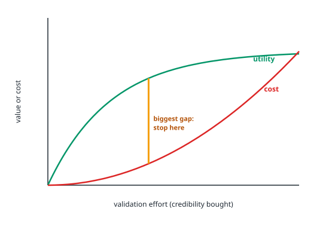

# Verification and Validation 3: Errors, Bounds of Validity and Credibility

Deciding whether to use a model can go wrong in three ways, and a model is only ever valid over a range of inputs.

## Before you start
<!-- bite: 9b41fd6f-64a6-4a2a-9dc9-4d84d3eae5f0 -->

You should have read [[systems-simulation/32-verification-and-validation-2|32 — Verification and Validation 2]].

After this lesson you will be able to:

1. name the Type I, II and III errors in V&V, whose risk each is, and how serious each is;
2. explain bounds of validity with the falling-object example;
3. explain why credibility stops being worth buying at some point.

## What the limits of validation are
<!-- bite: 5492168a-f8d9-4485-9097-4382f3309f1c -->

Validation can't make a model perfect, so the decision to use it can be wrong. This lesson names the three ways that happens. It then replaces the idea of "a valid model" with something more honest: a model is valid *over a range*. Finally, it looks at credibility as something you pay for, with a point where more isn't worth it.

## The three errors
<!-- bite: 461e8a4d-c54d-41e7-853a-f58a55bfb0a0 -->

| Error | What happens | Whose risk | How serious |
| --- | --- | --- | --- |
| Type I | A valid model isn't used, because validation didn't convince anyone | The model builder's | Less serious: wasted development cost and lost benefits |
| Type II | An invalid model is used, because validation was done wrongly but convincingly | The model user's | More serious: can lead to disaster, such as a collapsed bridge from a faulty load analysis |
| Type III | A model valid for one purpose is used for a different one | The model accreditor's | More serious, like Type II |

**Type III errors are common,** because a model that worked well for its original use gains a reputation for being valid everywhere. A factory model built to size the warehouse gets reused to plan maintenance, a question it was never checked for.

## Bounds of validity
<!-- bite: a6070ba0-3e5a-44c2-8c6b-5b79dbeeb65a -->

The aim of V&V isn't to declare "the model is valid". It is to find the range of inputs over which the model is accurate enough: its **bounds of validity**.

The textbook's falling-object example: three different models of height against time looked equally good when tested at a single time, or over a narrow range. Only testing across the full range of inputs the model would meet in real use showed which one was best.

So: **validate over the whole range of intended use, and write that range down.** Otherwise someone will reuse the model outside it, which is exactly a Type III error. This is the same idea as lesson 05's validity range for a fitted model.

## Credibility costs money
<!-- bite: 41a48e0d-6288-46c9-a943-68844ebd99bb -->

**Credibility** is how likely the results are to be accepted. V&V and accreditation build it, and they cost money.

Utility rises with credibility but with diminishing returns: the first tests teach you a lot, later ones less. Cost rises faster and faster. The project manager balances them, and stops adding credibility when the extra cost isn't worth the extra utility.

## Common pitfalls
<!-- bite: 575ca68a-228f-4d17-998b-28ba0152507f -->

1. **Mixing up Type II and III.** Type II: an invalid model is used. Type III: a valid model is used for the wrong job.
2. **Calling a model "valid" with no range.** Say valid *for what* and *over which inputs*.
3. **Endless validation.** Past a point, more credibility costs more than it gives.

The model is now trusted within its bounds. The last step before the answer is reading its output properly. Next lesson covers output analysis: replications, confidence intervals and comparing designs.

## Check your understanding
<!-- bite: f0099a7d-b3d5-473b-aeaf-98d33bc161bf -->

Try each one before you open the answer.

1. <!-- q: mcq id="cfeba8f4" -->
   A structural model passes a badly designed but convincing validation, and is used to approve a bridge that later fails. Which error is this?

   - [ ] Type I
   - [x] Type II
   - [ ] Type III
   - [ ] No error; it was validated

   

Answer

   Type II: an invalid model was used because its validation was wrong but convincing. It is the model user's risk, and the most dangerous kind.

   

2. <!-- q: mcq id="7a2cb71c" -->
   A traffic model validated for weekday rush hour is used to plan a stadium's match-day traffic. Which error risk is this?

   - [ ] Type I
   - [ ] Type II
   - [x] Type III
   - [ ] None

   

Answer

   Type III: a model valid for one purpose, used for another it was never checked for. Match-day traffic is outside its bounds of validity.

   

3. <!-- q: gap id="9745ab6d" answers="builder|model builder|builder's;user|model user|user's;accreditor|model accreditor|accreditor's" -->
   A Type I error is the model ___'s risk, a Type II error is the model ___'s risk, and a Type III error is the model ___'s risk.

   

Answer

   Builder, user, accreditor.

   

4. <!-- q: open id="5f944e4c" -->
   What are a model's bounds of validity, and why must they be documented?

   

Answer

   The range of inputs over which the model is accurate enough. Writing them down stops someone later reusing the model outside that range, where it may be badly wrong, which would be a Type III error.

   

5. <!-- q: open id="84137fea" -->
   Why might a project manager stop validating a model that could still be made more credible?

   

Answer

   Utility rises with credibility but levels off, while the cost of each extra test keeps rising. Past some point another round of validation costs more than the confidence it adds is worth to the decision.

   

## Before moving on
<!-- bite: a362737c-9306-4f01-ad6d-270ec58c4f65 -->

You can name the three errors, explain bounds of validity and weigh credibility against cost. **Next:** [[systems-simulation/34-output-analysis|34 — Output Analysis]].

## Related
<!-- bite: ba693b73-d79b-4dfb-a51c-0db63cd51c87 -->

- [[systems-simulation/index|Systems simulation map]]

## About this lesson
<!-- bite: 8d27c664-14c7-44e6-939c-d060bab2c2cc -->

**Level:** Intermediate. **Covers:** Type I, II and III errors, bounds of validity and the falling-object example, and the cost and utility of credibility.

**Where it sits:** lesson 33 of 38, part 3 of 3 on verification and validation.

**Source:** the author's own SSG 517 study notes, section 7. The factory and stadium examples are added for this lesson; the diagram comes from `scripts/diagrams/systems_simulation.py`.
