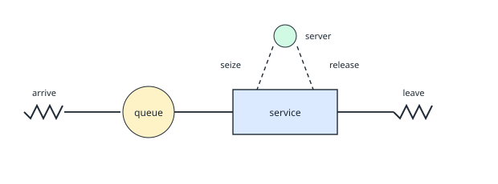

# Arena 2: How Time Works and the Activity Diagram

Arena moves time by jumping between scheduled events, moving one entity at a time, and each entity is always in one of five states.

## Before you start
<!-- bite: 4d290a24-85ed-4af0-89e5-066d29665d82 -->

You should have read [[systems-simulation/35-arena-1|35 — Arena 1]] and [[systems-simulation/09-discrete-event-simulation|09 — Discrete-Event Simulation]].

After this lesson you will be able to:

1. describe Arena's event calendar and its two processing phases;
2. name the five entity states and give an example of each;
3. draw an activity diagram and write pseudo-code for a single-server queue.

## What Arena's event calendar is
<!-- bite: 14e7f1d0-48d5-4ceb-af96-2352939ca721 -->

Arena hides the clock, but knowing how it works explains its behaviour and its debugger. This lesson opens the hood, then shows the **activity diagram**, the sketch you draw before building, which is the conceptual model of lesson 31 in picture form.

## How time moves
<!-- bite: 9ee194b7-86ad-4e0e-ba3a-d0a37030f6ad -->

1. Time jumps from one scheduled event to the next, using an **event calendar**, the same idea as the event list of lesson 09.
2. Processing alternates between two phases. In the **entity movement phase**, the active entity moves through modules until it hits a delay. In the **clock update phase**, the clock jumps to the next event on the calendar.
3. **Only one entity moves at a time,** even when many events share a moment.

## The five entity states
<!-- bite: 30ebbddd-5a98-4a5f-a171-499997dc63c2 -->

1. **Active:** the entity moving right now.
2. **Ready:** it could move now, and is waiting its turn in the same moment.
3. **Time-delayed:** it is waiting for a scheduled time, such as the end of its service.
4. **Condition-delayed:** it is waiting for a condition, such as a free server.
5. **Dormant:** it needs special logic to wake it up.

Two to remember: entities arriving from a CREATE start **time-delayed** (waiting for their arrival time), and a customer waiting for a busy server is **condition-delayed**.

## The run controller
<!-- bite: ddb8803d-abdd-40f0-8a48-c2fca965079b -->

The **run controller** lets you step through a run, trace entities and inspect variables. It is how tracing, stepping and breakpoints (lesson 31) are done in Arena, so it is the verification tool.

## The activity diagram
<!-- bite: 205c5c6d-71ba-43d6-ae43-84c3b4943401 -->

Draw the model before you build it. The symbols:

1. **Queues** are circles.
2. **Activities** are rectangles.
3. **Resources** are small circles.
4. **Arrows** show the flow of entities.
5. **Dashed arrows** show seizing and releasing a resource.
6. **Zigzag lines** show entities being created and disposed.


## The pseudo-code
<!-- bite: 92645c31-ac98-46e7-ad2a-341b70f8ed02 -->

The same single-server queue, written as pseudo-code:

```text
CREATE customers with EXPO(mean inter-arrival)
PROCESS customers
    SEIZE 1 server
    DELAY for service time
    RELEASE 1 server
END PROCESS
DISPOSE customer
```

Each line becomes one Arena module, or one setting inside the PROCESS module. Lesson 37 builds exactly this.

## Common pitfalls
<!-- bite: 9e7299a6-d413-4ffa-831c-fb2bb745e4c0 -->

1. **Mixing up time-delayed and condition-delayed.** Waiting for a clock time is time-delayed; waiting for a server is condition-delayed.
2. **Building before drawing.** The activity diagram is where missing queues and resources show up.
3. **Thinking several entities move at once.** Arena moves one at a time, even at the same simulated moment.

The model is designed. Next lesson builds it in Arena step by step, sets the run parameters, and checks the result against theory.

## Check your understanding
<!-- bite: 9a1fa3bc-ca67-43e9-8268-fa03d31f2cea -->

Try each one before you open the answer.

1. <!-- q: mcq id="82d5153e" -->
   A customer is waiting in line because the only teller is busy. Which entity state is the customer in?

   - [ ] Active
   - [ ] Time-delayed
   - [x] Condition-delayed
   - [ ] Dormant

   <details><summary>Answer</summary>

   Condition-delayed: waiting for a condition, a free teller, not for a set time.

   </details>

2. <!-- q: mcq id="4dd6f311" -->
   A customer is in service and will finish at minute 42. Which state are they in?

   - [ ] Ready
   - [x] Time-delayed
   - [ ] Condition-delayed
   - [ ] Active

   <details><summary>Answer</summary>

   Time-delayed: their next event is scheduled for a known time.

   </details>

3. <!-- q: gap id="2b39b770" answers="entity movement;clock update" -->
   Arena alternates between the ___ phase, where the active entity moves until it hits a delay, and the ___ phase, where the clock jumps to the next event.

   <details><summary>Answer</summary>

   The entity movement phase, then the clock update phase.

   </details>

4. <!-- q: sketch id="fea335dd" -->
   Draw an activity diagram for a car wash with one washing bay: cars arrive, wait in line, are washed using the bay, and leave.

   <details><summary>Answer</summary>

   

   What to check:
   - a zigzag line for cars arriving, and another for cars leaving;
   - a circle for the line of waiting cars;
   - a rectangle for the washing activity;
   - a small circle for the bay, joined to the washing rectangle by dashed arrows for seizing and releasing it.

   </details>

5. <!-- q: open id="96c44f49" -->
   Write the pseudo-code for a single-server queue with exponential arrivals of mean 6 minutes and service times of NORM(5, 1) minutes.

   <details><summary>Answer</summary>

   ```text
   CREATE customers with EXPO(6)
   PROCESS customers
       SEIZE 1 server
       DELAY for NORM(5, 1)
       RELEASE 1 server
   END PROCESS
   DISPOSE customer
   ```

   </details>

## Before moving on
<!-- bite: 7113013f-868e-4777-8b23-9cd5938a5878 -->

You can explain how Arena moves time, name the entity states and draw an activity diagram. **Next:** [[systems-simulation/37-arena-3|37 — Arena 3]]: building and running a single-server queue.

## Related
<!-- bite: 0c1edc03-1780-47c3-a283-a8703e0c8a4e -->

- [[systems-simulation/index|Systems simulation map]]

## About this lesson
<!-- bite: ccec7379-aca6-4423-8cbf-985d39d537b5 -->

**Level:** Beginner to intermediate. **Covers:** the event calendar and the two phases, the five entity states, the run controller, the activity diagram and its pseudo-code.

**Where it sits:** lesson 36 of 38, part 2 of 4 on Arena.

**Source:** the author's own SSG 517 study notes, section 8. The diagram comes from `scripts/diagrams/systems_simulation.py`.
