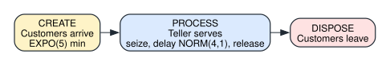

# Arena 3: Building and Running a Single-Server Queue

A single-server queue in Arena is three modules, CREATE, PROCESS and DISPOSE, plus a resource, a run set-up and a report.

## Before you start
<!-- bite: d4a7d0d9-7501-4cc1-96a5-cee2c9b61fe2 -->

You should have read [[systems-simulation/36-arena-2|36 — Arena 2]] and [[systems-simulation/14-littles-law-and-the-mm1-queue|14 — Little's Law and the M/M/1 Queue]].

After this lesson you will be able to:

1. build a single-server queue in Arena step by step;
2. set the replication length, number of replications and base time units;
3. read Arena's output and check it against queueing theory, including the M/G/1 formula.

## What the bank model is
<!-- bite: f324629e-3cf5-4070-a8f1-c159237e2a82 -->

This is the exam's Arena question (Q6, 2025/26) worked through: a bank with one teller. It builds the model from the pseudo-code of lesson 36, sets up the run, then does what lesson 32 called comparison with known results: checking the output against a formula.

## The bank
<!-- bite: 35ffc503-4def-4c18-a49e-20515fec0054 -->

Inter-arrival times are exponential with mean 5 minutes. Service times are normal with mean 4 and standard deviation 1 minute. One teller, first come first served. In Kendall's notation it is **M/G/1**: exponential arrivals, a general (here normal) service distribution, one server.

## Building it, step by step
<!-- bite: af18fd84-67d9-4f95-a58f-87bb30c0fc33 -->

1. **Drag** CREATE, PROCESS and DISPOSE from the Basic Process panel, and connect them in that order.
2. **CREATE:** time between arrivals Random (Expo), mean 5, units minutes, entities per arrival 1, maximum arrivals infinite.
3. **RESOURCE (data module):** add the teller with capacity 1.
4. **PROCESS:** action **Seize, Delay, Release**. Add the teller resource, quantity 1. Delay type Expression: `NORM(4, 1)`, units minutes.
5. **Queue:** Arena creates one for the PROCESS module automatically. The default discipline is first in, first out.
6. **Run > Setup > Replication Parameters:** set the replication length, the number of replications and the base time unit (minutes).
7. **Run,** then open the report.

## The bank in Arena
<!-- bite: 5169a6ed-b4d8-4a03-994a-363ed02e0a78 -->

The finished model is three connected modules.

## Run parameters
<!-- bite: db4fed47-ec7b-4d08-bd1d-51d4d992e53f -->

1. **Replication length:** the bank closes, so use its real opening hours. That makes it a terminating simulation (lesson 34). For long-run behaviour you would use a very long run and a warm-up period instead.
2. **Number of replications:** each is an independent run, so the results form a random sample. Ten to thirty is a typical minimum.
3. **Base time units:** match the model's units, so reports come out in minutes.

## Reading the output
<!-- bite: 2d680054-fc32-400c-bff6-9e8d0a75b42f -->

Arena collects these automatically from the PROCESS module: waiting time in queue, number waiting, time in system, and resource utilisation. Use RECORD for anything else. Each average comes with its **95% half-width**, the ± around it.

Three measures, and what each is for:

1. **Average waiting time:** service quality. An average of 8 minutes may lead to adding a second teller.
2. **Utilisation:** staff workload and cost.
3. **Queue length:** space, and customer patience.

## Checking against theory
<!-- bite: d3d57fa2-6edb-4566-aed9-b72b3becbf29 -->

**Utilisation** should be close to mean service ÷ mean inter-arrival = 4 ÷ 5 = **0.8**.

For the wait, M/M/1 doesn't apply, because service is normal, not exponential. But the **Pollaczek-Khinchine formula** for M/G/1 does:

$$W_q = \frac{\lambda\,E[S^2]}{2(1-\rho)}$$

Here λ = 1/5 = 0.2 per minute, ρ = 0.8, and E[S²] = variance + mean² = 1 + 16 = 17. So Wq = 0.2 × 17 ÷ (2 × 0.2) = **8.5 minutes**, and by Little's law Lq = λ Wq = 0.2 × 8.5 = **1.7 customers**.

If Arena's report gives roughly these values, within its half-widths, the model passes a basic validation. This check isn't in the class notes; it was added in the study notes, so confirm with your lecturer whether it is expected.

## Common pitfalls
<!-- bite: d6b1d9f7-4a6a-411c-ba62-ca687bd7bef1 -->

1. **Using M/M/1 formulas for normal service.** Use M/G/1 (Pollaczek-Khinchine), or rely on the simulation.
2. **Base time units that don't match.** The report then comes out in hours while you think in minutes.
3. **One replication.** Report the average and its half-width from several.

The bank has one path through it. Real systems branch: some customers are turned away, some leave the line. Next lesson adds DECIDE modules, the lecturer's airport security problem, and Arena's other tools.

## Check your understanding
<!-- bite: bea96d6b-6363-4f3c-923a-f24816d63736 -->

Try each one before you open the answer.

1. <!-- q: exact id="e90f749c" answer="0.6" accept="60%|3/5" -->
   An Arena model has CREATE with EXPO(10) minutes and PROCESS with delay NORM(6, 2) minutes, one server. What utilisation should the report show, roughly?

   

Answer

   About 0.6: mean service ÷ mean inter-arrival = 6 ÷ 10.

   

2. <!-- q: exact id="2cff8de4" answer="5" -->
   Same model: arrivals EXPO(10), service NORM(6, 2), one server. Using the Pollaczek-Khinchine formula, what is the expected average wait in the queue, in minutes?

   

Answer

   5 minutes. λ = 0.1, ρ = 0.6, E[S²] = 2² + 6² = 40. Wq = 0.1 × 40 ÷ (2 × 0.4) = 4 ÷ 0.8.

   

3. <!-- q: mcq id="349eb507" -->
   In the PROCESS module for a teller, what should the action be?

   - [ ] Delay only
   - [ ] Seize, Delay
   - [x] Seize, Delay, Release
   - [ ] Delay, Release

   

Answer

   Seize, Delay, Release: take the teller, serve, give the teller back. Without Release the teller would stay busy forever.

   

4. <!-- q: mcq id="85712975" -->
   Arena reports an average wait of 8.3 minutes with a half-width of 0.9. What does the half-width mean?

   - [ ] The wait varied by 0.9 minutes in one run
   - [x] With 95% confidence, the true average wait is between 7.4 and 9.2 minutes
   - [ ] 0.9% of customers waited
   - [ ] The model is 0.9 minutes too slow

   

Answer

   It is the ± of a 95% confidence interval across replications: 8.3 ± 0.9.

   

5. <!-- q: open id="c7181f43" -->
   For the bank model, name three output measures and say what decision each supports.

   

Answer

   Average waiting time, for service quality (a long wait may justify another teller). Utilisation, for staff workload and cost (very high utilisation means overwork; very low means a teller could be moved). Queue length, for space and customer patience (a long line may cause balking).

   

## Before moving on
<!-- bite: d84c3008-492c-467c-8ae9-10b79f01321a -->

You can build, run and check a single-server queue in Arena. **Next:** [[systems-simulation/38-arena-4|38 — Arena 4]]: branching models and Arena's other tools.

## Related
<!-- bite: 16b3c7d1-dd42-4941-addb-c84f3c239077 -->

- [[systems-simulation/index|Systems simulation map]]

## About this lesson
<!-- bite: 7544a947-4019-4bed-a21a-0a9734bf6587 -->

**Level:** Intermediate. **Covers:** building the M/G/1 bank queue in Arena, run parameters, output measures, and the utilisation and Pollaczek-Khinchine checks.

**Where it sits:** lesson 37 of 38, part 3 of 4 on Arena.

**Source:** the author's own SSG 517 study notes, sections 8 and 9 (Q6). The Pollaczek-Khinchine check was added in the study notes, not the class notes. The flowchart comes from `scripts/diagrams/systems_simulation.py`.
