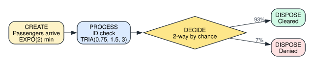

# Arena 4: Branching, Balking and Arena's Other Tools

DECIDE modules let entities take different paths, and Arena's analysers fit inputs, compare scenarios and search for the best design.

## Before you start
<!-- bite: 92dd5913-52c9-420c-bcbf-4ed79c3e7b22 -->

You should have read [[systems-simulation/37-arena-3|37 — Arena 3]].

After this lesson you will be able to:

1. build the lecturer's airport security model with a DECIDE module;
2. model balking with a condition-based DECIDE and NQ;
3. say what the Input Analyzer, Process Analyzer and OptQuest are for.

## What branching is
<!-- bite: 46dd3d3a-4416-4fc8-af08-4949a628b538 -->

Lesson 37's bank had one path. Here entities split: some passengers fail a check, some customers see a long line and leave. Both use **DECIDE**, by probability or by condition. Then a short tour of Arena's other tools, which tie it back to input analysis and output analysis.

## The airport security problem
<!-- bite: 5f82a177-6ab5-4253-acfb-dd843a9d4d29 -->

The lecturer's practice problem. Passengers arrive with exponential inter-arrival times, mean 2 minutes. The ID check takes TRIA(0.75, 1.5, 3) minutes. 93% of passengers pass; 7% are denied. Run 20 days and find: average time in system, longest time in system, maximum number waiting, and the proportion of time the officer is busy.

## The airport model in Arena
<!-- bite: b751ef3f-15b4-45a0-8d99-8ae985bcfd1f -->

The flow uses five modules:

1. **CREATE:** EXPO(2) minutes.
2. **PROCESS:** the ID check, seizing the officer, delay TRIA(0.75, 1.5, 3), release.
3. **DECIDE:** "2-way by chance", 93% true (pass), 7% false (denied).
4. **DISPOSE** on each path: one for cleared passengers, one for denied.

## Where each answer comes from
<!-- bite: 1b3f5354-234a-4ba4-a3bf-9fa8d4fe74be -->

1. **Proportion of time the officer is busy:** the resource's utilisation. Expect about mean check time ÷ mean gap. The mean of TRIA(0.75, 1.5, 3) is (0.75 + 1.5 + 3) ÷ 3 = 1.75 minutes, so utilisation ≈ 1.75 ÷ 2 = **0.875**.
2. **Average and longest time in system:** the time-in-system statistic, its average and maximum.
3. **Maximum number waiting:** the queue statistic's maximum.

## Modelling balking
<!-- bite: d67ccf32-1e2b-45e9-a36e-4f8e385a78d8 -->

Customers who see 4 or more people waiting leave without joining. Put a **condition-based DECIDE** before the PROCESS:

1. Condition: `NQ(Teller.Queue) >= 4`.
2. If true: send the customer to a second DISPOSE, "Balked".
3. If false: on to the PROCESS as usual.

The count of entities reaching the "Balked" DISPOSE is the number of customers lost, which is often the measure the manager cares about most.

## Arena's other tools
<!-- bite: 6a94bce1-46ef-4edf-b8a4-54fb6329c3c3 -->

1. **Input Analyzer:** fits distributions to data, from about 11 in its library, and reports the best fit with goodness-of-fit statistics. This is input analysis (lessons 27–29) inside Arena.
2. **Process Analyzer:** runs many scenarios in a batch and compares them, such as one, two and three tellers side by side.
3. **OptQuest:** searches for the best design configuration, the optimisation of lesson 34.

## Putting the subject together
<!-- bite: 10d6c75e-facb-456e-9b5c-03d2cbc04fa5 -->

Arena is where every earlier part meets. Input distributions from lessons 27–29 go into CREATE and PROCESS. Arena's random numbers rest on lessons 16–20. The queue and its statistics are lessons 10–15. Checking the model against theory is lessons 31–33. And a Monte Carlo model (lesson 22) is the same software with no clock: CREATE, ASSIGN, RECORD, DISPOSE with many replications.

## Common pitfalls
<!-- bite: 7c7e5091-ebf0-4b91-b8ff-21551d61fca4 -->

1. **One DISPOSE for every path.** Use one per exit, so each path is counted separately.
2. **Putting the balking DECIDE after PROCESS.** The customer must decide before joining the line.
3. **Reading "longest time" from the average.** It comes from the maximum of the time-in-system statistic.

That completes the subject. The [[systems-simulation/ssg-517-question-bank|question bank]] maps every past question to its lesson, so you can practise each one closed-book.

## Check your understanding
<!-- bite: ac229d1f-6ae3-44c6-a389-599424985490 -->

Try each one before you open the answer.

1. <!-- q: exact id="45cee929" answer="0.875" accept="7/8|87.5%" -->
   Passengers arrive at a security desk with EXPO(2) minutes between them, and the check takes TRIA(0.75, 1.5, 3) minutes. What utilisation should the officer have?

   

Answer

   About 0.875. The triangular mean is (0.75 + 1.5 + 3) ÷ 3 = 1.75 minutes, and 1.75 ÷ 2 = 0.875.

   

2. <!-- q: exact id="7831af2c" answer="0.8" accept="4/5|80%" -->
   A ticket desk has EXPO(5) minutes between arrivals and a service time of TRIA(2, 4, 6) minutes. What utilisation should the clerk have?

   

Answer

   0.8: the triangular mean is (2 + 4 + 6) ÷ 3 = 4 minutes, and 4 ÷ 5 = 0.8.

   

3. <!-- q: mcq id="d02d92b6" -->
   How do you model customers who leave without joining when 5 or more are already waiting?

   - [ ] A probability DECIDE after the PROCESS
   - [x] A condition DECIDE before the PROCESS, testing NQ of the queue ≥ 5, sending balkers to their own DISPOSE
   - [ ] A larger resource capacity
   - [ ] A RECORD module

   

Answer

   A condition-based DECIDE before the PROCESS, using NQ to read the queue length, with a separate DISPOSE for those who leave.

   

4. <!-- q: mcq id="522e7fa7" -->
   Which Arena tool would you use to compare one, two and three tellers in one batch of runs?

   - [ ] Input Analyzer
   - [x] Process Analyzer
   - [ ] The run controller
   - [ ] RECORD

   

Answer

   Process Analyzer, which runs and compares scenarios. OptQuest would search for the best number automatically.

   

5. <!-- q: open id="a4d838af" -->
   In the airport security model, where in Arena's report do you find (a) the proportion of time the officer is busy and (b) the maximum number waiting?

   

Answer

   (a) The officer resource's utilisation. (b) The maximum of the ID check queue's number-waiting statistic.

   

## Before moving on
<!-- bite: 5b6aae0f-0755-47bb-91ca-cde4e2d5e077 -->

You can build branching models in Arena, model balking, and name Arena's analysis tools. You've reached the end of the subject: try the [[systems-simulation/ssg-517-question-bank|question bank]].

## Related
<!-- bite: 055d472f-9b23-493b-a826-8708d77611dc -->

- [[systems-simulation/index|Systems simulation map]]

## About this lesson
<!-- bite: fe38f9cf-011c-42cc-8103-38c844c05441 -->

**Level:** Intermediate. **Covers:** the airport security model, DECIDE by chance and by condition, balking with NQ, the Input Analyzer, Process Analyzer and OptQuest, and how the subject fits together.

**Where it sits:** lesson 38 of 38, part 4 of 4 on Arena, and the last lesson.

**Source:** the author's own SSG 517 study notes, section 8. The ticket desk quiz is added for this lesson; the flowchart comes from `scripts/diagrams/systems_simulation.py`.
